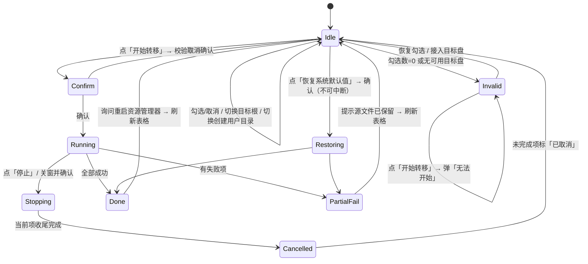

# DirMover WinUI 3 重写 — 产品需求文档（PRD）

> 作者：许清楚（产品经理）｜团队：software-dirmover-winui
> 版本基线：原项目 `Sword6988/dirmover` v3.0.1（MIT）｜上游输入：`00-research-brief.md`、`repo-src/pydm/`
> 文档性质：简单 PRD（不含竞品分析、不含市场定位）。判定标准是**行为逐条对等**，不是界面相似。

---

## 1. 产品信息

| 项 | 内容 |
|---|---|
| Language | 中文 |
| Programming Language | C# / .NET 8 + **WinUI 3**（Windows App SDK 1.6+） |
| 目标平台 | Windows 10 1809+（`10.0.17763`）/ Windows 11，**x64** |
| 打包形态 | **unpackaged**（`WindowsPackageType=None`）、`WindowsAppSDKSelfContained=true`（WinUI 运行时随应用走，**目标机无需预装**；构建期由 `DirMover.App.csproj` 的 `StageFrameworkPri` 从运行时 MSIX 补入**框架** `resources.pri`，缺它启动必 `0xC000027B`，见 `02-architecture.md` D-12）、`requiresAdministrator`（app.manifest `requestedExecutionLevel=requireAdministrator`） |
| Project Name | `dirmover_winui` |
| 原需求复述 | 研究 `https://github.com/Sword6988/dirmover`（Python + tkinter 的用户文件夹迁移工具），用 WinUI 3 + C# 全面重写，**确保功能与原项目保持一致**，并说明重写后的项目结构、关键模块划分与实现要点。 |

### 1.1 产品目标（三条，正交）

1. **数据安全不降级**：任何执行路径下「复制未通过校验 → 绝不删源、绝不写注册表」；重写不得放宽任何一道闸门。
2. **功能逐条对等**：7 项文件夹规格、注册表双形态同步、恢复默认值、快照回滚、单实例、执行中停止/关窗收尾，行为与文案契约与原版一致，不丢任何一项。
3. **界面载体现代化但交互不变**：用 WinUI 3 原生控件承载同一套单屏零导航布局，**不新增页面/抽屉/二级窗口**，不改变任何操作的触发方式与顺序。

### 1.2 用户故事

| # | 故事 |
|---|---|
| U1 | 作为 C 盘空间告急的用户，我想一次勾选多项个人文件夹并统一迁移到 D 盘，以便不用逐个右键「属性→位置→移动」。 |
| U2 | 作为对数据安全敏感的用户，我想在迁移失败时确定源文件还在原地，以便敢按下「开始转移」。 |
| U3 | 作为误操作后想反悔的用户，我想把文件夹恢复为系统默认位置（连文件一起搬回、注册表改回），以便系统回到出厂状态。 |
| U4 | 作为上次迁移中途断电/被杀进程的用户，我想在下次启动时被告知「上次没走完」并能一键回滚注册表，以便不留半成品状态。 |
| U5 | 作为迁移完成后发现桌面图标异常的普通用户，我想被询问是否重启资源管理器，以便改动立即生效。 |

### 1.3 硬约束与「已决策不做」

**必须完全对等（缺一即验收不通过）**：7 项文件夹规格与 GUID 双形态、安全事务顺序（路径 A 原子 rename / 路径 B 复制→校验→写注册表→删源）、恢复系统默认值（完整恢复）、注册表快照与一键回滚、单实例、管理员权限、执行中停止、关窗安全收尾、无配置持久化。

**已决策不做（红线，重写不得复活）**：

| 不做项 | 理由（沿用原项目决策） |
|---|---|
| 任何配置持久化（配置文件/注册表设置项） | 纯内存态，每次启动用内置默认值 |
| 写 `Desktop.ini` / 目录个性化别名 | 会给目标目录加 Read-only 且无还原路径；纯外观且收益不完整 |
| 倒计时 / 自动执行 | 原实现该路径本身有缺陷，已整体移除 |
| 界面内日志抽屉 / 日志查看区 | 过程详情只写 `logs\` 文件，仅留「打开日志目录」出口 |
| 规模预统计（勾选后自动扫描） | 数十万文件是分钟级读盘；规模由引擎执行时权威扫描 |
| 双击行查看详情 | 与勾选语义冲突，易误触 |
| 「刷新」「保存设置」「复制全部」「浏览目标」「打开目标」按钮 | 目标根目录为固定下拉，不支持自由填写 |
| 高风险文件夹项（Cookies / 缓存 / 历史 / 最近文档 / 临时目录） | 已从产品整体移除，仅保留 7 项 |
| 页签 / 侧栏 / 二级窗口 | 单屏零导航是不变式 |

---

## 2. 可转移文件夹规格表

写入位置（`HKCU`，只写用户级，永不越界到 HKLM）：

- **权威子键**：`Software\Microsoft\Windows\CurrentVersion\Explorer\User Shell Folders`
- **缓存同步子键**：`...\Explorer\Shell Folders` —— **只写该键中已存在的同名值，绝不新建**（作用是免重启资源管理器生效；系统可能覆盖回去，不影响数据安全）
- 值类型：值**以 `%VAR%` 开头且其后紧跟分隔符或结束** → `REG_EXPAND_SZ`；值中间出现 `%` → 一律 `REG_SZ`（否则读回被二次展开成错误路径）

| key | 显示名 | 权威注册表值名 | 别名（全串） | 系统默认路径 |
|---|---|---|---|---|
| `documents` | 我的文档 | `Personal` | `{F42EE2D3-909F-4907-8871-4C22FC0BF756}` | `%USERPROFILE%\Documents` |
| `favorites` | 收藏夹 | `Favorites` | `{1777F761-68AD-4D8A-87BD-30B759FA33DD}` | `%USERPROFILE%\Favorites` |
| `pictures` | 我的图片 | `My Pictures` | `{0DDD015D-B06C-45D5-8C4C-F59713854639}` | `%USERPROFILE%\Pictures` |
| `music` | 我的音乐 | `My Music` | `{A0C69A99-21C8-4671-8703-7934162FCF1D}` | `%USERPROFILE%\Music` |
| `videos` | 我的视频 | `My Video` | `{35286A68-3C57-41A1-BBB1-0EAE73D76C95}` | `%USERPROFILE%\Videos` |
| `downloads` | 下载目录 | `{374DE290-123F-4565-9164-39C4925E467B}`（**权威值名本身即 GUID**） | `{7D83EE9B-2244-4E70-B1F5-5393042AF1E4}` | `%USERPROFILE%\Downloads` |
| `desktop` | 桌面 | `Desktop` | `{754AC886-DF64-4CBA-86B5-F7FBF4FBCEF5}` | `%USERPROFILE%\Desktop` |

> 两类形态必须分清：`documents` 等是「传统值名 + GUID 别名」，`downloads` 是「GUID 权威值名 + 另一个 GUID 别名」，**不存在**传统值名。混淆会导致「资源管理器显示 A、系统实际认 B」。

### 2.1 目标路径合成规则

| 条件 | 目标路径 | 说明 |
|---|---|---|
| 勾选「创建当前用户目录」（默认） | `<目标根>\<用户名>\<基名>` | 用户名取 `Environment.UserName` |
| 未勾选 | `<目标根>\<基名>` | 直接在目标根下平铺 |
| 目标根为空（无可用盘） | 目标 = 当前位置 | 该项恒为「无需转移」，主按钮禁用 |
| 恢复默认值 | `%USERPROFILE%\<默认子目录>` | 不走目标根拼接；注册表写入**保留 `%USERPROFILE%` 形式** |

- **基名** = 源目录在**运行机器**上的本地化显示名，取自该目录 `desktop.ini` 的 `[.ShellClassInfo] LocalizedResourceName`（`@` 开头的间接串按本机 MUI 语言解析后使用），并须通过"可作目录名"校验；**取不到或非法时回退为当前实际路径的最后一段物理目录名**。
  - 为什么不是"最后一段目录名优先"：中文/日文 Windows 上 `%USERPROFILE%\Documents` 的**物理名是英文**，本地化显示名只存在于 `desktop.ini`。复制过程不保留该文件的 Hidden/System 属性，shell 因此回退显示英文——这正是「名称变英文」Bug 的成因。若基名取物理尾名，判据本身就错了。
  - 基名**不来自** `Catalog.FolderSpec.Display`（如「我的文档」）：那是纯界面标签，写进路径等于又硬编码一种语言。
  - Core 内**不得出现任何语言的目录名字面量**（有单测兜底），因为运行机器可能是简体/繁体中文、日文或英文系统。
- 目标根目录**不可自由填写**：取值恒为 `<盘>:\UserData`，盘符来自**非系统固定盘**（`DriveType.Fixed`，U 盘/光驱/网络盘不计）。
- 判定 `same`（当前位置 == 目标）时状态文案为「无需转移」（2026-11-14 按用户反馈由「路径相同，无需转移」缩短，避免状态列连续 7 行重复整句），该项跳过且不参与任何写操作。

### 2.2 注册表写入规则（多值同进同退）

1. 权威值名**总是写**。
2. 别名：**只在注册表中已存在时**同步，不凭空创建。
3. `Shell Folders` 中已存在的同名值/别名一并写（去重，大小写不敏感比较）。
4. 本项**全部值一起写**；任一失败立即把本项**已写入的值就地回滚**，杜绝「权威值已改、GUID 别名未改」。
5. 「别名是否已存在」的探测若发生**读取失败** → 本项直接阻断（fail-closed），不允许静默降级成"没有别名"。

---

## 3. 功能清单（F1–F32 → WinUI 3 承载方式）

优先级定义：**P0** = 安全与主链路，缺失即功能缺失或数据风险；**P1** = 对等项但缺失只影响体验（有可达替代），可在后续迭代补齐；**P2** = 不改行为的观感增强。

| # | 功能点 | 原承载（tkinter） | WinUI 3 承载方式 | 优先级 |
|---|---|---|---|---|
| F1 | 列出 7 个可转移项目 | `Treeview` 行 | `ListView`（`ItemsSource` 绑定 7 个 `PlanItemViewModel`，顺序即规格表顺序） | P0 |
| F2 | 显示「当前位置」 | 列 `current` | `ItemTemplate` 内 `TextBlock`（`TextTrimming=CharacterEllipsis`） | P0 |
| F3 | 显示「转移目标」 | 列 `target` | 同上（随勾选/目标根/创建用户目录变化重算） | P0 |
| F4 | 显示「状态/描述」 | 列 `status` | 同上，**状态列不裁字**（列宽契约见 F31） | P0 |
| F5 | 行首勾选框 | `Treeview` `#0` 列渲染图标 | `ItemTemplate` 内 `CheckBox`（`TwoWay` 绑定 `IsSelected`） | P0 |
| F6 | 切换单项勾选 | 点击 `#0`/名称列、`空格`、`回车` | `CheckBox` 点击 + `ListView.KeyDown`（空格/回车切换，`Ctrl+Enter` 不切换） | P0 |
| F7 | 全选 / 全不选 | `chk_select_all` | `CheckBox`（`IsChecked` 三态见 P2-R23；基础版为二态全选） | P0 |
| F8 | 已选摘要计数 | 标签 `lbl_summary` | 操作条 `TextBlock`：`已选择 N / 7 项`（零选时追加`（请先勾选项目）`） | P0 |
| F9 | ~~勾选操作提示语~~ | **已移除** | **不实现**（红线） | — |
| F10 | 目标根目录固定下拉 | `dest_combo`（readonly） | `ComboBox`（`IsEditable=False`），`ItemsSource` = 各盘 `X:\UserData` | P0 |
| F10b | 当前目标盘可用空间回显 | 右侧 muted 标签 | 同行右侧 `TextBlock`：`D:\  可用 1.2 TB / 2.0 TB` | P0 |
| F11 | 创建当前用户目录 | `CheckBox`（默认勾选） | `CheckBox`（默认 `true`） | P0 |
| F12 | 开始转移（主操作） | `Accent.TButton` + `Ctrl+Return` | `Button Style={StaticResource AccentButtonStyle}` + `KeyboardAccelerator(Key=Enter,Modifiers=Control)`；**全屏唯一强调按钮** | P0 |
| F13 | 执行中「停止」 | 同一按钮切文案与命令 | **同一 `Button`** 切换 `Content`/`Command`（`开始转移` ⇄ `停止` ⇄ `正在停止…` 且 `IsEnabled=false`） | P0 |
| F14 | 执行前确认弹窗 | 自绘 warning 模态弹窗 | `ContentDialog`（`PrimaryButtonText=是` / `CloseButtonText=否`），同时把将转移的行置 `Pending` 浅蓝底 | P0 |
| F15 | 「无需转移」提示 | `show_info` | `ContentDialog`（单按钮） | P0 |
| F16 | 目标校验 + 主按钮禁用 | `showwarning` + `disabled` | 点击时校验失败弹 `ContentDialog`；`IsEnabled` 由「有勾选 && 有可用目标盘 && 非忙碌」驱动 | P0 |
| F17 | 进度条 + 状态文字 | `Progressbar` + `status_var` | `ProgressBar`（determinate）+ 状态栏 `TextBlock`；`IProgress<ProgressInfo>` 节流 **≥100 ms 或最后一个文件** | P0 |
| F18 | 逐项处理中/完成着色 | `Treeview` tag 着色 | 行模板 `Border.Background` 绑定 `RowState`（`Normal/Alt/Disabled/Pending/Active/Done/Failed`）经 `IValueConverter` | P0 |
| F19 | 结果汇总弹窗 | `dialogs.*` | `ContentDialog`（成功→Default 样式，有失败→Warning 样式，逐项列原因） | P0 |
| F20 | 完成后询问重启资源管理器 | `ask_yes_no` | `ContentDialog` 是/否 → `Task.Run` 后台执行（不可中断，主按钮显示`重启中…` 并禁用） | P0 |
| F21 | 恢复系统默认值 | `Danger.TButton` | `Button`（危险样式：`Danger` 前景 + 描边），与主按钮**拉开横向间距**、不与主按钮相邻 | P0 |
| F22 | 退出程序 | `btn_exit` + 窗口 X | `Button` + `AppWindow.Closing`（`args.Cancel=true` 走同一收尾路径） | P0 |
| F23 | 试运行模式徽标 | 状态栏 `badge` | 状态栏 `TextBlock`（`Warning` 前景），`dry_run=true` 时可见 | P1 |
| F24 | 管理员提示条 + 提权重启 | 顶部 Banner | `InfoBar Severity=Warning`（`IsOpen=!IsElevated`）+ 内嵌 `HyperlinkButton`「以管理员身份重启」。manifest 已强制提权，故为**兜底路径**（如带调试器/特殊宿主启动） | P0 |
| F25 | ~~双击行~~ | **已移除** | **不实现**（红线：不绑 `DoubleTapped`） | — |
| F26 | 后台执行 / 结果回传 | `threading` + `queue` | `Task.Run` + `IProgress<T>` + `DispatcherQueue.TryEnqueue`；`CancellationToken` 贯穿复制与校验 | P0 |
| F27 | 控件 ToolTip | `ToolTip` | `ToolTipService.ToolTip`，**仅 4 处**：目标下拉、主按钮、恢复按钮、打开日志目录。不新增其他 ToolTip | P1 |
| F28 | ~~规模预统计~~ | **已移除** | **不实现**（勾选/切目标/切用户目录一律零读盘） | — |
| F29 | 「打开日志目录」出口 | 状态栏链接按钮（默认隐藏） | `HyperlinkButton`（`Visibility=Collapsed`），出错或有失败项后显示；目录不可用时报`日志目录不可用（可能没有写权限）` | P0 |
| F30 | 上次未完成事务提示与回滚 | `ask_yes_no_cancel` | `ContentDialog`（`Primary=是` / `Secondary=否` / `Close=取消`），启动 **400 ms** 后触发 | P0 |
| F31 | 列宽按内容自适应 | `columns.fit_columns()` | 移植为纯函数 `ColumnFitCalculator`（同签名：needs/minimums/quotas/available）；结果写入共享 `TableColumnLayout`，表头与每行 `ColumnDefinition.Width` 绑定 `GridLength`；防抖 **40 ms** + 内容宽度高水位 | P1（降级：固定列宽 + 全路径 ToolTip） |
| F32 | 截断单元格的完整文本提示 | `ToolTip(provider=…, at_pointer=True)` | `ToolTipService` + 指针位置浮层，**仅当真的被裁时**弹出（`Current：C:\...` 前缀）；未裁不打扰 | P1（降级：常显全路径 ToolTip） |

**F31 列宽契约（必须写测试）**：名称列与状态列为**受保护列**（下限 = 内容需要宽度），窗口变窄只压缩两个路径列；各列之和恒等于可用宽度；状态列**一个字都不裁**；表头不可拖拽改宽（拖拽事件拦截）。

**单屏布局（结构性常量，不随重写改变）**：根 `Grid` 7 行 —— `行0 AdminBanner(条件) / 行1 DestinationBar / 行2 分隔线 / 行3 表格(*，唯一伸缩区) / 行4 ActionBar / 行5 分隔线 / 行6 StatusBar`。窗口最小 `780×640` DIP、默认 `900×700` DIP。标题由窗口标题栏承担，正文不重复标题。

---

## 4. 核心交互流程

### 4.1 主流程（启动 → 迁移 → 重启资源管理器）

1. **启动**：manifest 提权（UAC）→ 取单实例互斥体 `Local\DirMover_Single`，若已存在则校验持有者 PID 是否是活着的本程序（不是则视为被抢占、允许启动），确认重复则提示`程序已在运行。请勿重复打开。`并退出。
2. **初始化内存态默认值**：全选 7 项；目标根 `D:\UserData`（D 盘不是可用非系统固定盘 → 回落首个可用盘；无可用盘 → 空态）；`创建当前用户目录 = true`；`dry_run=false`。
3. **枚举目标盘**：遍历 `A:`–`Z:` 取 `DRIVE_FIXED` 且盘符 ≠ 系统盘，逐盘读 total/free，生成 `<盘>:\UserData` 固定选项。
4. **建计划（只读、`scan=false`）**：逐项读当前位置（权威值名 → 别名 → 系统默认）→ 合成目标 → 求 `same`/`targetExists`/`merge` → 解析需写入的 `(子键, 值名)` 集合 → 引擎层校验（见 §2.2 与禁区分档）→ 生成状态文案。**不扫描目录规模**。
5. **400 ms 后检查遗留事务**（见 §4.3）。
6. **用户交互**（勾选 / 切目标根 / 切创建用户目录）：仅重算目标列与状态列、摘要、主按钮可用态，**零读盘**。
7. **点「开始转移」/`Ctrl+Enter`**：校验（无勾选→提示`请先勾选至少一个项目。`；目标非法→`无法开始` 弹窗）→ 全部项都是 `same` → `无需转移` 提示 → 否则弹**确认框**（`即将转移 N 项` + 规模摘要或`（规模在执行时统计）` + `目标根目录：X` + 安全说明），并把将转移的行置浅蓝底供逐行核对；取消则清除标记返回。
8. **确认后**：一次性把**本次计划涉及的全部**注册表原值写成一份 `backups\registry-<yyyyMMdd-HHmmss>.json`（写不进去**不阻断**，但结果里必须注明`注册表备份未能落盘，本次无法一键回滚`）→ 写 `backups\intent.json` 事务日志（原子写：`.tmp` → 替换）。
9. **逐项执行**（顺序不可颠倒）：
   - **路径 A：同盘且目标不存在** → 原子 `Move`，一步到位、无中间态、零字节需求。
   - **路径 B：安全通道** → ①清点源（文件 size+mtime、空目录、链接；任一读不到即整体失败）→ ②重建目录结构与链接 → ③复制（1 MiB 分块、边复制边算源摘要、稀疏按洞、硬链接按 inode 重连、同名冲突**绝不静默覆盖**：内容一致复用 / 不一致另存 `name (1).ext`、`.part` 临时名 + 原子改名）→ ④**源↔目标全量校验**（以源为基准：摘要、大小、源未改动、集合差集为空、目标侧目录/链接齐备）→ ⑤校验通过才**写注册表**（多值同进同退）→ ⑥删源前两道闸门（物理同位置判定、重新清点指纹一致）→ ⑦删源（只读属性清后重试一次；WinError 5/32/33 整树退避重试 3 次、累计 <1 s）。
10. **进度与着色**：`正在处理 {名称}（n/N）`，当前行 `Active`；完成后 `Done`/`Failed` 保留（刷新后仍保留上一次结果着色）。
11. **结果**：弹窗（`操作完成` / `部分项目未完成` / `已停止` / `执行出错`），状态栏显示摘要；**有失败项** → 露出「打开日志目录」。
12. **善后**：有成功项且非 dry-run → 询问是否重启资源管理器 → 后台执行 → 刷新表格回 `Idle`。



### 4.2 恢复系统默认值流程（完整恢复，不只是改注册表）

1. 校验勾选非空（零选 → `未选择项目` 提示）。
2. 确认弹窗：列出将恢复的显示名，说明「内容搬回系统默认目录 + 注册表改回指向该目录；先复制校验，全部通过后才写注册表、删原目录；任一步失败都不删源、不改注册表；空间不足的项单独跳过并列出缺口」。
3. 建恢复计划（只读）：目标 = 系统默认路径（`%USERPROFILE%` 展开用于文件操作，**写入注册表时保留 `%USERPROFILE%` 形式**）；逐项过源禁区（盘根 / 系统目录 / 与默认位置互为祖先或后代）；**源目录已不存在 → 标记 `registry_only`**（只修注册表，不动任何文件）。
4. 执行体**复用与转移完全相同**的安全事务（`execute`），因此天然继承全部闸门：校验未通过绝不删源。
5. **不可中断**：主按钮显示`恢复中…`并禁用，不提供假停止入口（关窗仍需确认，等其完成）。
6. 结果摘要；**成功不显示**「打开日志目录」（只有失败才显示）。

### 4.3 启动检测未完成事务与一键回滚

1. 启动 400 ms 后读 `backups\intent.json`。
2. **读取失败/JSON 损坏/结构异常** → 弹**警示**框`上次事务记录不可用`（不能等同于"没有残留"），说明无法判断是否有半完成项、也无法一键回滚，请人工核对；结束。
3. **有残留项** → 三选弹窗，逐项列出`· 显示名：阶段标签 / 源：… / 目标：…`；阶段标签固定 11 种：`未开始`、`正在复制（目标可能只写入一部分）`、`复制校验完成，源目录未删除`、`注册表已更新，源目录未删除`、`源目录已删除`、`已取消`、`复制失败`、`复制校验未通过`、`注册表写入失败`、`源目录删除失败`、`发生未预期错误`。
4. **选「是」**：用记录中的快照回滚注册表，但**先裁剪范围**——只回滚"未完成项"（阶段 ≠ `源目录已删除`）涉及的 `(子键, 值名)`，避免把本轮已成功的项滚回指向不存在目录的路径。旧日志无 `registry` 字段时**整份回滚**（绝不凭残缺信息收窄）。回滚结果必须报出`恢复 N 处 / 删除 N 处 / 已跳过 N 处属于已完成项目 / 因原值未知跳过 N 处`。
5. **选「否」**：忽略并删除记录；**选「取消」**：保留记录，下次启动再提示。
6. 回滚**只还原注册表值，不搬回文件**；要搬文件走「恢复系统默认值」。快照期**读取失败**的条目回滚时**跳过**（既不能恢复也不能删除），并单独告知需人工核对。

### 4.4 执行中「停止」

1. 执行中主按钮由`开始转移`切换为`停止`。
2. 点击 → 置取消位（`CancellationTokenSource.Cancel()`）→ 状态栏：`正在停止：已完成的项目会保留；未完成项目的源文件不会被删除，注册表也不会写入。`
3. 引擎在**项边界 / 复制分块循环 / 校验循环**检查取消：当前项按「已取消」收尾（源未删、注册表未写），剩余项全部标记「已取消」。
4. 恢复默认值同样可停止（`cancelable=true`）；重启资源管理器**不可**停止。
5. 收尾时把 `pending` 与 `cancelled` 阶段的登记**一并注销**（取消是正常收尾，不得在下次启动被误报为"未正常收尾"，否则一键回滚会把已成功的项滚坏）。
6. 结果弹窗`已停止`，摘要含`用户取消`；界面回 `Idle`，已完成项保留。

### 4.5 执行中关窗收尾（确认 → 取消 → 等待 → 上限 60 s）

1. 窗口 X 与「退出程序」按钮**走同一条路径**。
2. 若忙碌：弹确认框。可中断任务提示`建议先点主按钮上的「停止」…仍然退出程序吗？（会先安全收尾，可能需要一点时间）`；不可中断任务（重启资源管理器）提示`该步骤没有停止入口，退出会等它完成（最长约 20 秒，含两段等待合计约 22 秒）后自动收尾`。
3. 选「否」→ 返回；选「是」→ 置取消位 + 退出标记，状态栏`正在安全收尾：等当前项写完并校验后自动退出…`，所有输入控件禁用。
4. 每 **200 ms** 轮询，等「工作线程结束」且「收尾 UI（结果弹窗/状态栏/重启确认）结束」才销毁窗口。
5. 上限 **60000 ms**：超时记一条日志并**强制退出**。此时最坏结果是源目录留下半成品空壳（数据不丢：删源只发生在该项校验通过之后），下次启动会按 `intent.json` 提示处理。
6. **已请求退出期间**：不弹结果窗、不弹错误窗、**绝不执行** `taskkill explorer`。

---

## 5. 配置项与默认值

| 配置项 | 默认值 | 取值来源 | 语义 | 落盘 |
|---|---|---|---|---|
| 目标根目录 | `D:\UserData` | 内置常量 | D 盘不是可用非系统固定盘 → 回落**首个**可用盘；完全无非系统固定盘 → 空态（下拉空 + `未检测到可用的非系统固定磁盘` + 主按钮禁用） | **否** |
| 创建当前用户目录 | `true`（勾选） | 内置常量 | 决定是否插入 `<用户名>` 一层 | **否** |
| 勾选状态 | 7 项**全选** | 内置常量 | 只保留已知 key、去重、**保持规格表顺序** | **否** |
| dry-run 标记 | `false` | 启动参数 | 完整规划与判定但不落任何改动；状态栏显示`试运行模式`徽标；不提供提权重启入口 | **否** |

**强约束（与红线守卫对齐）**：

- **纯内存态**：程序**不读写任何配置文件/注册表设置项**，每次启动都回到上述默认值。
- 不允许"记住上次选择"、"记住窗口大小/位置"等任何形式的隐式持久化。
- 不提供「保存设置」「从旧版导入」「目标盘符策略」等入口。

---

## 6. 文案与状态契约

### 6.1 状态列文案（`describe()`，宽度受列宽算法保护，永不裁字）

| 条件（按优先级，先命中先返回） | 文案 |
|---|---|
| 当前位置 == 目标 | `无需转移` |
| 恢复默认且源目录已不存在 | `仅更新注册表` |
| 目标已存在且非空 | `将合并（{N} 个文件 / {X}）` |
| 尚未扫描规模（界面常态） | `待转移` |
| 已扫描规模 | `待转移，{N} 个文件 / {X}` |

> `{X}` 用 1024 进制、1 位小数（`B/KB/MB/GB/TB`）。界面刷新 `scan=false`，故常态文案恒为`待转移`；`将合并` 分支在未扫描时规模显示 `0 个文件 / 0 B`（与原实现一致，属既有行为，不在重写里"顺手修正"）。

### 6.2 状态栏关键文案

| 场景 | 文案 |
|---|---|
| 空闲 | `就绪` |
| 勾选摘要 | `已选择 {N} / 7 项`；零选追加 `（请先勾选项目）` |
| 执行中 | `正在处理 {显示名}（{done}/{total}）` |
| 停止中 | `正在停止：已完成的项目会保留；未完成项目的源文件不会被删除，注册表也不会写入。` |
| 恢复中 | `正在恢复系统默认位置…` |
| 重启资源管理器 | `重启中…` |
| 退出收尾 | `正在安全收尾：等当前项写完并校验后自动退出…` |
| 无可用盘 | 空间标签 `未检测到可用的非系统固定磁盘`；提示 `未检测到可用的目标磁盘（非系统固定盘），请先接入或挂载。` |
| 打开日志 | `已打开日志目录：{path}` / 失败 `日志目录不可用（可能没有写权限）：{path}` |
| 界面回调异常 | `界面刷新失败，详情见日志文件` |
| 徽标 | `试运行模式` |

### 6.3 结果摘要格式

```
完成 {N} 项[，失败 {N} 项][，跳过 {N} 项][，用户取消][（{附加提示}）]
```

- 失败项与跳过项为 0 时**整段省略**；`附加提示` 例如`注册表备份未能落盘，本次无法一键回滚`。
- 失败项弹窗必须**逐项**列出原因，超过 3 条时标注`（共 N 项，以下仅列前 3 条）`，并指引「打开日志目录」看全量。

### 6.4 失败文案必须给出下一步（不得只报"失败"）

| 失败类型 | 文案约定（含去向 + 下一步） |
|---|---|
| 复制失败 | `复制失败：{原因}；源目录已保留，目标副本位于 {target}，修正后重试即可` |
| 校验未通过 | `复制校验未通过，已保留源目录（{detail}）` |
| 写注册表失败 | `写入注册表失败 {子键}\{值名}：{原因}；已回滚本项 N 处注册表值`；复制路径下追加`源目录已保留，目标副本位于 {target}`；rename 路径下必须说明数据实际位置（`已把 {target} 改回 {current}` / `数据已在 {target}，注册表未改动，请勿重复搬迁`；合并项不做整目录回滚） |
| 删源失败 | `…数据已完整复制并校验通过，但清理源目录失败：{原因}（源目录：{current}）` → 结论为**重启本机后手动删除即可**（多为资源管理器/搜索索引/杀软持句柄） |
| 空间不足 | `目标磁盘空间不足：内容 {X}，建议预留 {Y}，可用 {Z}`（**只阻断该项**，其余照常） |
| 空间未知 | `无法读取目标磁盘可用空间，为避免写满磁盘已停止` |
| 统计期不可读 | `有 N 项内容无法读取（被占用或无权限），无法确认能否安全转移` |
| 目标成链接 | `目标路径或其上级目录成了链接/联接点（{path}）：数据会被写到链接指向的位置，已停止该项（源目录未改动）` |
| 源与目标同物理位置 | `源与目标实际指向同一位置，为安全起见保留源目录（{current}）；注册表已指向 {target}，如需回退可用备份快照回滚` |
| 源在复制期间变化 | `源目录在复制期间发生变化（新增 N 项/少了 N 项/N 项被改写），为安全起见保留源目录：{current}；注册表已指向 {target}，如需回退可用备份快照回滚` |

### 6.5 空态 / 忙碌态 / 特殊态

| 状态 | 表现 |
|---|---|
| 无可用目标盘 | 下拉置空 + 空间标签改为 `未检测到可用的非系统固定磁盘` + 状态栏与摘要同时告知 + 主按钮禁用 |
| 未勾选任何项 | 摘要 `（请先勾选项目）` + 主按钮禁用 + 主按钮 ToolTip 说明原因 |
| 执行中 | 主按钮变`停止`；目标下拉/全选/创建用户目录/恢复按钮全部禁用（下拉恢复时必须回到"只读"而非"可编辑"） |
| 停止中 / 退出收尾中 | 主按钮`正在停止…`并禁用；状态栏说明"已完成项保留、未完成项源文件不删除" |
| 试运行 | 状态栏出现`试运行模式`徽标；**不提供**提权重启入口（避免把试运行变成真实执行） |
| 上次事务未收尾 | 启动 400 ms 后弹三选说明，可一键回滚注册表 |

---

## 7. 需求池

### 7.1 P0 —— 必须对等（14 项）

| # | 需求 | 验收要点 |
|---|---|---|
| P0-1 | 7 项文件夹迁移主链路 | 规划 → 执行 → 校验 → 写注册表 → 删源，端到端跑通 7 项 |
| P0-2 | 安全事务顺序 + 路径 A 原子 rename | 顺序写死在执行器内、不可配置；同盘且目标不存在时零字节需求 |
| P0-3 | 全量校验以**源**为基准 | 比对源摘要/源大小/源未改动/集合差集；只比目标自身大小视为不合格 |
| P0-4 | 删源前两道闸门 | ①物理同位置判定 ②重新清点名字集合 + `(size, mtime)` 指纹一致 |
| P0-5 | 注册表双形态同步 | 权威值名总写、别名仅已存在时写、`Shell Folders` 已存在值同步、全值同进同退 |
| P0-6 | 注册表值类型判定 | 仅 `%VAR%\…` 写 `REG_EXPAND_SZ`，值中间 `%` 写 `REG_SZ` |
| P0-7 | 目标/源禁区校验（9 条） | 空/非法字符、非绝对、保留名与尾点空格、系统目录、互为祖先、物理同位置、重解析点（**含祖先链，且执行期再查一次**）、源是盘根/系统目录、8.3 短名还原 |
| P0-8 | 空间闸门 | `needed×1.05 + 64 MiB`；可用空间读不到**即阻断**；同卷 rename 不参与 |
| P0-9 | 复制健壮性 | 空目录/链接重建、稀疏按洞、硬链接按 inode、`.part` + 原子改名、同名冲突**绝不静默覆盖** |
| P0-10 | 恢复系统默认值 | 完整恢复（搬回 + 改注册表）；空间不足**单项阻断**；源不存在降级 `仅更新注册表`；写入保留 `%USERPROFILE%` |
| P0-11 | 快照 + 意图日志 + 启动回滚 | 快照一次性落盘、原子写、按未完成项裁剪回滚、读取失败必须可见、`pending/cancelled` 收尾注销 |
| P0-12 | 单实例 + 管理员权限 | `Local\` 互斥体 + 持有者 PID 校验（防抢占）；manifest `requireAdministrator`；非提权时 InfoBar 兜底 |
| P0-13 | 界面主链路（F1–F22、F24、F26、F29、F30） | 26 项功能点逐条可用；单屏零导航、无日志区、唯一强调按钮 |
| P0-14 | 取消与退出收尾 | `CancellationToken` 贯穿复制与校验；退出轮询 200 ms、上限 60 s、超时记日志强制退出；已请求退出期间不弹窗、不杀 explorer |
| P0-15 | 重启资源管理器 | 读 **HKLM** `Winlogon\AutoRestartShell`（`=1`/不存在→允许，`=0`→跳过并说明，读失败→跳过）；只杀本用户会话 explorer；复查存活；未回来用**未提权令牌**拉起 |
| P0-16 | 日志与崩溃兜底 | `logs\` 文件日志（界面不显示）；`startup_error.txt` 兜底；「打开日志目录」直达 |

> 注：上表 16 行为可独立验收的条目（含 1 条界面聚合项）。功能清单中的 P0 共 **26 个 F 编号**。

### 7.2 P1 —— 应做（4 项）

| # | 需求 | 缺省降级方案 |
|---|---|---|
| P1-1 | F31 列宽按内容自适应（含保护列、防抖 40 ms、高水位、禁拖拽） | 固定列宽 + 全路径 ToolTip |
| P1-2 | F32 截断单元格完整文本提示（仅真被裁时） | 全路径 ToolTip 常显 |
| P1-3 | F27 四处 ToolTip（目标下拉/主按钮/恢复按钮/打开日志） | 无 ToolTip（语义尚可自明） |
| P1-4 | F23 试运行徽标 | 无徽标（需先定 CLI 呈现方式，见 §8） |

### 7.3 P2 —— 可选增强（标注：**不改变行为**）

| # | 增强 | 边界 |
|---|---|---|
| P2-1 | Win11 Mica / 亚克力背景 | 仅 Win11 22H2+ 生效，Win10 回退纯色；不改任何交互与文案 |
| P2-2 | 深色主题适配（`ThemeResource` 双套令牌） | 只换色，不改布局、不改状态语义、不改行级着色含义 |
| P2-3 | 全选框三态（全选/部分选/未选 `IsChecked=null`） | 中间态点击语义为"全选"；不改变勾选结果 |
| P2-4 | 行 hover 反馈 | 视觉层，不改选中/勾选 |
| P2-5 | Win11 圆角窗口与云母标题栏 | 纯外观 |
| P2-6 | 高 DPI 多显示器真 per-monitor v2 | WinUI 3 原生已具备；原实现为 system-DPI-aware（拖到不同缩放屏会位图拉伸），此项属**修复观感缺陷**而非行为变更 |

---

## 8. 待确认问题（5 条，只列影响实现的）

| # | 问题 | 影响 | 建议 |
|---|---|---|---|
| Q1 | **CLI `--scan` / `--dry-run` / `--version` 在无控制台的 WinUI 应用里如何呈现？** unpackaged GUI 子系统无 stdout，原实现靠把输出落进 `logs\console.log` 并弹一次提示 | 决定 F23 徽标是否保留、是否需要"只读扫描结果"视图（会新增界面元素，触碰"零导航"红线）、决定退出码 0/2/3/4 语义是否保留 | 建议：`--dry-run` 保留为启动参数 → 状态栏徽标 + 结果摘要，不新增页面；`--scan` 改为把 7 项当前位置/状态写入 `logs\scan-<时间戳>.txt` 并打开目录；`--version` 仅写日志。**需产品确认是否允许新增一个只读"扫描结果"ContentDialog**（否则 `--scan` 价值有限） |
| Q2 | **`logs\` / `backups\` 落点**：原实现跟随 exe 所在目录（绿色便携）。unpackaged 若装进 `Program Files` 则不可写 | 影响日志、快照、意图日志全部能力；也影响"绿色便携"这一定位 | 建议改为 `%LOCALAPPDATA%\DirMover\{logs,backups}`，保留 exe 旁可写时优先的兼容分支。需确认是否接受"不再是绿色便携" |
| Q3 | **"非系统固定盘"枚举口径**：原用 `GetDriveTypeW == DRIVE_FIXED`（排除 U 盘/光驱/网络盘）。C# 侧 `DriveInfo.DriveType` 是否等价（含 ReFS/动态盘/存储池/VHD 挂载盘） | 决定下拉选项集合，直接决定用户能否选到目标盘 | 建议统一走 `GetDriveTypeW` P/Invoke 保持逐字等价，避免"某类盘在原版可选、重写后消失" |
| Q4 | **单实例命名空间与提权实例的互斥关系**：原用 `Local\`（按登录会话，提权实例共享同一互斥体）。WinUI 侧是否沿用 `Local\` 语义（多用户各一份） | 影响"多用户/RDP 场景能否各开一份"这一既有边界 | 建议沿用 `Local\` + 持有者 PID 校验，不使用 `Global\` |
| Q5 | **重启资源管理器后如何把 explorer 拉回来**：原实现用 `ShellExecuteExW` 以**未提权令牌**主动拉起，避免把管理员完整性级别扩散给之后从桌面启动的程序。WinUI 进程恒为提权 | 若处理不当，用户后续从桌面启动的所有程序都会继承管理员级别（安全回退） | 建议沿用未提权令牌拉起；若实现成本过高，需明确"仅依赖系统 `AutoRestartShell` 自动拉回"的取舍与风险，并在文案中说明 |

---

## 9. 技术规范（供架构师细化，不含代码）

### 9.1 建议模块划分（对应原 `docmover` 包，依赖方向严格单向）

| 原 Python 模块 | C# 模块（建议） | 职责 |
|---|---|---|
| `constants.py` | `Core/FolderCatalog.cs`、`Core/AppConstants.cs` | 7 项 `FolderSpec`（key/显示名/子键/值名/别名/默认值）、GUID、空间余量、重启与删源等待、禁区名单（按 `SystemDrive` 动态构造） |
| `config.py` | `Core/RunConfig.cs` | 纯内存态设置 + 脏值收敛（`Normalize`） |
| `registry.py` | `Interop/RegistryStore.cs`（+ `IRegistryBackend` 与内存实现） | 读失败与"值不存在"分离、`REG_EXPAND_SZ` 判定、快照 / 回滚（`unknown` 跳过） |
| `fsops.py` | `IO/`：`PathUtil`、`DriveInventory`、`TreeScanner`、`CopyEngine`、`VerifyEngine`、`SafeDelete`、`DestinationGuard` | 长路径前缀、盘枚举、校验 9 条、清点/摘要/复制/校验/删源、重解析点判定 |
| `transfer.py` | `Engine/`：`PlanBuilder`、`Executor`、`IntentJournal`、`TransferReport`、`SnapshotTrimmer` | 业务编排，UI 完全解耦，经回调上报 |
| `shell.py` | `Interop/ShellIntegration.cs` | 提权判定与重启、重启资源管理器、打开目录、环境广播（预留） |
| `logging_setup.py` | `Diagnostics/FileLogger.cs` | 文件日志，写入失败可感知 |
| `ui/*` | `App/MainWindow.xaml(.cs)`、`App/Dialogs/DialogService.cs`、`App/Controls/ColumnFitCalculator.cs`、`App/Theme/*.xaml` | 单屏 7 行布局、14 类弹窗、列宽纯函数、主题令牌（`ResourceDictionary`） |

> UI **不得**直接触碰注册表或文件系统；参数在主线程取好后传给后台任务，结果经 `DispatcherQueue` 回主线程消费（对应原项目的 tkinter 线程契约）。

### 9.2 关键实现要点（重写必须逐条保留）

1. **摘要属于源**：校验只比"目标自己的大小"会在复制失败时通过 —— 这是原项目 P0 级历史缺陷，必须避免。
2. **复用也必须比内容**：size+mtime 相同不能作为"内容一致"的充分条件。
3. **清点不漏项**：枚举必须显式捕获 `UnauthorizedAccessException`/`IOException`（`IgnoreInaccessible=false`），读不到即整体失败。
4. **原子落盘**：文件 `.part` + 原子改名；意图日志 `.tmp` + 原子替换；同盘 rename。
5. **重解析点三道闸**：规划期、执行期（建目录**之前**）、复制内部；必须查祖先链。
6. **长路径**：≥240 字符加 `\\?\`/`\\?\UNC\`；比较与相对路径计算一律用干净路径。
7. **不可静默失败**：注册表读失败、日志写不进、删源重试耗尽、错误截断（"共 N 项，仅列前 3 条"）都必须上报，不许假装成功。
8. **不因一项失败停下全部**；同名冲突永不静默覆盖；只结束本用户会话的 explorer。
9. **4 次全树遍历**（清点 / 复制 / 校验 / 删源前复查）是性能基线：参考规模约 48.7 万文件、26.1 GB；进度与取消必须贯穿复制与校验两个阶段，否则界面长时间假死。

### 9.3 UI 设计稿（基础布局）

```
┌ DirMover（系统标题栏，正文不重复标题） ─────────────────────────────┐
│ ① InfoBar（条件：非提权）⚠ 当前未以管理员身份运行… [以管理员身份重启] │
│ ② 目标根目录 [ D:\UserData ▾ ]            D:\  可用 1.2 TB / 2.0 TB │
│ ─────────────────────────────────────────────────────────────────── │
│ ③ ┌ ☑ │ 文件夹名称 │ 当前位置 │ 转移目标 │ 状态 ┐  ← 唯一 * 伸缩区   │
│   │ ☑ │ 我的文档   │ C:\Users\me\Documents │ D:\UserData\me\… │ 待转移 │
│   │ ☑ │ 收藏夹     │ … │ … │ 待转移 │                            │
│   └─────────────────────────────────────────────────────────────────┘ │
│ ④ ☑ 全选/全不选                              已选择 7 / 7 项  [开始转移]│
│   ☑ 创建当前用户目录          [恢复系统默认值]        [退出程序]        │
│ ─────────────────────────────────────────────────────────────────── │
│ ⑥ 就绪                [打开日志目录](条件)  [====----]     试运行模式  │
└─────────────────────────────────────────────────────────────────────┘
```

配色与层级沿用原 `ui-skeleton.md §5`（主操作 Accent / 次操作中性描边 / 危险操作 Danger 前景 + 拉开距离 / 链接样式），落地为 WinUI `ResourceDictionary` 令牌（禁止字面色值与裸像素）。

### 9.4 项目结构（建议）

```
dirmover_winui/
├─ DirMover.sln
├─ src/DirMover.App/            # WinUI 3 宿主（App.xaml / MainWindow.xaml / app.manifest）
│  ├─ Views/                    # 单屏主窗口 + 区域化 UserControl（DestinationBar/FolderTable/ActionBar/StatusBar）
│  ├─ Dialogs/                  # DialogService：14 类弹窗的唯一出口
│  ├─ Controls/                 # ColumnFitCalculator、行状态转换器
│  └─ Theme/                    # 令牌 ResourceDictionary（浅色/深色）
├─ src/DirMover.Core/           # 引擎：Core / IO / Engine（零 UI 依赖，可单测）
├─ src/DirMover.Interop/        # 注册表、Win32 P/Invoke（可注入后端）
└─ tests/DirMover.Tests/        # 对应原 8 个测试文件的红线用例（清单见上游简报 §10）
```
