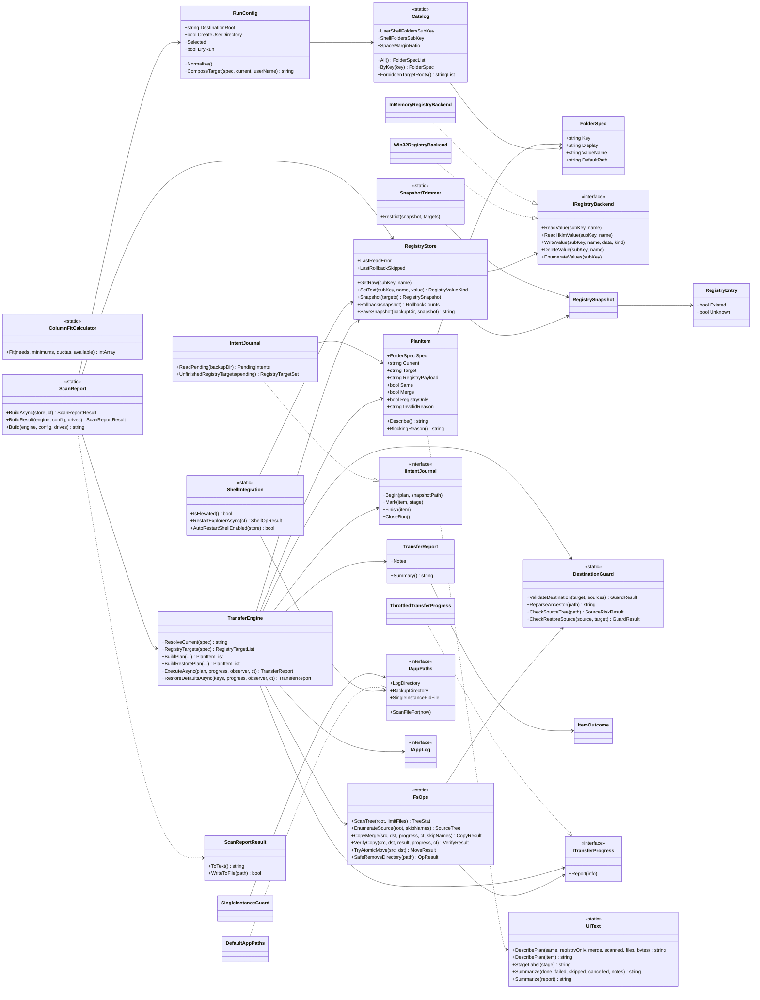
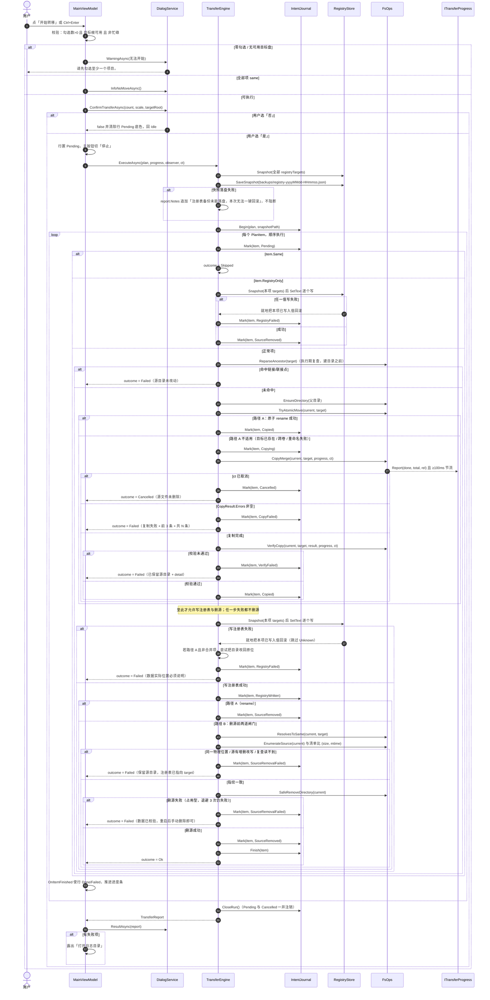
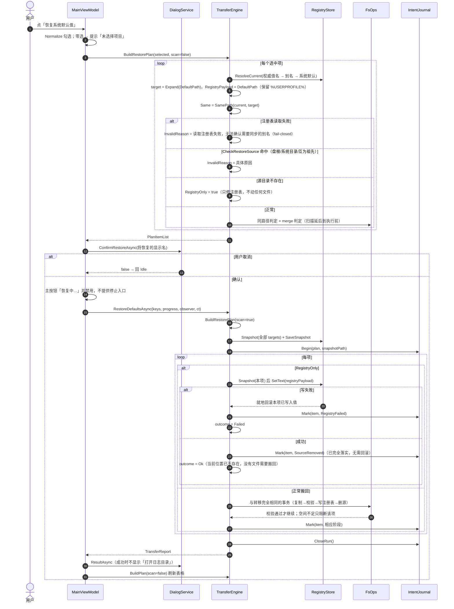
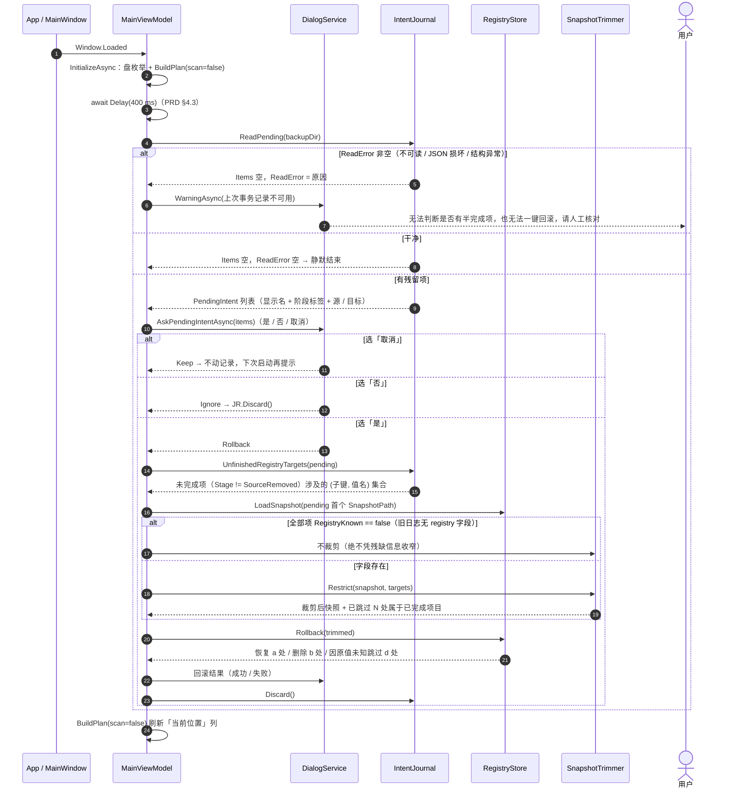

# DirMover WinUI 3 重写 — 系统架构与任务分解

> 作者：高见远（Gao）· 架构师｜团队：software-dirmover-winui
> 上游输入：`docs/01-prd.md`（PRD，F1–F32）、`docs/00-research-brief.md`（行为基线）、`repo-src/pydm/docmover/`（原实现，仅作行为对照）
> 版本：v1（2025-11）｜解决方案根：`D:/Program Files/WorkBuddy/DirMover/`

---

## 0. 阅读指引（给工程师）

| 你要做的事 | 看第几节 |
|---|---|
| 搞清为什么这么分层、哪些逻辑必须放 Core | §1 |
| 知道要建哪些文件、各写多少行 | §2 |
| 抄接口签名、直接开写 | §3 |
| 看整体关系与三条主流程的调用顺序 | §4 |
| 拿到可执行的施工顺序与验收标准 | §5 |
| 命名/错误处理/取消/日志/文案的跨文件约定 | §6 |
| 写 XAML 与 ViewModel 时对照绑定契约 | §7 |
| 知道哪里会踩坑 | §8 |
| CLI 参数与退出码（`--scan` / `--dry-run` / `--version` / `--help`） | §7.7 |
| 哪些 PRD 待确认问题已被裁决 | §9.1 |
| 代码与设计哪里不一样、为什么不一样 | §9.3（偏差记录 D-1…D-11，含构建参数、dotnet 探测、publish 两级缺陷 xbf/pri、盘根缺口） |
| 哪些"环境前提"不能引用、必须自己跑一遍 | §9.4（固定盘数量 / SDK 位置 / 有无 VS 打包任务，附命令与日期） |
| 12 条红线各自由哪些用例覆盖、强度是强/弱/无 | `docs/04-redline-coverage.md`（QA 独立验证产出，含"本轮新增"标记） |
| 构建/自检命令（含 App 的 2 个必要 CLI 属性） | 附录 B |

**唯一一处算法替换（本重写的全量算法差异清单）**：原项目用 `blake2b-128` 计算文件内容摘要；.NET BCL 无 BLAKE2，改用 `IncrementalHash.CreateHash(HashAlgorithmName.SHA256)` 按 1 MiB 分块。摘要**只用于同一进程内「源 ↔ 目标」比对**，不落盘、不跨进程共享、不作为任何外部契约，故算法可替换。除这一处外，重写不得在任何环节放宽行为（校验维度、事务顺序、闸门数量与原实现一一对应）。

---

## 1. 方案总览

### 1.1 分层图与依赖方向

> 图中 `App.xaml(.cs)` 另承担 CLI 参数解析与退出码（`--dry-run`/`--scan`/`--version`/`--help`，见 §7.7）；`Diagnostics` 提供 `IAppPaths` 落点解析且**只依赖 BCL**，`ScanReport`（`--scan` 文本）放在 **`Engine`**（它依赖 `TransferEngine`，放 `Diagnostics` 会让启动期崩溃兜底把整个引擎拖进加载图）。

```
┌──────────────────────────────────────────────────────────────────────────┐
│ DirMover.App  (net8.0-windows10.0.19041.0, UseWinUI, unpackaged, x64)     │
│                                                                          │
│  App.xaml(.cs)     单实例/提权判定/全局异常兜底/窗口创建                  │
│  MainWindow.xaml   单屏 7 行 Grid（唯一页面，零导航）                     │
│  ViewModels/       MainViewModel（状态机+命令）、FolderRowViewModel（行）  │
│  Views/            TableColumnLayout（共享 GridLength，40 ms 防抖+高水位）│
│  Controls/         RowState → Brush / GridLength 转换器                   │
│  Dialogs/          DialogService（14 类 ContentDialog 的唯一出口）        │
│  Theme/            Tokens.xaml（颜色/间距/字号令牌）、Styles.xaml          │
└───────────────────────────────┬──────────────────────────────────────────┘
                                │ 只依赖 Core 的公开类型；绝不直接碰注册表/文件系统
                                ▼
┌──────────────────────────────────────────────────────────────────────────┐
│ DirMover.Core  (net8.0-windows, 零第三方依赖, 零 UI 引用)                 │
│                                                                          │
│  Catalog / RunConfig / UiText        ← 静态真源、内存态配置、全部界面文案  │
│  Registry/*  ──────────────► IRegistryBackend ◄── Win32 / InMemory        │
│  IO/PathTools / DestinationGuard / FsOps.{Scan,Copy,Verify}               │
│  Engine/PlanData / IntentJournal / TransferEngine                         │
│  Diagnostics/AppLog(含 IAppPaths)    Shell/ShellIntegration(含单实例)      │
│  Layout/ColumnFitCalculator（列宽纯函数）                                 │
└───────────────────────────────┬──────────────────────────────────────────┘
                                ▼
        Win32 / 注册表 / 文件系统（P/Invoke + Microsoft.Win32.Registry）
```

依赖方向严格单向：**App → Core → OS**。Core 内部亦单向：`Catalog → Registry/IO → Engine → Diagnostics/Shell`，其中 `Diagnostics` 与 `Catalog` 被任何层引用（不含反向依赖）。
>
> **例外（白名单，评审通过）**：① `UiText` 是本程序集里唯一反向看 `Engine` 的根命名空间文件（typed 文案适配器，§9.3 D-2）；② `IO/FsOps.Copy.cs`、`IO/FsOps.Verify.cs` 反向引用 `Engine` 的**两个进度类型**（`ITransferProgress`/`TransferProgressInfo`，§9.3 D-5）。两条都只有"字段搬运/进度上报"，零业务判断；完整白名单与判定口径见 **§6.7**，别当缺陷再改一遍。

### 1.2 为什么这么切（四条决定性理由）

| 理由 | 具体后果 |
|---|---|
| **App 的编译可验证、运行期行为不可验证**（本机可完整构建，但缺 VS 时需 4 个 CLI 覆盖属性，且 XAML 绑定/资源查找是运行期语义 —— 见 §8-R1/R6） | 一切**可判定**逻辑落在 Core，由 xUnit 钉住：路径校验、列宽分配、状态文案、计划合成、事务编排、快照裁剪、注册表读写。App 层只留「绑定 + 编排 + XAML」，因为**能编译 ≠ 能跑对**（`{Binding}` 路径错、`StaticResource` 键名错都在运行期才暴露）。 |
| **行为对等靠测试钉住，不靠肉眼** | 原项目 12 条红线（简报 §10）必须逐条变成 xUnit 用例，因此注册表与文件系统都要在接口后（`IRegistryBackend` + 真实目录的临时沙箱），Core 不得依赖任何 WinUI 类型。 |
| **取消/进度必须贯穿复制与校验** | 48.7 万文件、4 次全树遍历；`CancellationToken` 从 `TransferEngine` 一路传到 1 MiB 分块循环。Core 用 `ITransferProgress` 上报，**不引用 `DispatcherQueue`**；UI 侧用 `Progress<T>`（构造于 UI 线程 → 回调天然回 UI），线程模型不外泄。 |
| **单屏零导航是不变式** | App 层刻意做成「一个窗口 + 一个 ViewModel + 一个 DialogService」，没有导航框架、没有页面路由、没有二级窗口，结构上杜绝了「顺手加个页面」。 |

### 1.3 线程模型（一眼看完）

```
UI 线程                               工作线程（Task.Run，由 Core 内部创建）
────────                              ─────────────────────────────────
MainViewModel.OnPrimaryAsync()
  └ await engine.ExecuteAsync(...) ──► ExecuteCore(plan)
       ITransferProgress.Report ──────► (ThrottledTransferProgress ≥100 ms)
                                        └ Progress<T>.Report → Post 回 UI 线程
       IItemObserver.OnItemFinished ───► UI 直接 await 前已在 UI 上下文（await 续体）
```

- Core 内部：`ExecuteAsync` = `await Task.Run(() => ExecuteCore(...))`，UI 只需 `await`。
- 进度：`ThrottledTransferProgress`（Core）包 `ProgressBridge`（Core）包 `Progress<T>`（UI 构造）。**节流与合并逻辑在 Core，可单测。**
- 关窗收尾：`AppWindow.Closing` → `args.Cancel=true` → `await vm.RequestCloseAsync()`（内部 200 ms 轮询 + 60 s 上限）→ 置 `_allowClose=true` → `Close()`。

---

## 2. 项目与文件清单

### 2.1 解决方案骨架

```
D:/Program Files/WorkBuddy/DirMover/
├─ DirMover.sln
├─ src/DirMover.Core/DirMover.Core.csproj            net8.0-windows · 零第三方 · 零 UI
├─ src/DirMover.App/                                 net8.0-windows10.0.19041.0 · UseWinUI
└─ tests/DirMover.Core.Tests/                        net8.0-windows · xUnit
```

三个项目文件的关键属性（写死在 T1，不允许工程师"顺手优化"）：

| 项目 | 关键属性 |
|---|---|
| `DirMover.Core.csproj` | `TargetFramework=net8.0-windows`、`Nullable=enable`、`ImplicitUsings=enable`、`LangVersion=12`、**无任何 PackageReference** |
| `DirMover.App.csproj` | `TargetFramework=net8.0-windows10.0.19041.0`、`TargetPlatformMinVersion=10.0.17763.0`、`UseWinUI=true`、`WindowsPackageType=None`、`RuntimeIdentifier=win-x64`、`Platforms=x64`、`WindowsAppSDKSelfContained=true`（**全自包含**：WinUI 运行时随包，目标机零前置依赖，见 D-12；配 `StageFrameworkPri` 从运行时 MSIX 取框架 `resources.pri` + `VerifyFrameworkPriInPublish` 门禁）、`ApplicationManifest=app.manifest`、`ApplicationIcon=Assets\app.ico`、`EnableMsixTooling=false`、PackageReference 3 个：`Microsoft.WindowsAppSDK 1.8.260921001` + `Microsoft.Windows.SDK.BuildTools 10.0.26100.4654`（两版本必须成对，1.8 强制 BuildTools ≥ 10.0.26100.4654，否则 `NU1605`）+ `Microsoft.WindowsAppSDK.Runtime 1.8.260921001`（`GeneratePathProperty="true"`，**只为拿到包内 `tools\MSIX\` 下的框架 pri**，见 D-11）、ProjectReference → Core |
| `DirMover.Core.Tests.csproj` | `TargetFramework=net8.0-windows`、`IsPackable=false`、PackageReference `xunit`（2.9.2）+ `xunit.runner.visualstudio`（2.8.2）+ `Microsoft.NET.Test.Sdk`（17.11.1）、ProjectReference → Core |

> ⚠ **`DirMover.App.csproj` 里不要再加 `<PublishProfile>`**：没有对应的 `Properties/PublishProfiles/*.pubxml` 时，它会让每次 `dotnet publish` 都报 `NETSDK1198`（§9.3 D-3）。同理不要放 `UseRidGraph`/`RuntimeIdentifiers`/`AppxGeneratePriEnabled` 等绕过属性——构建参数一律走命令行（附录 B）。

### 2.2 `DirMover.Core`（18 个文件）

| # | 相对路径 | 职责（一句话） | 预计行数 |
|---|---|---|---|
| C01 | `src/DirMover.Core/Catalog.cs` | 静态真源：注册表子键、8 个 GUID、`FolderSpec` 与 7 项目录、空间余量、删源重试、重启等待、退出上限、进度节流、长路径阈值、禁区名单构造（按当前系统盘现算） | 260 |
| C02 | `src/DirMover.Core/RunConfig.cs` | 纯内存态配置（目标根 / 创建用户目录 / 勾选集合 / dry-run）+ `Normalize` + 目标路径合成（PRD §2.1） | 140 |
| C03 | `src/DirMover.Core/UiText.cs` | 全部界面文案与格式化的**唯一出口**（PRD §6 逐条落地）+ 列标题 | 260 |
| C04 | `src/DirMover.Core/Registry/IRegistryBackend.cs` | `IRegistryBackend` + `RegistryValue` + `RegistryReadException` + `Win32RegistryBackend`（HKCU 写 / HKLM 只读）+ `InMemoryRegistryBackend`（单测与演练） | 360 |
| C05 | `src/DirMover.Core/Registry/RegistryStore.cs` | 读失败与「值不存在」分离、`REG_EXPAND_SZ` 判定、快照/回滚（`Unknown` 跳过）、快照落盘与读取 | 300 |
| C06 | `src/DirMover.Core/Interop/NativeMethods.cs` | 全部 P/Invoke：`GetDriveTypeW`/`GetDiskFreeSpaceExW`/`GetLongPathNameW`/`DeviceIoControl(FSCTL_SET_SPARSE)`/`GetFileInformationByHandle`/`IsUserAnAdmin`/`ShellExecuteExW` | 240 |
| C07 | `src/DirMover.Core/IO/PathTools.cs` | 长路径 `\\?\` 加/剥、规范化/同路径/包含/物理同位置、8.3 长名还原、盘枚举与可用空间（`DriveInventory`）、人类可读体积 | 330 |
| C08 | `src/DirMover.Core/IO/DestinationGuard.cs` | 9 条目标/源禁区校验 + `ReparseAncestor`（含祖先链，规划期与执行期各查一次）+ 源禁区（转移/恢复共用） | 280 |
| C09 | `src/DirMover.Core/IO/FsOps.Scan.cs` | `partial` 1/3：`TreeStat`/`FileFingerprint`/`SourceTree`/`ScanTree`/`EnumerateSource`（不可读即记录，绝不静默漏项） | 300 |
| C10 | `src/DirMover.Core/IO/FsOps.Copy.cs` | `partial` 2/3：`CopyMerge`（1 MiB 分块、稀疏按洞、硬链接按 inode、`.part` + 原子改名、同名冲突绝不覆盖、进度、取消） | 430 |
| C11 | `src/DirMover.Core/IO/FsOps.Verify.cs` | `partial` 3/3：`VerifyCopy`（7 维校验）/`TryAtomicMove`/`EnsureDirectory`/`SafeRemoveDirectory`（只读清理 + 占用退避 3 次） | 380 |
| C12 | `src/DirMover.Core/Engine/PlanData.cs` | 引擎数据契约：`PlanItem`（`Describe`/`BlockingReason`）、`ItemOutcome`、`TransferReport`、`TransferStage`/`ItemStatus`、`ITransferProgress`/`TransferProgressInfo`/`TransferProgressBridge`/`ThrottledTransferProgress`、`IItemObserver` | 390 |
| C13 | `src/DirMover.Core/Engine/IntentJournal.cs` | `IIntentJournal` + 原子写（`.tmp` → `Replace`）意图日志 + `ReadPending`（损坏可感知）+ `SnapshotTrimmer` | 300 |
| C14 | `src/DirMover.Core/Engine/TransferEngine.cs` | 唯一编排者：`BuildPlan`/`BuildRestorePlan`/`ExecuteAsync`/`RestoreDefaultsAsync` + 单项事务（A 路径 rename / B 路径复制校验写注册表删源）+ 本项注册表就地回滚 | 955 |
| C15 | `src/DirMover.Core/Diagnostics/AppLog.cs` | `IAppLog` + `FileLogger` + `IAppPaths`/`DefaultAppPaths`（落点解析与可写探测）+ `NullLog`（**不依赖 Engine**，保持单向） | 260 |
| C16 | `src/DirMover.Core/Shell/ShellIntegration.cs` | 提权判定与 `runas` 重启、HKLM `AutoRestartShell` 三态、重启 explorer（只杀本用户会话 + 不继承提权令牌拉起）、打开目录、`SingleInstanceGuard` | 350 |
| C17 | `src/DirMover.Core/Layout/ColumnFitCalculator.cs` | `ColumnSpec`（4 列定义：标题/配额/是否保护）+ 列宽分配纯函数 `Fit`（F31 契约：总和恒等、保护列不压缩、同输入同输出） | 190 |
| C18 | `src/DirMover.Core/Engine/ScanReport.cs` | `--scan` 只读报告（**独立文件，命名空间仍 `DirMover.Core.Engine`**）：`ScanReportItem` / `ScanReportResult`（`ToText`+`WriteToFile`）/ `ScanReport`（`BuildAsync`+`BuildResult`+`Build`）；零写入 | 331 |

> 合计约 **5 990 行**（18 个文件）。比任务书建议的 10–14 个文件多 4 个，原因是**硬性的**：`FsOps` 三个 partial 各自 300–430 行（清点 / 复制 / 校验是三种不同的出错模式，合并会超 1 100 行）；Registry 必须拆「抽象+实现」与「高层 Store」；`NativeMethods` 与 `PathTools` 分离才能让"纯托管路径逻辑"可单测。再合并会明显降低 review 质量。
>
> **已执行（纯搬家，不是欠账）**：`ScanReport`/`ScanReportResult`/`ScanReportItem` 已原样搬到 **`Engine/ScanReport.cs`（331 行）**，**命名空间保持 `DirMover.Core.Engine`**，逻辑与签名改动 **0**；`Engine/TransferEngine.cs` 回到 **955 行**（原 1 281 行，回到单文件 review 阈值内）。搬家后 `dotnet test` 全绿（现 **317 passed / 0 failed / 0 skipped**），App 侧 `grep -rn ScanReport src/DirMover.App` **0 命中**（公开签名未变）。**本项无后续动作，别再做第二遍。**

### 2.3 `DirMover.App`（15 个文件 + 已有图标）

| # | 相对路径 | 职责（一句话） | 预计行数 |
|---|---|---|---|
| A01 | `src/DirMover.App/DirMover.App.csproj` | 项目文件（属性见 §2.1），只锁 2 个 WindowsAppSDK 相关包 | 45 |
| A02 | `src/DirMover.App/app.manifest` | `requestedExecutionLevel level="requireAdministrator"` + `dpiAware/dpiAwareness=PerMonitorV2` + `supportedOS` | 40 |
| A03 | `src/DirMover.App/App.xaml` | `XamlControlsResources` + 合并 `Theme/Tokens.xaml`、`Theme/Styles.xaml` | 25 |
| A04 | `src/DirMover.App/App.xaml.cs` | 单实例前置判定、**CLI 解析（`--dry-run` / `--scan` / `--version` / `--help`）与退出码 0/2/3/4**、全局异常 → `logs\startup_error.txt`、创建窗口 | 210 |
| A05 | `src/DirMover.App/MainWindow.xaml` | 单屏 7 行 Grid（唯一页面）、表头 + `ListView` 行模板、4 处 ToolTip、键盘加速器 | 330 |
| A06 | `src/DirMover.App/MainWindow.xaml.cs` | code-behind（薄且机械）：设置标题栏/`AppWindow` 尺寸、`XamlRoot` 注入 `DialogService`、`AppWindow.Closing` 收尾、表格键盘、`ListView.SizeChanged` → 列宽重算 | 260 |
| A07 | `src/DirMover.App/ViewModels/ObservableBase.cs` | 自写 `ObservableObject`（`INotifyPropertyChanged`）+ `RelayCommand`/`AsyncRelayCommand`（合计 < 90 行，不引 CommunityToolkit） | 90 |
| A08 | `src/DirMover.App/ViewModels/MainViewModel.cs` | 编排：内存态配置 → 计划 → 命令 → 进度消费 → 结果弹窗 → 关窗收尾；**不含任何业务判定**（判定全在 Core） | 480 |
| A09 | `src/DirMover.App/ViewModels/FolderRowViewModel.cs` | 行绑定对象（Display/Current/Target/Status/IsSelected/RowState/IsOdd）+ `Apply(PlanItem)` + `ApplyOutcome(ItemOutcome)` | 150 |
| A10 | `src/DirMover.App/Views/TableColumnLayout.cs` | 共享 `GridLength`（4 列）+ 文本测量（`TextBlock.Measure`）+ 40 ms 防抖 + 内容宽度**高水位** → 调 `ColumnFitCalculator.Fit` | 220 |
| A11 | `src/DirMover.App/Controls/RowStateConverters.cs` | `RowState → Background/Foreground Brush`、`bool → Visibility`、`RowState → 透明度` 三个 `IValueConverter` | 130 |
| A12 | `src/DirMover.App/Dialogs/DialogService.cs` | 14 类业务 `ContentDialog` + **1 个只读文本弹窗（`ScrollViewer` + 等宽字体 + 底部「打开日志目录」，用于 `--scan`/`--version`/`--help`）** 的唯一出口（`XamlRoot` 必填、串行化、文案取自 `UiText`） | 400 |
| A13 | `src/DirMover.App/Theme/Tokens.xaml` | 配色/间距/字号/行高令牌（浅色 + `Default`/`Light` 两套 `ThemeDictionaries`，Token 名与 §7.4 表一致） | 180 |
| A14 | `src/DirMover.App/Theme/Styles.xaml` | `AccentButtonStyle` / `DangerButtonStyle` / `LinkButtonStyle` / 表头与行模板样式（禁止字面色值与裸像素） | 210 |
| A15 | `build.cmd`（仓库根） | `build` / `test` / `publish` 三个子命令 + **dotnet 三级探测**（`%DOTNET_ROOT%` → `%USERPROFILE%\.dotnet` → `PATH`，见 §9.3 D-4）+ SDK 8 校验 + `chcp 65001`；统一注入 `-p:Platform=x64 -p:EnableCoreMrtTooling=false`，禁止写死绝对路径 | 70 |
| — | `src/DirMover.App/Assets/app.ico` | 已存在（362 KB），仅由 `ApplicationIcon` 引用 | — |

> 合计约 **2 725 行**。App 层刻意薄：`MainViewModel` 是唯一"厚"文件，且其中不允许出现路径拼接、注册表判断、空间计算、文案字面量。

### 2.4 `tests/DirMover.Core.Tests`（8 个文件）

| # | 相对路径 | 覆盖的红线（简报 §10） | 预计行数 |
|---|---|---|---|
| T-01 | `tests/DirMover.Core.Tests/DirMover.Core.Tests.csproj` | 测试工程（xUnit 2.9.2 / runner 2.8.2 / Test.Sdk 17.11.1） | 25 |
| T-02 | `tests/DirMover.Core.Tests/RegistryStoreTests.cs` | 红线 11（`%VAR%\…` 才 `REG_EXPAND_SZ`）、读失败 ≠ 值不存在、红线 9（`Unknown` 回滚跳过且不 `DeleteValue`）、快照/裁剪 | 260 |
| T-03 | `tests/DirMover.Core.Tests/DestinationGuardTests.cs` | 红线 7、8（源在目标内 / 目标在源内 / 同物理位置 / 盘根 / 系统目录 / `\\?\` 前缀 / 8.3 短名 / 保留名 / 尾点空格 / 重解析祖先） | 300 |
| T-04 | `tests/DirMover.Core.Tests/CopyVerifyTests.cs` | 红线 1、2、3、4、9（校验未过不删源、同名冲突两份都在、空目录必复制、源变化检出、链接重建、`.part` 无残留） | 380 |
| T-05 | `tests/DirMover.Core.Tests/TransferEngineTests.cs` | 红线 1、5、6（注册表失败本项回滚且源在、空间未知阻断、空间不足只阻断该项、取消后不删源不写注册表、`same` 跳过） | 340 |
| T-06 | `tests/DirMover.Core.Tests/IntentJournalTests.cs` | 红线 10（原子写、损坏可感知且不报"干净"、`pending`/`cancelled` 收尾注销、未完成项快照裁剪） | 260 |
| T-07 | `tests/DirMover.Core.Tests/ColumnFitTests.cs` | 红线 12（各列和恒等于可用宽、名称/状态列不被压缩、同输入同输出、极端窄宽仍有解） | 150 |
| T-08 | `tests/DirMover.Core.Tests/UiTextTests.cs` | PRD §6 文案契约（状态列 5 分支、摘要省略规则、11 种阶段标签、失败文案含去向与下一步） | 200 |
| — | `tests/DirMover.Core.Tests/TestSupport.cs` | 临时目录沙箱（`IDisposable`，自动清理）、`FakeLog`、种子注册表构造器 | 180 |

> 合计约 **2 095 行**。测试只依赖 Core，不依赖 App（本机也编译不了 App）。

---

## 3. 关键类型与接口（C# 签名级）

> 全部 `namespace` 见 §6.1。以下签名即为**工程师应写出的形态**，允许增加 `internal` 辅助成员，不允许改变公开语义。

### 3.1 静态目录与配置

```csharp
namespace DirMover.Core;

public sealed record FolderSpec(
    string Key,                 // "documents" … （稳定标识）
    string Display,             // "我的文档" …
    string ValueName,           // 权威值名；downloads 本身即 GUID
    string DefaultPath,         // r"%USERPROFILE%\Documents"（保留 %VAR% 形态）
    IReadOnlyList<string> Aliases);

public static class Catalog
{
    public const string ExplorerSubKey        = @"Software\Microsoft\Windows\CurrentVersion\Explorer";
    public const string UserShellFoldersSubKey = ExplorerSubKey + @"\User Shell Folders";
    public const string ShellFoldersSubKey     = ExplorerSubKey + @"\Shell Folders";
    public const string WinlogonSubKey         = @"SOFTWARE\Microsoft\Windows NT\CurrentVersion\Winlogon";
    public const string DefaultTargetLeaf      = "UserData";
    public const string AppVersion             = "3.0.2";
    public const string SingleInstanceName     = @"Local\DirMover_Single";

    // 空间与等待（唯一真源，被引擎与界面文案共同复述）
    public const double SpaceMarginRatio = 1.05;
    public const long   SpaceMarginBytes = 64L * 1024 * 1024;
    public static readonly TimeSpan ExplorerKillTimeout = TimeSpan.FromSeconds(20);
    public static readonly TimeSpan ExplorerTermWait   = TimeSpan.FromMilliseconds(1500);
    // 2026-11-26 报障后重构：固定 1 s 查一次 → 轮询。
    // ExplorerAutoRespawnWait = 给 AutoRestartShell 的自动拉起宽限（winlogon 实机 1–3 s）；
    // ExplorerRelaunchTotalWait = 显式拉起后的存活确认预算（轮询，出现即算存活）；
    // ExplorerRelaunchPoll = 轮询间隔。
    public static readonly TimeSpan ExplorerAutoRespawnWait = TimeSpan.FromSeconds(3);
    public static readonly TimeSpan ExplorerRelaunchTotalWait = TimeSpan.FromSeconds(10);
    public static readonly TimeSpan ExplorerRelaunchPoll = TimeSpan.FromMilliseconds(250);
    public static readonly TimeSpan RemoveBackoff1 = TimeSpan.FromMilliseconds(200);
    public static readonly TimeSpan RemoveBackoff2 = TimeSpan.FromMilliseconds(500);
    public const int RemoveAttempts = 3;
    public static readonly TimeSpan ProgressThrottle = TimeSpan.FromMilliseconds(100);
    public static readonly TimeSpan ExitFinishPollInterval = TimeSpan.FromMilliseconds(200);
    public static readonly TimeSpan ExitFinishTimeout = TimeSpan.FromSeconds(60);
    public static readonly TimeSpan PendingIntentDelay = TimeSpan.FromMilliseconds(400);
    public const int LongPathThreshold = 240;

    public static IReadOnlyList<FolderSpec> All { get; }        // 顺序 == 界面顺序（7 项）
    public static IReadOnlyList<string> AllKeys { get; }
    public static FolderSpec? ByKey(string key);                // 未知 key → null（调用方忽略）

    public static string SystemDrive { get; }                   // "C:"（大写、无尾斜杠）
    public static IReadOnlyList<string> ForbiddenTargetRoots(); // 系统盘 + Windows/Program Files/…/Users
    public static IReadOnlyList<string> ForbiddenSourceTrees();
    public static IReadOnlyList<string> ForbiddenSourceExact();
}

public sealed class RunConfig
{
    public string DestinationRoot { get; set; }                  // "D:\UserData"；空串 = 无可用盘
    public bool   CreateUserDirectory { get; set; }               // 默认 true
    public ISet<string> Selected { get; set; }                    // 默认全选 7 项
    public bool   DryRun { get; init; }

    public void Normalize();                                      // 只留已知 key、去重、按 Catalog.All 顺序
    public static RunConfig CreateDefault(IReadOnlyList<DriveVolume> drives, bool dryRun);

    /// PRD §2.1：目标 = <根>\<用户名>\<英文物理基名> / <根>\<英文物理基名>；根为空 → 返回 current（同路径语义）
    /// 「基名」固定取 spec.DefaultPath 的最后一段，见 §3.1.1
    public string ComposeTarget(FolderSpec spec, string currentPath, string userName);
}
```

### 3.1.1 路径与显示名分离 —— `IO.FolderDisplayName`

**硬规则**：磁盘目录名与注册表路径永远是英文；中文只出现在 Shell 显示层。

- `RunConfig.ComposeTarget` 取 `FolderSpec.DefaultPath` 的最后一段（出厂物理名），
  **不读** `currentPath` 的物理尾名，也**不用** `desktop.ini` 的显示名拼路径。
  这样即使源目录已经被旧版本改成中文名，也不会把错误延续下去。
- `FolderDisplayName.ReadRawResourceName(source)` 读源 `desktop.ini` 的
  `[.ShellClassInfo] LocalizedResourceName`，返回**原始串**（可能是 `@module,-id`），不做语言解析。
- `TransferEngine.RunItem` 在**移动/复制之前**缓存这个原始串（同卷 rename 会搬走源目录，
  事后再读就读不到了），在复制校验完成后、写注册表之前调用
  `FolderDisplayName.ApplyToDirectory(target, raw)`。
- `ApplyToDirectory` 只替换/插入目标 `desktop.ini` 的 `LocalizedResourceName`，其它段原样保留；
  写回原始串（不解析成某种语言），并给目录加 System、给 ini 加 Hidden+System，
  最后 `SHChangeNotify` 刷新 Shell 缓存。失败则保留源、不写注册表；rename 通道还要搬回源。
- `FolderDisplayName.Resolve(path)` 仍保留：它把间接串解析成本机 UI 语言文本，
  用于测试与诊断，**不参与路径合成**。

**硬约束**：

- Core 内**不得出现任何语言的目录名字面量**。`RunConfigTests.Catalog_FolderSpecHasNoHardcodedTargetNameColumn`
  用反射钉住 `FolderSpec` 的属性集，禁止再长出"目标名列"。
- 不走 `SHGetLocalizedName` / `SHGetKnownFolderItem`：前者要求目录仍带 System/ReadOnly 属性，
  后者要 COM interop + FOLDERID 映射，面积更大却读同一份 `desktop.ini`。
- 读不到显示名不是错误：目标目录仍用英文物理名，Shell 按系统默认显示，不影响数据搬迁。
- 显示名写入失败要显式失败，不能留下"英文路径但显示名丢失"的半完成态。

### 3.2 注册表

```csharp
namespace DirMover.Core.Registry;

public readonly record struct RegistryValue(object? Data, RegistryValueKind Kind);

public sealed class RegistryReadException : IOException
{
    public RegistryReadException(string message, Exception? inner = null) : base(message, inner) { }
}

public interface IRegistryBackend
{
    /// 子键路径**相对 HKCU**。返回值语义严格三态：
    ///   null  → 键或值确实不存在（合法）
    ///   value → 读到了
    ///   抛 RegistryReadException → 权限/句柄/损坏（**绝不可降级成"不存在"**）
    RegistryValue? ReadValue(string subKey, string name);

    /// 只读通道，仅用于 HKLM 的系统开关（Winlogon\AutoRestartShell）。本工具**从不写 HKLM**。
    RegistryValue? ReadHklmValue(string subKey, string name);

    void WriteValue(string subKey, string name, object data, RegistryValueKind kind);
    void DeleteValue(string subKey, string name);              // 值不存在时静默成功
    IReadOnlyDictionary<string, RegistryValue> EnumerateValues(string subKey); // 大小写不敏感
}

public sealed class Win32RegistryBackend : IRegistryBackend;      // Microsoft.Win32.Registry
public sealed class InMemoryRegistryBackend : IRegistryBackend    // 单测/演练；记录 Writes 供断言
{
    public IReadOnlyList<(string SubKey, string Name, object? Data, RegistryValueKind Kind)> Writes { get; }
}

public sealed record RegistryEntry(
    string SubKey, string Name, object? Data, RegistryValueKind? Kind,
    bool Existed,        // false = 快照时确实不存在 → 回滚时 DeleteValue
    bool Unknown);       // true  = 快照期读失败 → 回滚时**必须跳过**（既不能恢复也不能删除）

public sealed record RegistrySnapshot(IReadOnlyList<RegistryEntry> Entries, string CreatedAt);

public readonly record struct RegistryTarget(string SubKey, string Name);   // 全序去重用 (lower, lower)

public sealed class RegistryStore
{
    public RegistryStore(IRegistryBackend backend, IAppLog log);

    public string? LastReadError { get; }        // 最近一次读失败（不含"不存在"）
    public int LastRollbackSkipped { get; }      // 最近一次 Rollback 因 Unknown 跳过的条数
    public string? ConsumeReadError();            // 取走即清空

    public RegistryValue? GetRaw(string subKey, string name);
    public string GetText(string subKey, string name, bool expand = true);
    public bool Exists(string subKey, string name);

    /// 按 PRD §2.2 判定类型后写入，返回实际写入的 ValueKind：
    ///   值以 %VAR% 开头且其后紧跟分隔符或结束 → RegistryValueKind.ExpandString
    ///   其余（含值中间出现 %）→ RegistryValueKind.String
    public RegistryValueKind SetText(string subKey, string name, string value);

    public RegistrySnapshot Snapshot(IEnumerable<RegistryTarget> targets);   // 去重；读失败→Unknown
    public (int Restored, int Removed) Rollback(RegistrySnapshot snapshot);  // Unknown 跳过

    public IReadOnlyDictionary<string, RegistryValue> EnumerateValues(string subKey);

    /// 落盘失败**不抛**，返回 null 并由引擎写入 report.Notes（PRD §4.1-8）
    public string? SaveSnapshot(string backupDir, RegistrySnapshot snapshot);
    public static RegistrySnapshot LoadSnapshot(string path);                // 损坏 → 抛 InvalidDataException
}
```

**可展开判定正则（逐字移植，勿"改进"）**：

```csharp
// ^%[A-Za-z_][A-Za-z0-9_()]*%(\\[^\0]*)?$
//  %USERPROFILE%\Documents → ExpandString   %USERPROFILE% → ExpandString
//  D:\a%USERPROFILE%b\UserData → String     100% / %FOO / %FOO%bar → String
private static readonly Regex ExpandablePrefix =
    new(@"^%[A-Za-z_][A-Za-z0-9_()]*%(\\[^\0]*)?$", RegexOptions.Compiled);
```

### 3.3 路径与守卫

```csharp
namespace DirMover.Core.IO;

public sealed record DriveVolume(string Letter, string Root, long TotalBytes, long FreeBytes)
{
    public string TargetRoot { get; }    // "D:\UserData"
    public string SpaceLabel { get; }    // "D:\  可用 1.2 TB / 2.0 TB"
}

public static class DriveInventory
{
    /// GetDriveTypeW == DRIVE_FIXED 且盘符 != 系统盘（PRD Q3：**不用** DriveInfo.DriveType）
    public static IReadOnlyList<DriveVolume> ListFixedNonSystem();
    /// 默认目标根：D:\UserData 可用则取之，否则首个，都没有 → ""
    public static string PreferredTargetRoot(IReadOnlyList<DriveVolume> drives);
}

public static class PathTools
{
    public static string ToExtended(string path);       // _lp：≥240 字符 → \\?\ / \\?\UNC\
    public static string FromExtended(string path);     // _unlp
    public static string Expand(string path);           // %USERPROFILE% 展开
    public static string Normalize(string path);        // abspath + 去尾分隔符 + 小写（仅比较）
    public static bool   SamePath(string a, string b);
    public static bool   IsWithin(string child, string parent);      // 含自身
    /// 存在性判定的**唯一入口**：内部先 StripExtendedPrefix → ToExtended 再判。
    /// 裸 Directory.Exists/File.Exists 对 >MAX_PATH 的**合法**路径返回 false，
    /// 会把"源还在"误判成"源不存在"（数据事故）。T6/T9 一律走这里。
    public static bool   Exists(string path);
    public static bool   ResolvesToSame(string a, string b);         // samefile → realpath → 字符串
    public static string LongPath(string path);         // GetLongPathNameW 还原 8.3（逐级找最深已存祖先）
    public static string StripExtendedPrefix(string path);
    public static string TailName(string path);         // 目录基名（不是显示名）
    public static string HumanSize(long bytes);         // 1024 进制、1 位小数、B 不带小数
    public static string VolumeKey(string path);        // 卷 GUID；取不到回退盘符
    public static long?  FreeSpace(string path);        // null = 读不到（**不许当成"无需检查"**）
    public static bool   IsReparsePoint(string path);   // FileAttributes.ReparsePoint + LinkTarget
}

public enum SourceRisk { None, Invalid, DriveRoot, SystemDirectory }
public readonly record struct SourceRiskResult(SourceRisk Risk, string Reason);
public readonly record struct GuardResult(bool Ok, string Reason)
{
    public static GuardResult Pass { get; }
    public static GuardResult Fail(string reason);
}

public static class DestinationGuard
{
    /// 9 条校验（PRD P0-7）：空/非法字符 → 绝对路径 → 保留名/尾点空格 → 盘符存在 →
    /// 系统目录（长名还原后比）→ 同物理位置 → 目标在源内 / 源在目标内 → 重解析祖先链
    public static GuardResult ValidateDestination(string target, IReadOnlyList<string> sources);

    /// 返回自身或任一已存在上级中的第一个重解析点；无命中返回 ""。
    /// 规划期由 ValidateDestination 调用；**执行期在建目录之前必须再调一次**。
    public static string ReparseAncestor(string path);

    /// 源位置自身禁区（转移与恢复共用）：盘根 / 系统目录（`\Users` 仅精确匹配）
    public static SourceRiskResult CheckSourceTree(string path);

    /// 恢复路径专用：CheckSourceTree + 拒绝「源与默认目标互为祖先/后代」
    public static GuardResult CheckRestoreSource(string sourcePath, string defaultTarget);
}
```

### 3.4 文件系统操作

```csharp
namespace DirMover.Core.IO;

public sealed class TreeStat
{
    public int Files { get; init; }
    public int Dirs { get; init; }
    public long Bytes { get; init; }
    public int Links { get; init; }
    public int Unreadable { get; init; }      // > 0 → 规模被低估，引擎阻断
    public string Describe();                 // "12 个文件 / 3.4 GB"
}

public sealed class FileFingerprint            // 属于**源**，不属于目标
{
    public long Size { get; init; }
    public long ModifiedTicksUtc { get; init; }
    public string Digest { get; init; } = "";  // SHA256（十六进制小写）
    public uint Device { get; init; }
    public ulong Inode { get; init; }
    public uint LinkCount { get; init; }
    public FileAttributes Attributes { get; init; }
}

public sealed class SourceTree
{
    public List<string> Dirs { get; }                                  // 含空目录
    public Dictionary<string, FileFingerprint> Files { get; }           // key = 相对路径
    public List<string> Links { get; }
    public List<string> Skipped { get; }
    public List<string> Errors { get; }                                // 非空 → 整体失败
}

public sealed class CopyItem
{
    public required string Rel { get; init; }
    public required string TargetRel { get; init; }   // 同名冲突时 != Rel
    public required FileFingerprint Fingerprint { get; init; }
    public bool Reused { get; init; }
}

public sealed class CopyResult
{
    public List<CopyItem> Items { get; }
    public List<string> Dirs { get; }
    public List<string> Links { get; }
    public List<string> Conflicts { get; }
    public List<string> Skipped { get; }
    public List<string> Errors { get; }
    public bool Cancelled { get; set; }
    public int SparseFiles { get; set; }
    public int HardlinkedFiles { get; set; }
    public int CopiedFiles { get; }
    public long CopiedBytes { get; }
    public bool Ok { get; }                 // Errors.Count == 0 && !Cancelled
}

public readonly record struct VerifyResult(bool Verified, string Detail, bool Cancelled);
public readonly record struct MoveResult(bool Moved, string Message);
public readonly record struct OpResult(bool Ok, string Message);

public static partial class FsOps
{
    // FsOps.Scan.cs
    public static TreeStat ScanTree(string root, int limitFiles = 0);
    public static SourceTree EnumerateSource(string root, IReadOnlyCollection<string>? skipNames = null);

    // FsOps.Copy.cs —— 绝不做任何删除；删除由调用方在 VerifyCopy 通过后决定
    public static CopyResult CopyMerge(
        string src, string dst,
        ITransferProgress? progress = null,
        CancellationToken ct = default,
        IReadOnlyCollection<string>? skipNames = null);

    // FsOps.Verify.cs
    public static VerifyResult VerifyCopy(
        string src, string dst, CopyResult result,
        ITransferProgress? progress = null, CancellationToken ct = default);
    public static MoveResult TryAtomicMove(string src, string dst);         // 同卷且目标不存在 → 原子改名
    public static OpResult   EnsureDirectory(string path);
    public static OpResult   SafeRemoveDirectory(string path);             // 只读清理 + 占用退避 3 次（<1 s）
}
```

**`VerifyCopy` 的 7 个判定维度（缺一即不通过，逐条对应简报 §2.4-4）**：
① 目标存在；② 目标大小 == **源**记录大小；③ 目标摘要 == **源**摘要（复用项也带摘要）；④ 源自清点以来未改动（大小 + mtime）；⑤ 重新枚举源后「源集合 − 清单集合」为空（文件/目录/链接分别比）；⑥ 清单内目录与链接在目标侧齐备（链接用"条目存在"判，避免悬空链接永不通过）；⑦ 无「按名跳过却未复制」的项。

### 3.5 引擎

```csharp
namespace DirMover.Core.Engine;

public enum TransferStage
{
    Pending, Copying, Copied, RegistryWritten, SourceRemoved,
    Cancelled, CopyFailed, VerifyFailed, RegistryFailed, SourceRemovalFailed, UnexpectedError
}   // 11 个 —— 与 UiText.StageLabel 一一对应

public enum ItemStatus { Pending, Ok, Skipped, Failed, Cancelled }

public sealed class PlanItem
{
    public required FolderSpec Spec { get; init; }
    public required string Current { get; init; }        // 注册表解析（已展开）
    public required string Target { get; init; }         // 已合成的绝对路径
    public string RegistryPayload { get; init; } = "";   // 写注册表的值（恢复时保留 %USERPROFILE%）
    public IReadOnlyList<RegistryTarget> RegistryTargets { get; init; } = Array.Empty<RegistryTarget>();
    public bool Same { get; set; }
    public bool TargetExists { get; set; }
    public bool Merge { get; set; }
    public bool Scanned { get; set; }
    public bool RegistryOnly { get; set; }               // 恢复专用：源已不存在，只修注册表
    public TreeStat Stat { get; set; } = new();
    public string InvalidReason { get; set; } = "";

    public string Key { get; }
    public string Display { get; }
    public bool NeedsMove { get; }                       // !Same && Current && Target

    public string Describe();          // 字段搬运 → UiText.DescribePlan(same, registryOnly, merge, scanned, Stat.Describe())
    public string BlockingReason();    // "" = 可执行；顺序固定：
                                       // Same → Current 空 → 当前位置不存在 → InvalidReason →
                                       // 同物理位置放行 → Unreadable>0 → 空间闸门（同卷 rename 豁免）
}

public sealed class ItemOutcome
{
    public required string Key { get; init; }
    public required string Display { get; init; }
    public required ItemStatus Status { get; init; }
    public string Message { get; init; } = "";
    public string Source { get; init; } = "";
    public string Target { get; init; } = "";
    public int Files { get; init; }
    public long CopiedBytes { get; init; }
    public string Label { get; }        // UiText.StatusLabel
}

public sealed class TransferReport
{
    public List<ItemOutcome> Outcomes { get; }
    public string? SnapshotPath { get; set; }
    public DateTimeOffset StartedAt { get; set; }
    public DateTimeOffset FinishedAt { get; set; }
    public bool Cancelled { get; set; }
    public List<string> Notes { get; }                  // 例：注册表备份未能落盘，本次无法一键回滚
    public IReadOnlyList<ItemOutcome> Failed { get; }
    public IReadOnlyList<ItemOutcome> Succeeded { get; }
    public bool Ok { get; }
    public string Summary();                            // 字段搬运 → UiText.Summarize(计数, Cancelled, Notes)（PRD §6.3）
}

public readonly record struct TransferProgressInfo(
    string ItemKey, string Display,
    int DoneInItem, int TotalInItem,      // 文件级（复制/校验共享）
    long BytesCopied, string CurrentRelativePath);

public interface ITransferProgress { void Report(in TransferProgressInfo info); }

/// 桥接 IProgress<T>：UI 侧传 new Progress<TransferProgressInfo>(...)（构造于 UI 线程，回调天然回 UI）
public sealed class TransferProgressBridge : ITransferProgress;

/// ≥100 ms 或最后一项才放行（原实现同一节流口径），逻辑在 Core，可单测
public sealed class ThrottledTransferProgress : ITransferProgress
{
    public ThrottledTransferProgress(ITransferProgress inner, TimeSpan? minInterval = null);
}

/// 项级事件（UI 用于行着色与状态栏），在**工作线程**触发，实现方自行 `Progress<T>`/`DispatcherQueue` 切回
public interface IItemObserver
{
    void OnItemStarted(int index, int total, PlanItem item);
    void OnItemFinished(int index, int total, PlanItem item, ItemOutcome outcome);
}
```

### 3.6 意图日志与快照裁剪

```csharp
namespace DirMover.Core.Engine;

public sealed record PendingIntent(
    string Key, string Display, string Source, string Target,
    TransferStage Stage, string SnapshotPath,
    IReadOnlyList<RegistryTarget> RegistryTargets,
    bool RegistryKnown);      // false = 旧日志无 registry 字段 → 不允许缩小回滚范围

public sealed record PendingIntents(IReadOnlyList<PendingIntent> Items, string? ReadError);
// ReadError 语义：读失败 / JSON 损坏 / 结构异常 → 非空。**"没有文件" == 干净，ReadError 为空**

public interface IIntentJournal
{
    void Begin(IReadOnlyList<PlanItem> plan, string? snapshotPath);
    void Mark(PlanItem item, TransferStage stage);
    void Finish(PlanItem item);      // 该项安全收尾 → 注销；全部注销即删除 intent.json
    void CloseRun();                 // 一次运行收尾：Pending 与 Cancelled 一并注销（PRD §4.4-5）
    void Discard();
}

public sealed class IntentJournal : IIntentJournal
{
    public static IIntentJournal Open(string? backupDir, bool enabled, IAppLog log);
    public static PendingIntents ReadPending(string? backupDir);
    public static ISet<RegistryTarget> UnfinishedRegistryTargets(PendingIntents pending);
}

public static class SnapshotTrimmer
{
    /// 纯函数：把快照裁到 targets（子键/值名均小写比较）。返回 (裁剪后快照, 被排除条数)。
    public static (RegistrySnapshot Trimmed, int Excluded) Restrict(
        RegistrySnapshot snapshot, IEnumerable<RegistryTarget> targets);
}
```

### 3.7 编排者

```csharp
namespace DirMover.Core.Engine;

public sealed class TransferEngine
{
    public TransferEngine(RegistryStore store, string? backupDir, bool dryRun, IAppLog log);

    public RegistryStore Store { get; }

    /// 当前位置解析优先级：权威值名 → 别名 → 系统默认；读失败记 warning 并回退（不阻断，但可见）
    public string ResolveCurrent(FolderSpec spec);

    /// 需写入的 (子键, 值名)：权威名总写；别名仅在**已存在**时同步；Shell Folders 中已存在的同名值一并写
    public IReadOnlyList<RegistryTarget> RegistryTargets(FolderSpec spec);

    /// 只读规划。scan=false 时不扫描目录规模（界面常态）。任何注册表读失败 → 该项 InvalidReason（fail-closed）
    public IReadOnlyList<PlanItem> BuildPlan(
        IEnumerable<string> selectedKeys, string destinationRoot, bool createUserDirectory,
        string userName, bool scan, IReadOnlyDictionary<string, TreeStat>? statCache = null);

    /// 只读恢复规划。target = Expand(spec.DefaultPath)，RegistryPayload = spec.DefaultPath（保留 %USERPROFILE%）
    public IReadOnlyList<PlanItem> BuildRestorePlan(
        IEnumerable<string> selectedKeys, bool scan,
        IReadOnlyDictionary<string, TreeStat>? statCache = null);

    public Task<TransferReport> ExecuteAsync(
        IReadOnlyList<PlanItem> plan, ITransferProgress? progress = null,
        IItemObserver? observer = null, CancellationToken ct = default);

    public Task<TransferReport> RestoreDefaultsAsync(
        IEnumerable<string> selectedKeys, ITransferProgress? progress = null,
        IItemObserver? observer = null, CancellationToken ct = default);
}
```

**`ExecuteAsync` 的契约（写死在实现里，不可配置）**：

1. 快照一次性落盘；失败 → `report.Notes += 注册表备份未能落盘，本次无法一键回滚`，**不阻断**。
2. `journal.Begin(plan, snapshotPath)`。
3. 逐项 `await` 同一线程内**顺序**执行，单项异常被捕获 → `ItemStatus.Failed` + `UnexpectedError` 阶段，**不中断整轮**。
4. 每项顺序：`ReparseAncestor(目标)`（**建目录之前**）→ `EnsureDirectory(父)` → `TryAtomicMove`（A 路径）→ 否则 `CopyMerge` → `VerifyCopy` → 写注册表（本项快照 + 就地回滚）→ 删源前两道闸门（`ResolvesToSame` / `EnumerateSource` 指纹）→ `SafeRemoveDirectory` → `journal.Finish`。
5. `CancellationToken` 在：项边界、复制 1 MiB 分块循环、校验循环、删源前复查前检查。取消 → 当前项 `Cancelled`（源未删、注册表未写）+ 剩余项全部 `Cancelled`。
6. 收尾 `journal.CloseRun()`（`Pending`/`Cancelled` 注销），`report.FinishedAt` 置位。
7. `dryRun=true` 时：不写快照、不写意图日志、不写注册表、不动文件；每项 `Ok` + `[试运行] …` 文案。

```csharp
namespace DirMover.Core.Engine;   // 实现在独立文件 Engine/ScanReport.cs（定稿，见 §9.3 D-1）

/// 报告里的一行（一个用户文件夹）。
public sealed record ScanReportItem(
    string Key, string Display, string Current, bool Exists,
    string Target, string State, string RiskLabel);   // State = 路径相同 / 可执行 / 不可执行：原因

/// --scan 的报告数据（只读快照）。排版与落盘都在这里，调用方只决定"给谁看、存哪"。
public sealed class ScanReportResult
{
    public DateTimeOffset GeneratedAt { get; init; }
    public IReadOnlyList<ScanReportItem> Items { get; init; }
    public IReadOnlyList<DriveVolume> Drives { get; init; }
    public int UserShellFolderValues { get; init; }     // User Shell Folders 枚举到的值数
    public int ShellFolderValues { get; init; }         // Shell Folders 枚举到的值数
    public IReadOnlyList<string> Warnings { get; init; } // 读失败 / 被取消等；空 = 全程干净

    /// 四段排版（7 项明细 / 非系统固定盘 / 两个子键值计数 / 读取告警），CJK 按 2 列宽对齐。
    public string ToText();

    /// 落盘：父目录按需创建；**UTF-8 带 BOM**（便于记事本直接打开）；失败返回 false，**不抛**。
    public bool WriteToFile(string path);
}

public static class ScanReport
{
    /// 零写入采集（只调 ResolveCurrent / BuildPlan(scan:false) / 只读枚举），必须响应 ct。
    public static Task<ScanReportResult> BuildAsync(RegistryStore store, CancellationToken ct = default);
    public static ScanReportResult BuildResult(TransferEngine engine, RunConfig config,
                                              IReadOnlyList<DriveVolume> drives);
    /// 便捷：= BuildResult(...).ToText()（只读弹窗与写文件共用同一段文本）。
    public static string Build(TransferEngine engine, RunConfig config,
                              IReadOnlyList<DriveVolume> drives);
}
```

### 3.8 诊断、系统集成、列宽

```csharp
namespace DirMover.Core.Diagnostics;

public interface IAppLog
{
    void Info(string message);
    void Warn(string message);
    void Error(string message, Exception? ex = null);
}

/// 落点解析抽象（可注入 → 测试用临时目录，绝不写真实 %LOCALAPPDATA%）
/// 裁决（Q2）：优先 exe 所在目录（绿色便携不变）；该目录不可写时**整体**回落到
/// %LOCALAPPDATA%\DirMover\{logs,backups}，并在日志首行记录实际落点。
public interface IAppPaths
{
    bool   IsPortable { get; }                             // true = 用 exe 旁
    string BaseDirectory { get; }
    string LogDirectory { get; }                           // <base>\logs
    string BackupDirectory { get; }                        // <base>\backups
    string StartupErrorFile { get; }                       // <logs>\startup_error.txt
    string LogFileFor(DateTimeOffset now);                  // <logs>\DirMover-yyyyMMdd.log
    string ScanFileFor(DateTimeOffset now);                 // <logs>\scan-yyyyMMdd-HHmmss.txt
    /// **恒为** %LOCALAPPDATA%\DirMover\single_instance.pid（进程协调产物，不随便携落点变化）
    string SingleInstancePidFile { get; }
}

public sealed class DefaultAppPaths : IAppPaths
{
    /// 可写探测（建 logs 目录 + 写探针文件后删除）决定 portable / fallback；探测失败 → fallback
    public static DefaultAppPaths Resolve(string exeDirectory);
}

public sealed class FileLogger : IAppLog, IDisposable
{
    public static FileLogger Create(string path);      // 打开失败 → 降级为"写 stderr + 禁用"，不抛
}
public sealed class NullLog : IAppLog;                 // 单测用

namespace DirMover.Core.Shell;

public readonly record struct ShellOpResult(bool Ok, string Message);

public static class ShellIntegration
{
    public static bool IsElevated();
    public static ShellOpResult RelaunchAsAdmin(string arguments);          // ShellExecuteW "runas"
    /// HKLM 三态：值=1 → true；值=0 → false；值不存在 → true；读失败 → false（fail-closed）
    public static bool AutoRestartShellEnabled(RegistryStore store);
    /// ① 结束本用户本会话 explorer（taskkill 带 username/session 双过滤）→ **检查退出码**
    /// ② **PID 快照轮询**确认"结束前那批 PID"全部消失；仍在则按 PID 兜底补杀一次，再确认
    /// ③ **自动拉起宽限 3 s（轮询）**：winlogon 重启 shell 实机要 1–3 s，固定查一次太窄；
    ///    宽限内没回来才显式拉起
    /// ④ **存活确认 10 s（轮询，250 ms 间隔，出现即算存活）**；预算用尽补拉一次，再给一轮预算
    /// 四步任一不成立都返回可操作的失败文案，**不再出现"没杀成却报成功"**（Bug1 修复点）
    /// **每一步都经 DiagnosticsSink 落日志**（宿主接 IAppLog）：PID 快照、taskkill 退出码、
    /// 拉起通道与 Win32 错误码、存活结论——2026-11-26 报障时日志里只有一句"无法自动拉起"，
    /// 无法定位，此后这是硬性契约。
    /// 拉起顺序：① ShellExecuteExW（lpVerb=nil、nShow=SW_SHOWNORMAL、System32\explorer.exe 绝对路径）
    /// → ② 降级 **CreateProcess（UseShellExecute=false）**——降级绝不能还走 ShellExecute 通道：
    /// explorer 刚死时 shell 基础设施半死，同通道兜底形同虚设（2026-11-26 报障核心嫌疑）
    /// → ③ 都失败则 Message 明说「请手动运行 explorer.exe」。
    public static Task<ShellOpResult> RestartExplorerAsync(CancellationToken ct = default);
    public static ShellOpResult OpenDirectory(string path);                 // explorer.exe <path>
    public static Task<ShellOpResult> BroadcastEnvironmentChangeAsync();    // 预留（当前无消费者）
}

public sealed class SingleInstanceGuard : IDisposable
{
    /// Local\DirMover_Single + IAppPaths.SingleInstancePidFile（%LOCALAPPDATA%\DirMover\single_instance.pid）
    /// "已存在"不直接阻断：还要确认持有者 PID 的镜像名是存活的 DirMover（裁决 Q4，不用 Global\）
    public static SingleInstanceGuard Acquire(IAppPaths paths, IAppLog log, out bool alreadyRunning);
    public void Release();
}

namespace DirMover.Core.Layout;

public sealed record ColumnSpec(string Key, string Header, int Quota, bool Protected);

public static class ColumnFitCalculator
{
    public const int CellPad = 12;
    public const int HeadPad = 14;
    public const int MinColumn = 90;
    public const int FloorColumn = 56;
    public const int FallbackViewport = 720;

    /// 4 列：name（受保护/配额 24）、current（不保护/140）、target（不保护/140）、status（受保护/72）
    public static IReadOnlyList<ColumnSpec> Columns { get; }

    /// 纯函数：返回 4 个宽度，**总和恰等于 available**；保护列不低于 needs；同输入同输出（最大余数法）
    public static int[] Fit(int[] needs, int[] minimums, int[] quotas, int available);
}
```

### 3.9 文案出口（节选，完整形态见实现）

```csharp
namespace DirMover.Core;

public static class UiText
{
    public const string WindowTitle = "DirMover — 用户数据转移工具";
    public const string Ready = "就绪";
    public const string NoTargetDisk = "未检测到可用的非系统固定磁盘";
    public const string NoTargetDiskHint = "未检测到可用的目标磁盘（非系统固定盘），请先接入或挂载。";
    public const string Stopping = "正在停止：已完成的项目会保留；未完成项目的源文件不会被删除，注册表也不会写入。";
    public const string Restoring = "正在恢复系统默认位置…";
    public const string RestartingShell = "重启中…";
    public const string SafeShutdown = "正在安全收尾：等当前项写完并校验后自动退出…";
    public const string DryRunBadge = "试运行模式";
    public const string UiRefreshFailed = "界面刷新失败，详情见日志文件";

    public static string SelectionSummary(int selected, int total);       // 零选追加「（请先勾选项目）」
    public static string Processing(string display, int done, int total); // 正在处理 X（n/N）

    /// 状态列文案（PRD §6.1 五个分支，先命中先返回）。
    /// **实现只有一份**：`DescribePlanCore`（internal，分支判定 + 措辞都在这里）；下面每个重载都只是它的入口。
    internal static string DescribePlanCore(bool same, bool registryOnly, bool merge,
                                            bool scanned, string statText);

    /// 原语重载 A（调用方已算好规模文案）：直接转调 Core。
    public static string DescribePlan(bool same, bool registryOnly, bool merge, bool scanned,
                                      string statText);

    /// 原语重载 B（调用方只给数字）：拼好「n 个文件 / X.X MB」后转调 Core。
    public static string DescribePlan(bool same, bool registryOnly, bool merge, bool scanned,
                                      int files, long bytes);

    /// typed 便捷重载：PlanItem.Describe() 一行委托到它；只摊平字段，不判分支。
    public static string DescribePlan(PlanItem item);

    public static string StatusLabel(ItemStatus status);                  // 完成/失败/跳过/已取消（枚举在 Engine，故签名收枚举）
    public static string StageLabel(TransferStage stage);                 // 11 种（PRD §4.3-3）
    public static string StatusLabel(string statusKey);                   // 兜底：未知阶段原样返回

    /// 摘要（PRD §6.3）：省略规则（失败/跳过为 0 整段省略）由本重载实现。
    public static string Summarize(int done, int failed, int skipped, bool cancelled,
                                   IReadOnlyList<string>? notes = null);

    /// typed 便捷重载：按 ItemStatus 重新计数后转调上面那版（TransferReport.Summary() 一行委托到它）。
    /// 计数口径：完成只算 Ok；Skipped 单列，不混进完成数。
    public static string Summarize(TransferReport report);

    public static string OpenLogOk(string path);                          // 已打开日志目录：{path}
    public static string OpenLogFailed(string path);                      // 日志目录不可用（可能没有写权限）：{path}
    public static string FailureWithNextStep(...);                        // PRD §6.4 各类型（复制/校验/注册表/删源/空间/链接/同位置/源变化）
    public static string ResultTitle(bool failed, bool cancelled, bool anyOk);  // 操作完成 / 部分项目未完成 / 已停止 / 执行出错
}
```

> **分层约束（定稿，主理人裁决）**：`UiText` 内部是「**一个 Core + 三个入口**」——
> ① `internal DescribePlanCore(...)` / `internal SummarizeCore(...)` 是**唯一实现**，分支判定与措辞只在这里；
> ② 两个原语重载负责"把调用方给的东西整理成 Core 的入参"（一个收 `statText`，一个收 `files/bytes` 自己拼规模文案）；
> ③ typed 重载（`PlanItem`/`TransferReport`）只做字段摊平 + 一行转调，**零逻辑**。
>
> 二者同处 `src/DirMover.Core/UiText.cs`，因此该文件 `using DirMover.Core.Engine;` —— 这是**全项目唯一**允许根命名空间反向看到 Engine 的文件（偏差 D-2，评估见 §9.3；主理人已核定 `UiText.DescribePlan(PlanItem)` 处为纯字段搬运，接受不改）。引擎侧只保留三行委托：`PlanItem.Describe()`、`TransferReport.Summary()`、`ItemOutcome.Label`。
>
> **禁止**：把任何文案字面量写进 Engine/App；把分支判断写进 typed 重载（会变成两份逻辑）。
> **调用约束**：App 层只允许调 typed 重载或上述三个委托属性；直接调原语重载视为越界（原语版保持 `public` 的唯一理由是让 `UiTextTests` 不构造 `PlanItem` 就能钉住 5 个分支，见 §9.3 D-2a）。

---

## 4. 图

### 4.1 类图（主干）



> 三处与代码核对后的要点（详见 §9.3）：① `UiText` 是**成对重载**，原语版是唯一实现，typed 版零逻辑；② `ScanReport`/`ScanReportResult`/`ScanReportItem` 在 `DirMover.Core.Engine`，独立文件 `Engine/ScanReport.cs`；`Diagnostics` **只依赖 BCL**；③ `PlanItem.Describe()` / `TransferReport.Summary()` / `ItemOutcome.Label` 是仅有的三个文案委托属性。

### 4.2 时序图 ①：转移单项（含 rename 与复制两条路径、失败分支）



### 4.3 时序图 ②：恢复系统默认值（`registry_only` 分支）



### 4.4 时序图 ③：启动时未完成事务回滚



---

## 5. 任务列表（T1–T14，按依赖排序）

> 施工原则：**先 Core 后 App，先纯函数后 IO，先单文件可测后编排**。每个任务结束时都必须 `dotnet test` 通过；T14 结束后 `dotnet build src/DirMover.Core` 必须 0 warning/0 error（App 的编译状态单独记录，见 §8-R1）。

| ID | 目标 | 涉及文件 | 验收标准 | 依赖 |
|---|---|---|---|---|
| **T1** | 建立解决方案骨架与三个项目（含 App 的 XAML 空壳），让 `DirMover.Core` 与测试工程在本机可 build/test | `DirMover.sln`、`src/DirMover.Core/DirMover.Core.csproj`、`src/DirMover.App/DirMover.App.csproj`、`src/DirMover.App/app.manifest`、`src/DirMover.App/App.xaml`、`src/DirMover.App/App.xaml.cs`、`src/DirMover.App/MainWindow.xaml`、`src/DirMover.App/MainWindow.xaml.cs`、`src/DirMover.App/Theme/Tokens.xaml`、`src/DirMover.App/Theme/Styles.xaml`、`tests/DirMover.Core.Tests/DirMover.Core.Tests.csproj` | ① `dotnet build src/DirMover.Core` 成功且**无 PackageReference**；② `dotnet test` 能跑（0 用例也算通过）；③ 三个 csproj 属性与 §2.1 表逐条一致；④ `app.manifest` 含 `requireAdministrator` 与 `PerMonitorV2`；⑤ `MainWindow.xaml` 只有 7 行 `RowDefinitions`，行高分别为 `Auto/Auto/1/Auto(*)/Auto/1/Auto` | — |
| **T2** | Core 的静态层与纯函数：目录真源、内存态配置、全部界面文案、列宽算法、落点解析 | `Catalog.cs`、`RunConfig.cs`、`UiText.cs`、`Layout/ColumnFitCalculator.cs`、`Diagnostics/AppLog.cs`（`IAppLog`+`FileLogger`+`IAppPaths`/`DefaultAppPaths`+`NullLog`，`ScanReport` 留到 T11）、`tests/.../UiTextTests.cs`、`tests/.../ColumnFitTests.cs`、`tests/.../TestSupport.cs` | ① 7 项 key/显示名/值名/别名/默认路径与 PRD §2 表逐字一致（含 `downloads` 的 GUID 权威名）；② `UiText` 单测覆盖状态列 5 分支、摘要省略规则、11 种阶段标签，且**直接调原语重载**（不构造 `PlanItem`，这是原语版保持 `public` 的唯一理由，§9.3 D-2a）；typed 重载（`DescribePlan(PlanItem)` / `Summarize(TransferReport)`）只摊平字段、**零分支判断**，`PlanItem.Describe()` / `TransferReport.Summary()` / `ItemOutcome.Label` 各一行委托，禁止第二份文案逻辑；③ `Fit` 满足红线 12 四条（和恒等、保护列不压缩、同输入同输出、极端宽度有解）；④ 代码中**不存在**任何界面文案字面量（`UiText` 与 `IAppPaths` 的路径片段除外）；⑤ `DefaultAppPaths.Resolve` 在只读目录（用临时目录 + 去写权限模拟）下回落到 `%LOCALAPPDATA%` 风格路径，且 `SingleInstancePidFile` **恒不随落点变化**；测试通过 `TempAppPaths`（写在 `TestSupport.cs`）注入临时目录 | T1 |
| **T3** | 注册表层：后端抽象 + Win32 实现 + 内存实现 + 高层 Store（快照/回滚/类型判定） | `Registry/IRegistryBackend.cs`、`Registry/RegistryStore.cs`、`tests/.../RegistryStoreTests.cs` | ① `%USERPROFILE%\Documents` → `ExpandString`；`D:\a%USERPROFILE%b` → `String`；`100%`/`%FOO` → `String`；② `read` 抛 `RegistryReadException` 与返回 `null` 两种情形在 `Exists`/`GetText` 下**可区分**（`ConsumeReadError` 非空 vs 空）；③ 快照期读失败 → `Entry.Unknown=true`，`Rollback` **跳过且不调用 `DeleteValue`**，`LastRollbackSkipped` 计数正确；④ `SaveSnapshot` 失败返回 `null` 不抛；⑤ 全程不触真实注册表（`InMemoryRegistryBackend`） | T1 |
| **T4** | Win32 互操作与路径工具：长路径、规范化、物理同位置、8.3 长名还原、盘枚举、可用空间 | `Interop/NativeMethods.cs`、`IO/PathTools.cs` | ① `ToExtended` 对 <240 字符原样返回、≥240 加 `\\?\`、UNC 转 `\\?\UNC\`、已带前缀不重复加；② `SamePath`/`IsWithin` 大小写与尾分隔符不敏感；③ `ResolvesToSame` 对同一目录不同写法（junction / `subst`）返回 true；④ `LongPath` 把 `PROGRA~1` 还原为长名（在临时目录构造短名验证，不可用时 `return` 并输出 `[ENV-MISSING]`，不计为通过）；⑤ `HumanSize(0)=="0 B"`、`HumanSize(1536)=="1.5 KB"`；⑥ `ListFixedNonSystem` 排除系统盘 | T1 |
| **T5** | 目标/源禁区校验（P0-7 九条）与重解析点祖先链 | `IO/DestinationGuard.cs`、`tests/.../DestinationGuardTests.cs` | ① **一行只装一条红线**（简报 §10 编号固定，不重排，但必须拆开引用）：
　　①-a **红线 7 全绿**（三向位置关系）：源在目标内 / 目标在源内 / 同一物理位置（`ResolvesToSame` 穿透 junction，不得用字符串比较冒充）；
　　①-b **红线 8 全绿**（盘根、系统目录，**源与目标两侧都算**）：目标侧 9 条校验（盘根作目标 / 系统目录 `C:\Windows`·`C:\Program Files`·`C:\ProgramData`·`C:\Users` 精确匹配 / `\\?\C:\Windows` / `C:\PROGRA~1` / 保留名 `CON`·`CON.txt`·`NUL` / 尾点与尾空格 / 非法字符 / 相对路径 / 盘符不存在）+ 源侧 `CheckSourceTree` 同一套判定；
　　② `ReparseAncestor` 在临时目录建 junction 后能命中祖先（无权限建 junction 时 `return` 并输出 `[ENV-MISSING]`，不计为通过）；③ 系统盘非 C: 时禁区名单随 `SystemDrive` 变化（可通过构造 `Catalog.SystemDrive` 的测试钩子验证）；④ **红线 8「盘根作目标 → 拒绝」（简报 §10-8：盘根 / 系统目录作为源或目标一律拒绝）曾是实现缺陷，不是环境限制**：`ValidateDestination(@"C:\", [])` 实测返回 `Ok = true` —— 因为 `InvalidSegment` 先把盘根从待检查串里切掉，`C:\` 无片段可查，于是直接放行。**已修复并闭环（§9.3 D-6）**：盘根判定插在"盘符存在性"之后、"禁区比较"之前，对 `Normalize` 与 `LongPath` 两形态都判，fail-closed，文案 `UiText.GuardDriveRootAsTarget`。**回归已转正**：原 `[Fact(Skip="已知缺口…")]` 已删除，`DriveRootTargetGuardTests.DriveRootAsTarget_IsRejected` 真跑并绿（实测 **317 passed / 0 failed / 0 skipped**）。⚠ 该 Skip 曾是**硬编码的缺陷记账**（该用例只用 `Catalog.SystemDrive`，任何机器都能跑），**不是**"缺第二个固定盘自动跳过"——这条教训已记入 §9.4。⑤ **断言强度**：只断言 `Ok == false` 会掩盖"闸门走错分支"——`\\?\C:\Windows` 曾被 `FirstIllegalCharacter(':')` 拒掉，与系统目录判定无关（§9.3 D-6a，已修：剥前缀提前到非法字符判定之前）；要证明前缀/8.3 绕不过去，必须喂**不含 `?`** 的形态（`C:\PROGRA~1`），且**断言要落到 `Reason` 而不只是 `Ok`** | T4 |
| **T6** | 清点与规模统计：空目录、链接、不可读项、指纹 | `IO/FsOps.Scan.cs` | ① 空目录进 `Dirs`；② 目录联接进 `Links` 且**不递归**；③ 无权限子目录 → `Errors` 非空（不是静默跳过）；④ `ScanTree` 的 `Unreadable>0` 可被构造；⑤ `skipNames` 命中的项进 `Skipped`；⑥ 指纹含 size/mtime/dev/ino/nlink/attrs | T4 |
| **T7** | 安全复制：分块 + 摘要、稀疏、硬链接、`.part` 原子改名、同名冲突、进度、取消 | `IO/FsOps.Copy.cs` | ① 红线 2：同名不同内容 → 两份都在（`name (1).ext`）且 `Conflicts` 记录；② 复用必须比内容（构造 size+mtime 相同、内容不同的两文件 → 不复用）；③ 空目录被创建；④ 链接按原样重建；⑤ 取消后目标无 `.part` 残留、`Cancelled=true`；⑥ 进度回调被调用且节流（同一 100 ms 窗口内合并）；⑦ 源与目标同物理位置 → 直接 `Errors` 且**没有任何写操作** | T5, T6 |
| **T8** | 校验与收尾：7 维校验、原子移动、目录创建、安全删源 | `IO/FsOps.Verify.cs`、`tests/.../CopyVerifyTests.cs` | ① 红线 1、3、4：目标缺一文件 / 目标少一空目录 / 源被改写 → 全部 `Verified=false` 且 `Detail` 含维度名与样例；② 悬空符号链接在目标侧重建后**不**导致恒失败；③ `skipNames` 有跳过项 → 校验失败（fail-closed）；④ `TryAtomicMove` 跨卷返回 `Moved=false` 且消息说明改用复制；⑤ `SafeRemoveDirectory` 对只读文件成功；对占用型错误退避 3 次后返回失败且文案含"重启本机后即可删除" | T7 |
| **T9** | 引擎数据契约：`PlanItem`（含 `BlockingReason` 顺序）、`ItemOutcome`、`TransferReport`、进度与观察者 | `Engine/PlanData.cs` | ① `BlockingReason` 判定顺序与 PRD 逐条一致（`Same` → 位置未知 → 不存在 → `InvalidReason` → 同路径放行 → `Unreadable` → 空间）；② 同卷且目标不存在时**不做**空间判断；③ `Available==null` → 「无法读取目标磁盘可用空间」；④ `TransferReport.Summary()` 在失败/跳过为 0 时整段省略，`Notes` 用「；」连接并加中文括号 | T2, T6 |
| **T10** | 意图日志：原子写、残留读取、损坏可感知、注销规则、快照裁剪 | `Engine/IntentJournal.cs`、`tests/.../IntentJournalTests.cs` | ① 红线 10：写后无 `.tmp` 残留、文件为合法 JSON；② 把文件写成半截 JSON → `ReadPending` 返回 `ReadError` 非空（**不得**当作干净）；③ 无文件 → `Items` 空且 `ReadError` 空；④ `CloseRun` 后 `pending`/`cancelled` 不残留、`source-removed` 项也不残留（`Finish` 已注销）；⑤ `UnfinishedRegistryTargets` 排除 `SourceRemoved`；⑥ `RegistryKnown=false` 时调用方可用其判断"不可裁剪"；⑦ `SnapshotTrimmer.Restrict` 大小写不敏感且返回被排除条数 | T9, T3 |
| **T11** | 引擎编排：`BuildPlan`/`BuildRestorePlan`/`ExecuteAsync`/`RestoreDefaultsAsync` + 单项事务 + `--scan` 文本报告 | `Engine/ScanReport.cs`（独立文件，命名空间 `DirMover.Core.Engine`）、`tests/.../TransferEngineTests.cs` | ① 红线 1：`CopyMerge` 或 `VerifyCopy` 失败 → **不删源、不写注册表**（`InMemoryRegistryBackend.Writes` 为空）；② 红线 5：写注册表第二个值抛异常 → 本项已写值回滚、源目录保留、`Stage=RegistryFailed`；③ 红线 6：`FreeSpace` 返回 null → 该项 `Failed` 且其余项照常执行；空间不足 → 只阻断该项；④ `dryRun` 下零写入（文件、注册表、快照、意图日志全无副作用）；⑤ 取消后剩余项全 `Cancelled`、`report.Cancelled=true`、`intent.json` 不残留 `cancelled`；⑥ `registry_only` 在恢复计划中被正确置位；⑦ 单项抛异常不中断整轮；⑧ `ScanReport.BuildAsync`/`BuildResult` 输出四段（7 项明细、非系统固定盘清单、两个注册表子键的值计数、读取告警）且**零写入**（`InMemoryRegistryBackend.Writes` 为空）；⑨ `ScanReportResult.WriteToFile` 父目录按需创建、UTF-8 **带 BOM**、路径不可写时返 `false` 而**不抛** | T8, T10 |
| **T12** | 系统集成：提权判定与重启、`AutoRestartShell` 三态、重启 explorer、打开目录、单实例 | `Shell/ShellIntegration.cs` | ① `AutoRestartShellEnabled` 三态：值=1→true、值=0→false、不存在→true、读抛异常→false；② 重启流程用 `taskkill` 参数**含** `/fi "username eq …"`（可用注入的进程执行器断言参数数组，不真跑）；③ 拉起顺序逐级降级：`ShellExecuteExW`（`lpVerb=nil`、`nShow=SW_SHOWNORMAL`、`System32\explorer.exe` 绝对路径）→ `Process.Start` → 两者都失败时 `ShellOpResult.Message` 含「请手动运行 explorer.exe」；④ `OpenDirectory` 路径不存在时返回失败而非抛；⑤ `SingleInstanceGuard`（`IAppPaths` 注入临时目录）：第二次 `Acquire` 得到 `alreadyRunning=true` 且能识别"持有者 PID 已死"从而允许启动；PID 文件路径**恒为** `%LOCALAPPDATA%\DirMover\single_instance.pid`（不随便携落点变化） | T3, T4 |
| **T13** | App 数据层：MVVM 基类、行 VM、共享列布局、行状态转换器、`MainViewModel` 编排 | `ViewModels/ObservableBase.cs`、`ViewModels/FolderRowViewModel.cs`、`Views/TableColumnLayout.cs`、`Controls/RowStateConverters.cs`、`ViewModels/MainViewModel.cs` | ① `MainViewModel` 不含任何路径拼接或注册表判断（`grep` 检查：无 `Registry`、无 `Path.Combine`、无文案字面量）；② 勾选/切目标根/切用户目录 → 只调 `BuildPlan(scan:false)` 与 `RecomputePlan`，**零文件系统枚举**（用注入的 `FsOps` 计数或日志断言）；③ 主按钮文案与可用性矩阵：空闲（有勾选→`开始转移`+可用）/无盘→禁用/执行中→`停止`/停止中→`正在停止…`+禁用/恢复中→`恢复中…`+禁用；④ `TableColumnLayout` 40 ms 防抖与高水位（连续两次更窄的 `needs` 不得让列变窄）；⑤ `RowState` 7 态映射表与 §7.4 一致 | T11 |
| **T14** | App 集成与收尾：7 行布局、弹窗服务、键盘、关窗收尾、启动回滚弹窗、日志链接、`build.cmd`。**⚠ 前置：先确认产物是「全自包含 + 4 个 pri 齐」形态** —— 自包含产物缺框架 `resources.pri` 时会 `0xC000027B`，那是**发布配置缺陷**（已由构建门禁 fail-closed 挡住），**不是环境限制**；**不再做"本机能否运行 WinUI 3 应用"的判定** —— 那两轮探针结论已被证伪（探针等价于"形态 A"，§9.3 D-12），把它当环境限制会把代码缺陷记成"不记红也不记通过" | `MainWindow.xaml`、`MainWindow.xaml.cs`、`Dialogs/DialogService.cs`、`App.xaml.cs`、`Theme/Styles.xaml`（补样式）、`build.cmd`（仓库根） | ① 单屏零导航：XAML 中无 `Frame`/`NavigationView`/二级 `Window`；② 14 类弹窗全部可达且按钮形态与 PRD 一致（`是/否`、`是/否/取消`、单按钮）；③ 表格键盘：空格/回车切换勾选、`Ctrl+Enter` 不切换、`Ctrl+Enter` 触发主操作、表头无拖拽改宽（`CanResize=false` 或事件拦截）；④ `AppWindow.Closing` → 忙碌时确认 → 200 ms 轮询 + 60 s 上限 → 超时写日志后强制关闭；已请求退出期间不弹结果窗、不出现「重启中」；⑤ 4 处 ToolTip 齐备且无第五处；⑥ 启动 400 ms 后处理残留事务（三选弹窗 + 回滚结果文案四项计数）；⑦ 失败项才露出「打开日志目录」；⑧ `dotnet test` 全绿 + Core `dotnet build` 0 warning；⑨ **CLI（裁决 Q1）**：`--dry-run` 启动 GUI 且状态栏有徽标、无提权重启入口、结果弹窗照常；`--scan` → `ScanReport.BuildAsync`/`BuildResult` → `WriteToFile(IAppPaths.ScanFileFor(now))`（写失败只记日志）→ 弹**只读文本弹窗**（`ScrollViewer` + 等宽字体 + 底部「打开日志目录」）；`--version`/`--help` 写日志 + 只读文本弹窗；退出码 0 正常 / 2 环境不满足（无可用目标盘等）/ 3 界面初始化失败 / 4 未预期错误；**不新增任何页面**；⑩ `build.cmd` 的 `build`/`test`/`publish` 三个子命令在本机裸跑通过（`build` 0 warning 0 error；`publish` 产出含 `DirMover.App.exe` 且**无 `NETSDK1198`**），且**未写死任何绝对路径**；⑪ **发布可用性（三条并列，按执行成本排序，缺一不可）**：① **静态（仅自包含形态）** `publish\resources.pri` 存在且 ≥ 1,300,000 B、且另外 3 个 pri 在位（框架依赖形态 N/A，仅排障对照；**① 失败不必跑 ②③**）；② `publish\DirMover.App.exe` **存活 ≥ 6 秒**；③ 若退出，`Get-WinEvent -LogName Application` 里最近一条 `DirMover` 的 `Application Error` 必须给出**出错模块名 + 异常代码**。判定脚本：`$p = Start-Process publish\DirMover.App.exe -PassThru; Start-Sleep 6; $p.Refresh(); if ($p.HasExited) { "CRASH " + $p.ExitCode } else { "ALIVE"; Stop-Process $p.Id -Force }`。**"任务管理器里有进程"永远不算证据**（apphost 的错误对话框也会让进程活着）；**`bin\` 下的 exe 不算证据**（框架依赖，本机机器级运行时只有 10.0.15，见 §9.4） | T12, T13 |

**P0 / P1 覆盖对照**

| 需求 | 落点任务 | 需求 | 落点任务 |
|---|---|---|---|
| P0-1 主链路 | T6–T11 | P0-9 复制健壮性 | T7 |
| P0-2 事务顺序 + 路径 A | T11、T8 | P0-10 恢复默认值 | T11 |
| P0-3 全量校验以源为基准 | T8 | P0-11 快照/意图/回滚 | T3、T10、T14 |
| P0-4 删源前两道闸门 | T11（顺序固化在 `ExecuteAsync`） | P0-12 单实例 + 管理员 | T12、T1 |
| P0-5 双形态同步 | T3、T11 | P0-13 界面主链路 | T13、T14 |
| P0-6 值类型判定 | T3 | P0-14 取消与退出收尾 | T7、T8、T11、T14 |
| P0-7 禁区校验（9 条） | T5 | P0-15 重启资源管理器 | T12、T14 |
| P0-8 空间闸门 | T9、T11 | P0-16 日志与崩溃兜底 | T2、T14 |
| P1-1 列宽自适应（F31） | T2（算法）+ T13/T14（绑定） | P1-3 四处 ToolTip（F27） | T14 |
| P1-2 截断提示（F32） | T14（**按降级方案**：常显全路径 ToolTip，见 §9-3） | P1-4 试运行徽标（F23） | T2（文案）+ T14（显示） |
| P2-1…P2-6 | **本轮不做**（仅换色/换外观，不触行为；留待后续迭代） | | |

---

## 6. 跨文件约定

### 6.1 命名空间与文件组织

| 命名空间 | 目录 | 内容 |
|---|---|---|
| `DirMover.Core` | `src/DirMover.Core/*.cs` | `Catalog`、`RunConfig`、`UiText` |
| `DirMover.Core.Registry` | `Registry/` | 后端抽象、两个实现、`RegistryStore`、快照 |
| `DirMover.Core.Interop` | `Interop/` | `NativeMethods`（全部 `internal`） |
| `DirMover.Core.IO` | `IO/` | `PathTools`、`DriveInventory`、`DestinationGuard`、`FsOps`（3 个 partial） |
| `DirMover.Core.Engine` | `Engine/` | `PlanItem`、`ItemOutcome`、`TransferReport`、进度、`IntentJournal`、`TransferEngine`、`ScanReport`/`ScanReportResult`/`ScanReportItem` |
| `DirMover.Core.Diagnostics` | `Diagnostics/` | `IAppLog`、`FileLogger`、`IAppPaths`/`DefaultAppPaths`、`NullLog`（**只依赖 BCL，绝不引用 Engine**） |
| `DirMover.Core.Shell` | `Shell/` | `ShellIntegration`、`SingleInstanceGuard` |
| `DirMover.Core.Layout` | `Layout/` | `ColumnFitCalculator`、`ColumnSpec` |
| `DirMover.App` / `.ViewModels` / `.Views` / `.Controls` / `.Dialogs` | 对应目录 | 窗口、VM、布局、转换器、弹窗 |

命名规范：类型 `PascalCase`；私有字段 `_camelCase`；常量 `PascalCase`（不用 SCREAMING）；异步方法以 `Async` 结尾**并**返回 `Task`；公开类型必须有 `<summary>`；枚举成员不加前缀（`ItemStatus.Ok`）。

### 6.2 错误处理策略（三层）

| 层 | 策略 |
|---|---|
| **业务失败**（可预期：空间不足、校验不通过、写注册表失败、删源被占用） | **用返回值/结果对象**：`GuardResult`、`CopyResult.Errors`、`VerifyResult`、`OpResult`、`ItemOutcome.Status=Failed`。绝不用异常表达。 |
| **意外异常**（越界、空引用、P/Invoke 失败等） | 在**单项边界**捕获（`TransferEngine.ExecuteAsync` 的 per-item try/catch）→ `Stage=UnexpectedError` + `ItemStatus.Failed` + 日志全量堆栈；不中断整轮。`App` 层再兜一层 → `logs\startup_error.txt`。 |
| **必须吞并记日志**（唯一允许 catch 后继续的清单） | ① 日志目录创建/写入失败（降级 stderr、禁用 FileLogger）；② PID 文件写/删失败；③ 快照落盘失败（→ `report.Notes`）；④ 意图日志写入失败（停用日志，继续搬运）；⑤ 删源退避重试的**中间**失败（最终失败才上报）；⑥ `Explorer` 拉起失败（上报到结果文案，不抛）；⑦ 环境变量广播失败；⑧ `ColumnFitCalculator` 的文本测量失败（返回 0）；⑨ UI 回调里的 `DispatcherQueue` 关闭异常（记日志后丢弃）。除以上 9 条，**其他任何 catch 后继续都算缺陷**。 |

### 6.3 取消传播规则

1. 唯一取消源：`MainViewModel._cts`（每次执行新建；停止按钮 / 关窗收尾调用 `Cancel()`）。恢复默认值传 `CancellationToken.None`（不可中断）。
2. 检查点（**缺一则视为缺陷**）：项边界；`CopyMerge` 的 1 MiB 分块循环；`VerifyCopy` 的逐文件循环；删源前复查前。
3. 取消的表达：`CopyResult.Cancelled=true`；`VerifyResult.Cancelled=true`；`ItemOutcome.Status=Cancelled`。**不使用** `OperationCanceledException` 穿过引擎边界（`Task.Run` 内捕获后转换）。
4. 取消收尾：当前项不删源、不写注册表、`Stage=Cancelled`；剩余项全部 `Cancelled`；`CloseRun()` 把 `Cancelled` 一并注销（PRD §4.4-5，否则下次启动会误报并滚坏已成功项）。
5. 副作用顺序约定：**任何 `Cancel()` 之后都不允许新开注册表写入或删源**；已写入的注册表不回滚（那是快照的职责，不是取消的职责）。

### 6.4 日志与时间格式

- 行格式：`yyyy-MM-dd HH:mm:ss [LEVEL] message`，`LEVEL ∈ {INFO, WARN, ERROR}`，UTF-8 with BOM（记事本友好），`AutoFlush` 每行。
- **日志首行固定记录实际落点**（裁决 Q2）：`INFO 落点：<base>（便携模式 / 已回落到 %LOCALAPPDATA%）`，便于排障时确认日志与备份到底写在哪。
- 文件名：日志 `logs\DirMover-yyyyMMdd.log`（UTF-8 **无 BOM**）；扫描报告 `logs\scan-yyyyMMdd-HHmmss.txt`（UTF-8 **带 BOM**，便于记事本直接打开，§9.3 D-1a）；快照 `backups\registry-yyyyMMdd-HHmmss.json`；意图日志 `backups\intent.json`（+ `.tmp` 中转）；启动兜底 `logs\startup_error.txt`。
- 意图日志与快照的 JSON **统一缩进 2 空格 + 中文不转义**（`JavaScriptEncoder.UnsafeRelaxedJsonEscaping`），便于人工核对。
- JSON 内时间：`CreatedAt` 用 ISO 8601 UTC（`DateTime.UtcNow.ToString("O")`）。
- 界面时间**不显示**（PRD 无此需求，不得新增）。
- 日志禁止记录：文件内容、注册表值的完整路径以外的隐私内容不做限制，但**不记录**文件内容与用户口令类数据；路径可以记录（排障必需）。

### 6.5 文案归属（**目标状态 + 当前偏差清单**）

**目标状态**：所有面向用户的字符串只允许出现在 `UiText`（含 14 类弹窗标题/正文、按钮文案、状态列、状态栏、摘要、失败下一步指引）。`DialogService` 只负责"把这些字符串摆进 `ContentDialog`"，`MainWindow.xaml` 里不允许出现中文文案；`ContentDialog` 的按钮文案也必须取自 `UiText`。

**当前现实（QA 独立验证 + 架构师复核，2026-11）**：`UiText.cs` 之外仍有 **109 处中文字符串字面量**（注释不计；`grep -rnP "[\x{4e00}-\x{9fa5}]" src/DirMover.Core --include=*.cs | grep -v UiText.cs` 再剔除纯注释行）。**主理人裁定本轮不修**（改动 4 个以上文件 + 大量断言，且不影响运行期文案正确性），但必须诚实记录，否则下一个维护者会拿一个错误的检查前提去做事。

| 分类 | 文件（字面量条数） | 判定 |
|---|---|---|
| **已声明例外** | `Catalog.cs`（7，= 7 个 `FolderSpec.Display`） | 允许：静态真源就在这里，搬到 `UiText` 会形成 Catalog → UiText 的方向反转 |
| **可接受（人读的诊断/日志，不上屏）** | `AppLog.cs`（6）、`RegistryStore.cs`（9）、`IntentJournal.cs`（7）、`IRegistryBackend.cs`、`ShellIntegration.cs`、`FsOps.Copy.cs`（5） | 允许：写给日志/`ReadError`/`Warnings`，供排障阅读；**不得**出现在 `ItemOutcome.Message` 或弹窗正文里 |
| **真违规（会直接上屏）** | `ScanReport.cs`（**28**，报告正文四段）、`FsOps.Verify.cs`（**24**，`problems` 经 `UiText.VerifyFailed(detail)` 原样进弹窗）、`TransferEngine.cs`（**11**，装配 `ItemOutcome.Message`，如"为安全起见保留源目录…"）、`PathTools.cs`（`SpaceLabel` 的 `D:\ 可用 …`） | **本轮不修，记为技术债**：这些串会原样出现在结果弹窗/状态列/扫描报告里，绕过了 `UiText` |

**由此得出两条必须记住的结论**：
1. **PRD §6 的逐条文案对照，目前无法只对一个文件做** —— 需要同时看 `UiText`、`ScanReport`、`FsOps.Verify`、`TransferEngine`、`PathTools`。QA 若要断言"文案与 PRD 一致"，请按这 5 处取样，不要只 `grep UiTextTests`。
2. `ScanReport` 报告正文是**用户直接阅读**的文本，规模（28 条）已接近一个小型文案表；下轮若要清理，它应第一个搬（或整体挂到 `UiText.Scan*` 下），因为它的四段结构已经固定、搬动风险最低。

### 6.6 依赖与安全边界（红线，代码评审必查）

1. `DirMover.Core.csproj` **不得**出现 `PackageReference`；**不得**出现 `using Microsoft.UI.*` / `using Windows.*`。
2. App 层**不得** `new RegistryStore()`、**不得** `Directory.*`/`File.*`/`Path.*` 的业务调用（`TableColumnLayout` 内的文本测量除外，测量不碰文件系统）。
3. 写注册表只经 `RegistryStore`；`IRegistryBackend.WriteValue` 只被 `RegistryStore` 调用。
4. **HKLM 只读**：`ReadHklmValue` 是全项目唯一的 HKLM 入口，且没有对应的写方法。
5. 删源只能由 `TransferEngine` 在 `VerifyCopy` 通过 + 两道闸门通过之后调用 `SafeRemoveDirectory`；`FsOps.Copy*` 内**不允许**任何删除调用（`.part` 清理除外）。
6. **文案**：`UiText` 是**目标状态下的**唯一出口（**当前尚有 109 处未收敛，清单见 §6.5，本轮不修**）。`DescribePlanCore`/`SummarizeCore`（`internal`）是唯一实现；typed 重载（`DescribePlan(PlanItem)` / `Summarize(TransferReport)`）内**不得**出现 `if`/`switch`/插值措辞，只允许字段摊平 + 一行转调（§9.3 D-2）。App 层不得直接调原语重载。**新增代码必须走 `UiText`**，摩擦到存量那 109 处时不要顺手扩散。
7. **依赖方向**：全项目只有 `src/DirMover.Core/UiText.cs` 一个根命名空间文件允许 `using DirMover.Core.Engine;`（typed 重载所致，§9.3 D-2）。这是一条**被批准的**回边，别再"修"它，见 §6.7。
8. **`Diagnostics` 只依赖 BCL**：`Diagnostics/` 下任何文件不得出现 `using DirMover.Core.Engine;`（启动期崩溃兜底会加载 `AppLog`/`IAppPaths`，一旦它拖进 Engine，兜底路径就跟着变脆）。`--scan` 报告属 Engine，不得再在 `Diagnostics` 下新建同名类型（曾出现重复实现，见 §9.3 D-1）。

### 6.7 允许的同程序集回边（白名单，别再"修"）

`DirMover.Core` 是**单个程序集**，"分层"在这里的意思是**命名空间级的依赖方向**，不是编译期强制。下列回边是**评审通过、有意保留**的；下一个维护者若拿"发现循环依赖"来改，会把适配器推进 Engine 侧、反而扩大依赖面 —— 请先读本节再动手。

| 回边 | 形态 | 为什么保留 | 不允许扩散成什么 |
|---|---|---|---|
| `DirMover.Core` ⇄ `DirMover.Core.Engine` | `UiText.cs` 里 `DescribePlan(PlanItem)` / `Summarize(TransferReport)` 两个适配器，各一行字段摊平，逻辑转调 `DescribePlanCore`/`SummarizeCore` | PRD §6 的文案契约要能在 `UiTextTests` 里逐条断言，而调用点又需要 `item.Describe()` 这种一行形态；把适配器搬进 `PlanData` 只会让 Engine 反向持有文案规则，等于把 §6.5「文案归属」打穿 | ① `UiText` 里出现第二处 Engine 类型（除这两个适配器与 `ItemStatus`/`TransferStage` 枚举参数）；② 适配器里出现任何分支；③ 除了 `UiText.cs` 之外再有根命名空间文件 `using DirMover.Core.Engine` |
| `DirMover.Core.IO` → `DirMover.Core.Engine` | `FsOps.Copy.cs`、`FsOps.Verify.cs` 的 `using DirMover.Core.Engine;`，**只为两个进度类型**：`ITransferProgress`、`TransferProgressInfo`（`progress?.Report(new TransferProgressInfo(...))`）。`PathTools`/`DestinationGuard`/`FsOps.Scan` **无**此依赖；`TreeStat`/`FileFingerprint` 本来就在 `IO/FsOps.Scan.cs`（**不构成回边**，别记错） | **环的方向**：`Engine` 调 `FsOps`（编排→IO，正向），而 `FsOps` 需要 `Engine` 里的两个进度类型（被调用方上报，反向）→ **命名空间级成环，文件级不成环**（同程序集内互相引用在 C# 里不构成编译问题）。进度接口放在 Engine 是既有设计（§3.5 `IProgress<T>` 语义）。**为什么现在不改**：拆法是把这几个类型搬到一个**中立命名空间**（如 `DirMover.Core.Progress` / `DirMover.Core.Model`），属纯搬家 + 修 `using`、**下轮可执行**；本轮 Core 刚冻结、测试套件刚全绿、三方口径刚统一，为一条命名空间回边再翻工作区，成本远超收益（§9.3 D-5）。 | 除这两个进度类型外再引 `PlanItem`/`TransferReport`/`TransferEngine`/`ItemStatus`/`TransferStage`；或 `PathTools`/`DestinationGuard` 出现该 `using`。**禁止的"修法"**：把它改造成 `Engine → IO` 的单向（例如让 `FsOps` 直接回调 `TransferEngine`、或把进度实现搬进 `Engine` 去"消掉" `IO` 的 using）—— `Engine` 依赖 `FsOps` 是编排层的本分，抹平方向会让编排层失去对 IO 的**独占调用权**，而"删源只能由 `TransferEngine` 在建目录/校验/双闸门之后调用一次"正是靠这个独占权才能被集中审计（§6.6-5）。 |
| `DirMover.Core.Diagnostics` → `DirMover.Core.Engine` | **无**（只允许 BCL） | 见 §6.6-8 | 任何 `Diagnostics/` 文件出现 `using DirMover.Core.Engine` |

**判定口径**：一条回边算"合规"，必须同时满足 ① 在 `UiText` 的两个适配器之内，或是 `FsOps` 的那两个进度类型；② 只有字段搬运 / 进度上报，零业务判断；③ 全仓 `grep -rn "using DirMover.Core.Engine" src/DirMover.Core --include=*.cs` 的命中文件**只有三个**：`UiText.cs`、`IO/FsOps.Copy.cs`、`IO/FsOps.Verify.cs`（`Engine/` 自身除外）。多出第四个就是新回边，必须进本节讨论。

---

## 7. UI 层的绑定契约

### 7.1 `MainWindow.xaml` 的 7 行结构

| 行 | `RowDefinition` | 内容（控件） | 绑定 |
|---|---|---|---|
| 0 | `Auto` | `InfoBar`（`Severity=Warning`，`IsOpen={x:Bind Vm.IsElevated, Converter=InvertBool}`）内嵌 `HyperlinkButton`「以管理员身份重启」 | `Vm.IsElevated`、`Vm.RelaunchAsAdminCommand`（dry-run 时隐藏） |
| 1 | `Auto` | `Grid` 两列：`ComboBox`（`IsEditable=False`，`ItemsSource={x:Bind Vm.Drives}`，`SelectedItem={x:Bind Vm.SelectedDrive, Mode=TwoWay}`）+ 右侧 `TextBlock`（muted，`Vm.SpaceLabel`） | `Vm.Drives` / `Vm.SelectedDrive` / `Vm.SpaceLabel` |
| 2 | `1` | `Border` 分隔线（`BorderThickness="0,1,0,0"`，`Brush=DividerBrush`） | — |
| 3 | `*` | `Grid`：表头 `Grid`（4 个 `ColumnDefinition.Width` 绑 `Vm.Columns.*Width`）+ `ListView`（`ItemsSource={x:Bind Vm.Rows}`，`SelectionMode=None`，`IsItemClickEnabled=False`，行高 40） | 行模板见 §7.2 |
| 4 | `Auto` | `Grid` 两行：行 A `CheckBox`（全选）+ `TextBlock`（`Vm.SelectionSummary`）+ 主 `Button`（`Style=AccentButtonStyle`，`Vm.PrimaryButtonText`/`Vm.PrimaryCommand`）；行 B `CheckBox`（创建当前用户目录，`TwoWay`）+ 恢复 `Button`（`DangerButtonStyle`，右侧留 ≥24 DIP 间距）+ 退出 `Button` | 见 §7.3 |
| 5 | `1` | 分隔线 | — |
| 6 | `Auto` | `Grid` 四段：状态 `TextBlock`（`Vm.StatusText`，`TextTrimming=CharacterEllipsis`）+ `HyperlinkButton`「打开日志目录」（`Visibility` 绑 `Vm.IsLogLinkVisible`）+ `ProgressBar`（`Determinate`，`Value={x:Bind Vm.ProgressValue, Mode=OneWay}`，宽 160）+ 试运行 `TextBlock`（`Vm.IsDryRun`） | §7.3 |

窗口：`MinWidth=780`、`MinHeight=640`，默认 `900×700`（DIP）；标题由标题栏承担，正文不重复标题。

### 7.2 `FolderRowViewModel` 属性表

| 属性 | 类型 | 变更通知 | 来源 | 说明 |
|---|---|---|---|---|
| `Key` | `string` | 无 | `FolderSpec.Key` | 稳定标识 |
| `Display` | `string` | 无 | `FolderSpec.Display` | 「文件夹名称」列 |
| `Current` | `string` | 有 | `PlanItem.Current` | 「当前位置」列，`TextTrimming=CharacterEllipsis` |
| `Target` | `string` | **有** | `PlanItem.Target` | 「转移目标」列，随勾选/目标根/创建用户目录重算 |
| `Status` | `string` | **有** | `PlanItem.Describe()` | 「状态」列，**不裁字** |
| `IsSelected` | `bool` | 有（`TwoWay`） | `RunConfig.Selected` | `CheckBox.IsChecked` |
| `RowState` | `RowState`（7 值） | **有** | 见 §7.4 | `Border.Background` 经转换器 |
| `IsOdd` | `bool` | 无 | 索引奇偶 | 斑马纹（`RowState=Normal` 时按此选 `Alt`） |
| `Columns` | `TableColumnLayout` | 无 | 共享实例 | 行模板 4 个 `ColumnDefinition.Width` 绑 `Columns.*Width` |

典型用法：刷新时 `row.Apply(planItem)` 一次性重建 `Target`/`Status` 并只对**变化**的属性发通知（含 `RowState` 回落到 `Normal/Alt`）。`ApplyOutcome(ItemOutcome)` 只改 `RowState` 与 `Status`（上一次执行结果着色保留到下次刷新，PRD §4.1-10）。

### 7.3 `TableColumnLayout` 与命令契约

| 成员 | 签名 | 语义 |
|---|---|---|
| `NameWidth` / `CurrentWidth` / `TargetWidth` / `StatusWidth` | `GridLength`（`get`，`RaisePropertyChanged` 时返回**新实例**） | 表头与每行 `ColumnDefinition.Width` 绑定同一份值 |
| `AvailableWidth` | `double`（`set`） | 由 `ListView.SizeChanged` 写入（扣除勾选列固定宽 40 DIP） |
| `UpdateNeeds(int[] needs)` | `void` | 应用 40 ms 防抖 + **高水位**（`_needs[i] = Math.Max(_needs[i], needs[i])`，仅在行集合变化时重置），然后调 `ColumnFitCalculator.Fit` |
| `ResetHighWater()` | `void` | 目标根/路径变化导致文本整体变化时由 VM 调用 |

| 命令 | 触发 | 语义 |
|---|---|---|
| `PrimaryCommand` | 主按钮 / `Ctrl+Enter` | 空闲→开始转移（含校验与确认）；执行中→停止（置取消位、切「正在停止…」并禁用） |
| `RestoreDefaultsCommand` | 恢复按钮 | 执行中/恢复中禁用；恢复期间主按钮显示「恢复中…」且禁用 |
| `ExitCommand` / 窗口 X | `AppWindow.Closing` | 同一条收尾路径（§7.5） |
| `ToggleRowCommand` | 行首 `CheckBox` 点击 / 空格 / 回车 | 切换 `IsSelected` 并 `RecomputePlan()` |
| `SelectAllCommand` | 全选 `CheckBox` | 二态全选/全不选（P2-3 三态本轮不做） |

**`{Binding}` 的 6 条硬前提（缺一即"点了没反应"的静默故障，主理人已确认）**

| # | 要求 | 违反后的症状 |
|---|---|---|
| 1 | `MainWindow.xaml` 根 `Grid` 加 `x:Name="Root"`，`MainWindow.xaml.cs` 里显式 `Root.DataContext = vm;`（不依赖窗口级 DataContext 继承） | 整页无数据，所有绑定失败但无异常 |
| 2 | 行模板的 `DataContext` 由 `ListView.ItemsSource` 提供，模板内只用 `{Binding X}`，**不写** `ElementName=`/`RelativeSource=` | 行内某些列空白或永远不刷新 |
| 3 | 所有 `TwoWay` 源属性必须 `INotifyPropertyChanged`，setter 严格三步：比较 → 赋值 → `RaisePropertyChanged`。清单：`FolderRowViewModel.IsSelected/Target/Status/RowState`、`MainViewModel.CreateUserDirectory/SelectedDrive/AllSelected` | 勾选/下拉点了不回写，或回写了界面不刷新 |
| 4 | `AllSelected` setter 批量改 7 行 `IsSelected` 时必须 `_suppressSync` 抑制回环（改完复位） | 全选触发 7 次回写 → 递归/卡顿/状态错乱 |
| 5 | `TableColumnLayout` 的 4 个 `GridLength` 属性每次返回**新实例**（`=> new GridLength(_w)`）；`GridLength` 是 struct，复用不触发刷新 | 列宽永不更新 |
| 6 | 任意 `TwoWay` 写回后调用 `RecomputePlan()`（零读盘） | 「转移目标」列不随勾选/目标根/用户目录变化 |

**兜底诊断**：`App.xaml.cs` 里挂 `DebugSettings.BindingFailed += (s,e) => log.Warn($"绑定失败：{e.Message}")`，把每条失败绑定的路径写进 `logs\`。App 能编译但 `{Binding}` 是**运行期**解析（拼错不会编译报错，只会静默不生效），这是实机上定位绑定错误的**唯一**手段，故**始终开启**（不弹窗）。另：XAML 内不得出现中文字面量，文案一律取自 `UiText`。

### 7.4 `RowState` → 画刷映射（令牌 → WinUI 资源）

| `RowState` | 含义 | 背景令牌 | 前景令牌 | WinUI 资源名 |
|---|---|---|---|---|
| `Normal` | 奇行、已勾选 | `surface` | `text-primary` | `SurfaceBrush` / `TextPrimaryBrush` |
| `Alt` | 偶行、已勾选（斑马纹） | `row-alt` | `text-primary` | `RowAltBrush` / `TextPrimaryBrush` |
| `Disabled` | 未勾选 | `surface` | `text-disabled` | `SurfaceBrush` / `TextDisabledBrush` |
| `Pending` | 本次将转移（确认后） | `pending`（浅蓝） | `text-primary` | `PendingRowBrush` / `TextPrimaryBrush` |
| `Active` | 处理中 | `accent-subtle` | `text-primary` | `AccentSubtleBrush` / `TextPrimaryBrush` |
| `Done` | 完成（保留到下次刷新） | `success-subtle`（绿） | `text-primary` | `SuccessSubtleBrush` / `TextPrimaryBrush` |
| `Failed` | 失败 | `danger-subtle`（红） | `danger-text` | `DangerSubtleBrush` / `DangerTextBrush` |

> 转换器实现 `IValueConverter`（`RowStateToBackgroundConverter` / `RowStateToForegroundConverter`），内部只做 `switch` 查表，**不含任何颜色字面量**；颜色只在 `Tokens.xaml` 定义。

### 7.5 `DialogService` 封装 API

```csharp
namespace DirMover.App.Dialogs;

public enum PendingChoice { Rollback, Ignore, Keep }

public sealed class DialogService
{
    public DialogService(XamlRoot root);          // 缺 XamlRoot 时构造即抛 InvalidOperationException

    // 14 类弹窗（标题/正文/按钮文案全部取自 UiText）
    public Task InfoAsync(string title, string message);
    public Task SuccessAsync(string title, string message);
    public Task WarningAsync(string title, string message);
    public Task ErrorAsync(string title, string message);
    public Task<bool> ConfirmTransferAsync(int count, string? scaleSummary, string targetRoot);   // 是/否
    public Task<bool> ConfirmRestoreAsync(IReadOnlyList<string> displays);                        // 是/否
    public Task<bool> AskRestartShellAsync();                                                    // 是/否
    public Task InfoNoMoveAsync();                                                               // 无需转移（单按钮）
    public Task ResultAsync(TransferReport report);   // 操作完成 / 部分项目未完成 / 已停止 / 执行出错；
                                                     // 失败逐项列原因，>3 条标注「共 N 项，以下仅列前 3 条」
    public Task<bool> ConfirmExitWhileBusyAsync(bool cancelable);                                // 是/否
    public Task<PendingChoice> AskPendingIntentAsync(IReadOnlyList<PendingIntent> items);         // 是/否/取消
    public Task WarningPendingUnreadableAsync(string reason);                                    // 单按钮
    public Task InfoElevationAsync(string message);                                              // 提权提示
    public Task WarningAlreadyRunningAsync();                                                     // 重复启动

    // 回滚结果（成功 → SuccessAsync；失败 → ErrorAsync），文案含四项计数
    public Task ShowRollbackResultAsync(string message, bool ok);

    // 只读文本弹窗（裁决 Q1）：--scan / --version / --help 共用
    // 结构：ScrollViewer(VerticalScrollBarVisibility=Auto) + TextBlock(FontFamily=Consolas, IsTextSelectionEnabled=true)
    // 底部：PrimaryButtonText =「打开日志目录」（=UiText.OpenLogButton）→ 调 ShellIntegration.OpenDirectory(logDir)
    public Task ShowTextAsync(string title, string body, bool showOpenLogButton);
}
```

弹窗约束：① 串行化（内部 `SemaphoreSlim(1,1)`，WinUI 同一时刻只允许一个 `ContentDialog`）；② `XamlRoot` 取 `Window.Content.XamlRoot`，窗口 `Loaded` 之前不调用；③ 关闭键与 `ESC` 语义与 PRD §4.3 三选一致（`Primary=是` / `Secondary=否` / `Close=取消`）；④ **不新增**任何 PRD 未列的业务弹窗；唯一的额外弹窗是 `ShowTextAsync`（只读文本，**不是**新页面）。

### 7.6 关窗收尾（`MainWindow.xaml.cs` 的唯一"厚"逻辑）

```
AppWindow.Closing += async (s, e) => {
    if (_allowClose) return;                       // 已在收尾完成后主动 Close()
    e.Cancel = true;                               // 一律先取消，走统一路径
    if (!await _vm.RequestCloseAsync()) return;    // 用户在确认框选「否」→ 什么都不做
    _allowClose = true;
    Close();
};
```

`MainViewModel.RequestCloseAsync()`（Core 语义在 T13/T14 实现）：

1. 不忙碌 → `true`。
2. 忙碌 → `ConfirmExitWhileBusyAsync(cancelable)`；否 → `false`。
3. 置取消位（可中断任务）+ `_exitRequested = true`；状态栏 `UiText.SafeShutdown`；所有输入 `IsEnabled=false`。
4. 每 `Catalog.ExitFinishPollInterval`（200 ms）轮询「工作完成」且「收尾 UI 完成」；上限 `ExitFinishTimeout`（60 s）。
5. 超时 → 写一条 `ERROR` 日志（含当前阶段）→ 返回 `true`（强制关闭）。
6. `_exitRequested` 期间：不弹结果窗、不弹错误窗、**不执行** `taskkill explorer`。

### 7.7 CLI 入口与退出码（裁决 Q1，定稿）

| 参数 | 行为 | 退出码 |
|---|---|---|
| 无参数 | 正常 GUI（`dryRun=false`） | 正常路径 0 |
| `--dry-run` | 以**试运行模式**启动 GUI：状态栏「试运行模式」徽标、**不提供**提权重启入口、结果弹窗照常、零副作用（不写注册表/不动文件/不写快照与意图日志） | 0 |
| `--scan` | **只读**扫描：`ScanReportResult r = await ScanReport.BuildAsync(store)` 或 `ScanReport.BuildResult(engine, config, drives)` → `r.WriteToFile(IAppPaths.ScanFileFor(now))`（写失败只记日志，弹窗照常）→ `DialogService.ShowTextAsync(r.ToText())`（`ScrollViewer` + 等宽字体 + 底部「打开日志目录」）。**不新增页面**（弹窗不是导航） | 0（成功）/ 2（环境不满足）/ 3（界面初始化失败）/ 4（未预期错误） |
| `--version` / `--help` | 写日志 + 同一个只读文本弹窗（版本号 + 参数说明） | 0 |
| 未知参数 | 视同 `--help`，并在文本里说明"未识别的参数：xxx" | 2 |

- 退出码判定点：① 单实例已存在且持有者存活 → 弹「程序已在运行」后退出 **0**（属正常路径）；② 无可用非系统固定盘且用户选择退出 → **2**；③ `XamlRoot`/窗口创建失败 → **3**（并写 `logs\startup_error.txt`）；④ 未捕获异常 → **4**。
- `--scan` / `--version` / `--help` 都以 `Environment.ExitCode` 返回，**不**弹任何业务弹窗、不建主流程状态机。
- 所有参数解析集中在 `App.xaml.cs` 的一个 `ParsedArgs` 记录里（`DryRun` / `Scan` / `ShowVersion` / `ShowHelp` / `Unknown`），**不散落到 VM**。

---

## 8. 风险与取舍

| # | 风险 | 影响 | 缓解措施 |
|---|---|---|---|
| **R1** | **App 层"能编译 ≠ 能跑对"**：本机可完整构建（见 §8-R6：本代包 `build` 需 **0** 个额外属性、`publish` 需 **1** 个 `--self-contained`），但 `{Binding}` 路径、`StaticResource` 键名、`x:Name` 冲突、`GridLength` 刷新时机全部是**运行期**语义，编译器一条都不会报 | 典型故障：勾选框点了没反应、列宽不更新、样式查找失败导致控件透明 → 看起来像"没实现"，实际是绑定/资源错 | ① 可判定逻辑全部压到 Core（§1.2），App 只剩绑定 + XAML；② **构建门禁**：`$DN build src/DirMover.App/DirMover.App.csproj -c Release`（**本代包零属性即可**）必须 0 error / 0 warning（XAML markup pass + C# 全通过；`$DN` 的探测见 §9.3 D-4）；**⚠ `StageFrameworkPri` 必须与构建/发布同存**：`-p:EnableCoreMrtTooling=false` 与本代"是否必需"无关，真正不能少的是那个补 pri 的目标（理由见 §8-R6 的限定 ①）；**发布门禁（三条并列，按执行成本从低到高，缺一不可）**：**① 静态 —— 仅自包含形态**：`publish\resources.pri` 存在且 **≥ 1,300,000 B**，且**另外 3 个 pri 在位**（框架依赖形态本项 N/A，仅用于排障对照；**① 失败不必跑 ②③**）。**⚠ 取数时机**：必须"**刚 publish 完、未启动、且没有构建在跑**"——实测 23:03–23:04 的重建窗口内 `resources.pri` **短暂不存在**，当场取值会得到**假红**（假红比假绿更危险：它促使人去"修"或干脆删掉门禁）；判据是**先确认 `publish\DirMover.App.exe` 的 mtime 已稳定**再取数；**②** `publish\DirMover.App.exe` **存活 ≥ 6 秒**；**③** 若退出，事件日志里最近一条 `DirMover` 的 `Application Error` 要给出**出错模块 + 异常代码**（`$p = Start-Process ... -PassThru; Start-Sleep 6; $p.Refresh(); if ($p.HasExited) { "CRASH " + $p.ExitCode } else { "ALIVE"; Stop-Process $p.Id -Force }`）。**按成本排序而非信息价值排序**：缺 pri 的产物要等满 6 秒再翻事件日志才暴露，且只能从 `0xC000027B` 反推根因；**① 无需交互桌面（可在 CI 跑），②③ 需要桌面会话**。**文件数 / 0 警告 / `tasklist` 有进程 / `bin\` 下的 exe 都不算证据**（§9.3 D-7 + D-11：xbf 缺了会崩、缺框架 pri 也照样崩；§9.4：`bin\` 是框架依赖，本机机器级运行时只有 10.0.15）；③ §7.3 的 6 条硬前提 + `DebugSettings.BindingFailed → log.Warn` 把静默失败变日志；④ 行模板只 5 个 `TextBlock` + 1 个 `CheckBox` + 1 个 `Border`，XAML 面积最小化，人工核对清单 = §7.1–§7.4 四张表。 |
| **R2** | `ListView` 的选中语义与 `Treeview` 不同：默认点击行会设 `SelectedItem`，与行首 `CheckBox` 形成双状态；空格键默认行为是"切换选中项" | 键盘/鼠标交互与 PRD §3.3 不一致（空格没切换勾选、反而改了高亮） | `SelectionMode=None` + `IsItemClickEnabled=False` + 行内 `CheckBox` 独占勾选态；`ListView.KeyDown` 显式处理 `Space`/`Enter`（`Ctrl+Enter` 放行给 `KeyboardAccelerator`）；行 `Border` 的 `Background` 完全由 `RowState` 驱动，**不用** `ListViewItem` 的选中态样式（`Styles.xaml` 里覆盖 `ListViewItemPresenter` 的选中/悬停画刷为空）。 |
| **R3** | `GridLength` 是非 `DependencyProperty` 友好的值类型，`ColumnDefinition.Width` 绑定需在每行模板内绑定到同一 `TableColumnLayout` | 窗口 `resize` 时列宽不刷新，或每行各绑一份导致抖动/性能问题（7 行 × 5 列 × 频繁 `resize`） | ① `TableColumnLayout` 的 4 个属性在 `RaisePropertyChanged` 时**返回新 `GridLength` 实例**（`GridLength` 是 `struct`，复用实例不会触发更新）；② 40 ms 防抖 + 内容宽度**高水位**，避免"文本变短 → 列变窄 → 更短 → 抖动"；③ 行模板用 `{Binding Columns.NameWidth}`（`OneWay`）而非 `x:Bind`，避免模板类型解析问题；④ 兜底：若绑定在实机上不生效，改用 code-behind 遍历 7 行的 `ColumnDefinition` 直接赋值（`TableColumnLayout` 暴露 `Changed` 事件即可，不改 Core）。 |
| **R4** | `Directory.Move` 跨卷行为与 `os.rename` 不同：.NET 在跨卷时抛 `IOException`（不自动回退复制），且错误码被包装 | 若把 `Directory.Move` 当"原子移动"用，跨卷时会抛异常并冒到 UI；或误判为"目标已存在"而走错分支 | `TryAtomicMove` 先用 `PathTools.VolumeKey` 预判同卷（含"目标父目录的卷"这层，与原实现一致）；非同卷直接返回 `Moved=false` + 说明，不走 rename；同卷时 `catch (IOException/UnauthorizedAccessException)` → 返回 `Moved=false` 回退 `CopyMerge`；**任何情况下异常都不穿出 `FsOps`**。 |
| **R5** | `ContentDialog` 必须设置 `XamlRoot`，且 WinUI 同一时刻只允许一个；启动 400 ms 的残留事务弹窗可能早于 `Loaded` | 弹窗抛 `COMException`/不显示，或两个弹窗互相覆盖 | `DialogService` 构造时强制传入 `XamlRoot`（缺则立即抛，把问题前移到编码期）；内部 `SemaphoreSlim` 串行化；启动检查由 `MainWindow.Loaded` 事件触发（不是构造函数），再 `await Task.Delay(400ms)`；任何弹窗失败都 `catch` → 记日志 → 状态栏 `UiText.UiRefreshFailed`（归入 §6.2 允许吞并的第 ⑨ 条）。 |
| **R6** | 无 VS 时 `dotnet build` 会因 WindowsAppSDK 的 MSIX/PRI 任务缺失而失败；且本机 `PATH` 上的 `dotnet` **没有 SDK** | 不知道命令的人会以为"App 编不了"，直接放弃验证 | **本代包（`Microsoft.WindowsAppSDK 1.8.260921001` + `BuildTools 10.0.26100.4654`）实测：`build` 需 0 个额外属性、`publish` 需 1 个（`--self-contained`）**——`dotnet build` **裸跑**即 0 warning / 0 error，且 `bin\Debug\…\win-x64\resources.pri` = 1,351,648 B；`dotnet publish` 零属性会产出 **.NET 框架依赖**的产物（启动是**假活**，见下），必须带 `--self-contained`。`-p:Platform=x64` 与 `-p:EnableCoreMrtTooling=false` 在本代**已非必需**（实测 `-p:EnableCoreMrtTooling=true` 也是 0/0，`MSB4062` 不复现）；**`build.cmd` 里保留这两个开关是给旧包版本（1.5 / 22621 代，那里会撞 `NETSDK1083` / `MSB4062`）留的保险，不是本代必需**。**"脚本里传了 2 个"与"本代需要 2 个"是两件事。** **⚠ 四条必须一起读的限定**：① **`MSB4062` 不复现 ≠ 可以删 `StageFrameworkPri`** —— 没有任何证据表明现在的 MRT 工具链会**自己产出框架 pri**（工程师那次 `EnableCoreMrtTooling=true` 的构建里，pri 是**我们自己的目标**补进去的，来源无法区分）；`StageFrameworkPri` 仍是**当前唯一已验证**的补 pri 途径，要删必须先做一次**不带该目标**的对照构建并证明产物自带 1,351,648 B 的 pri。② **假活样本**：零属性 `publish` 的产物 `328 文件 / wsMB=27.4 / threads=8 / 标题是 exe 名` —— 这是"**进程活着 ≠ 程序起来了**"的第二个样本（第一个是 apphost 的 .NET 缺失框），同时说明 **`--self-contained` 不是可选优化，是产物可运行的前提**。③ **"属性可以少，目标不能少"**：本代包上 `build` 零属性、`publish` 只需 `--self-contained`，但 csproj 里三个目标**一个都不能删** —— `StageFrameworkPri`（唯一取源 MSIX，把框架 `resources.pri` 搬进输出目录，fail-closed）、`CopyXbfToPublish`（把 `.xbf` **与**框架 pri 带进 `publish\`；**名字沿用历史名，职责已扩大，看到名字别以为它只搬 xbf**）、`VerifyFrameworkPriInPublish`（发布期收口，缺 pri 即失败）。它们补偿的正是"关掉 MRT 工具链后没人搬框架 pri"这件事（§9.3 D-12）。④ **`Clean` → `publish` 路径按设计应成立**（`Clean` 删 `OutDir` → `Publish` 依赖 `Build` → 重新触发 `StageFrameworkPri` → `CopyXbfToPublish` 再从 `OutDir` 取），**但未实测**（冻结期内没有跑，见 §9.4 的"仍未验证"清单）；`dotnet publish --no-build` 会被 `VerifyFrameworkPriInPublish` 拦住 —— 这是**已知且刻意**的设计，不是缺陷：`--no-build` 等于"拿没被门禁验证过的既有输出发布"，与门禁目标直接冲突。**旧包版本时代的口径（保留作对照）**：曾**收敛为 2 个属性**（2026-11-12，`--no-incremental` 全量重建：0 warning / 0 error / 18.37 s，见附录 B；`csproj` 显式写 `RuntimeIdentifier=win-x64` 后，早先的 `NETSDK1083/NETSDK1082` 两道 RID 卡口自动消失，`-p:UseRidGraph=true`/`-p:RuntimeIdentifiers=win-x64` **不再需要**）：`-p:Platform=x64`（`WindowsAppSDKSelfContained=true` 要求具体平台，否则 `AnyCPU is not supported for Self Contained mode`）+ `-p:EnableCoreMrtTooling=false`（缺 VS 的 `Microsoft\VisualStudio\v17.0\AppxPackage\` 任务 → `MSB4062 RemovePayloadDuplicates` / `ExpandPriContent`）。代价：不生成项目级 `resources.pri`；本项目**零 `.resw`**，不影响任何功能。**但有一个必须记住的副作用**：关掉 MRT/PRI 工具链后，`*.xbf` 也不再被标为可发布项 → `publish` 目录里曾**一个 `.xbf` 都没有**（`bin` 下有 4 个）；已用 csproj 的 `AfterTargets="Publish"` 补齐。同一开关也不产出项目级 `resources.pri`（本项目零 `.resw`，原本认为无影响）。**但两条都试过了、发布版仍崩** —— xbf 与 pri 均已被实测排除（§9.3「D-7 的排除表」/ D-11），所以 ① 仍要留着（它确实是缺陷），② **不要再当根因**。验收＝实测启动一次（**三条并列**见 §8-R1）。另：`C:\Program Files\dotnet\` 下**没有 `sdk\`**（`dotnet --version` 报 "No .NET SDKs were found"），真实 SDK 在 `%USERPROFILE%\.dotnet\sdk\8.0.404` → `build.cmd` 必须探测（§9.3 D-4）。 |
| **R7** | 单实例互斥体在提权/非提权实例间的可见性（`Local\` 按会话隔离，但完整性级别不同仍共享同一命名空间）+ PID 文件竞态 | 重复启动未被拦住（两个实例同时迁移 → 删源冲突），或误拦正常启动 | 按裁决 Q4 定稿：`Local\DirMover_Single`（**不用** `Global\`）+ `%LOCALAPPDATA%\DirMover\single_instance.pid` 双通道；`Acquire` 判定"已存在"后**必须**校验持有者 PID 的**镜像名**是存活的 `DirMover`（`Process.GetProcessById` + `ProcessName` 比较），不是则视为被抢占并允许启动；PID 文件写失败只记日志（不阻断）；提权重启前先 `Release()` 并删 PID 文件。 |
| **R8** | 进度回调频率与"假死"：48.7 万文件下若不节流会队列洪水；若只按项上报则长时间无反馈 | 界面假死或 CPU 被回调占满 | `ThrottledTransferProgress`（≥100 ms 或最后一项）在 Core 内实现并可单测；进度覆盖**复制与校验两个阶段**（两者共用同一 `ITransferProgress`）；状态栏同时显示"正在处理 X（n/N）"（项级）与 `ProgressBar`（文件级）。 |
| **R9** | `logs\` / `backups\` 落点：unpackaged 装进 `Program Files` 时不可写 | 快照与意图日志全部失效（等于失去"一键回滚"与"上次未收尾"两项能力） | 按裁决 Q2 定稿：`IAppPaths` 抽象（可注入，测试用临时目录）；`DefaultAppPaths.Resolve` 先做**可写探测**（建 `logs` + 写删探针文件），成功即便携（exe 旁），失败则**整体**回落 `%LOCALAPPDATA%\DirMover\{logs,backups}`；日志首行记录实际落点；`SingleInstancePidFile` 恒指向 `%LOCALAPPDATA%`（不随便携变化）；快照失败仍不阻断（`report.Notes`）；「打开日志目录」用实际落点。 |
| **R10** | 长路径与 `\\?\` 前缀混用（`GetLongPathNameW`、`DeviceIoControl`、`File.OpenHandle` 对前缀的容忍度不同），且 .NET 8 已默认支持长路径 | 超长路径下出现 `DirectoryNotFoundException` 或误判"源不存在" | 统一走 `PathTools.ToExtended`/`FromExtended`：**只在真正调 Win32/BCL 的那一刻加前缀，比较与相对路径一律用干净路径**；`\\?\` 路径不做 `.`/`..` 归一化（与原实现一致）；`app.manifest` 声明 `longPathAware=true`。 |

---

## 9. 已裁决事项（定稿）与剩余待明确

### 9.1 主理人裁决（Q1–Q5，已并入本文档，无需再确认）

| 裁决 | 内容（定稿） | 落地位置 |
|---|---|---|
| **Q1 CLI** | **不新增任何页面/视图**（零导航红线不变）。`--dry-run` → 试运行模式 GUI（徽标 + 无提权重启入口 + 结果弹窗照常）；`--scan` → 写 `logs\scan-yyyyMMdd-HHmmss.txt` + **一个只读 `ContentDialog`**（`ScrollViewer` + 等宽字体）展示同一段文本，底部「打开日志目录」；`--version`/`--help` → 写日志 + 同一只读弹窗；退出码 **0/2/3/4**。 | §3.8（`ScanReport`）、§7.5（`ShowTextAsync`）、§7.7（参数与退出码）、T11/T14 |
| **Q2 落点** | 优先 **exe 所在目录**（绿色便携不变）；该目录不可写时**整体回落** `%LOCALAPPDATA%\DirMover\{logs,backups}`，日志**首行**记录实际落点；落点解析封装为 `IAppPaths`（可注入，测试用临时目录）。 | §3.8（`IAppPaths`/`DefaultAppPaths`）、§6.4、§8-R9、T2 |
| **Q3 盘枚举** | 走 `GetDriveTypeW == DRIVE_FIXED` P/Invoke（与原版逐字等价），**不用** `DriveInfo.DriveType`。 | §3.3（`DriveInventory`）、§8 附录 A |
| **Q4 单实例** | `Local\DirMover_Single` + `%LOCALAPPDATA%\DirMover\single_instance.pid` + 镜像名存活校验；**不用** `Global\`。 | §3.8（`SingleInstanceGuard`）、§8-R7、T12 |
| **Q5 explorer 拉起** | 必须实现 `ShellExecuteExW` **未提权**拉起（`lpVerb=nil`、`nShow=SW_SHOWNORMAL`、`System32\explorer.exe` 绝对路径）；失败降级 `Process.Start`；仍失败则在结果文案里明说「请手动运行 explorer.exe」。 | §3.8、T12（验收 ③） |
| 项目数 | 以**3 个项目**为准，不设 `DirMover.Interop`；注册表与 P/Invoke 放 `DirMover.Core` 的 `Registry/`、`Interop/` 子目录。 | §2.1、§2.2 |

### 9.2 剩余待明确（1 条，不阻塞施工）

| # | 事项 | 默认决策（本轮按此实现） | 若改，改动面 |
|---|---|---|---|
| **1** | PRD §7.2 F32：「仅当真的被裁时才弹 ToolTip」在 WinUI 需逐行测量文本宽度并与列宽比较，实现成本与刷新耦合较高 | 按 PRD 已给出的**降级方案**：`ToolTipService.ToolTip` **常显全路径**（`Current：{path}` 前缀），不区分是否被裁。F31（列宽自适应）**照常完整实现**。 | 若要做精确版：`FolderRowViewModel` 增加 `IsCurrentTruncated`/`IsTargetTruncated`（由 `TableColumnLayout` 在 `UpdateNeeds` 后回写），XAML 需把 `ToolTipService.ToolTip` 换成 `ToolTip` 元素 + `PlacementTarget`；改动限于 A05/A09/A10 三个文件。 |

> 另：`{Binding}`（而非 `{x:Bind}`）是 §8-R1 的**技术决策**，不是待明确项 —— 理由：`{Binding}` 的失败有 `DebugSettings.BindingFailed` 统一日志兜底且模板内无需 `x:DataType`，改造成本与收益不成比例；已在 §8-R1 与 §7.3 说明。

### 9.3 架构偏差记录（代码 vs §2–§4，逐条判定）

> 本节由架构师在工程师交付后核对**实际代码**写入。判定只有三种：**接受**（追认，文档已同步改）/ **须改**（代码若要回到原设计）/ **待 QA**（需运行期验证）。

**核对时点的客观状态（本机实测，非引用）**：`build`（App，**本代包 0 个额外属性**，见 §8-R6）**0 warning / 0 error**；`test`（Core.Tests）**317 passed / 0 failed / 0 skipped**（team-lead 独立复跑，17 s）；`publish` **两代产物，两组数字都留档（不要互相替代）**：**现形态 = 全自包含**（WinUI 与 .NET 都随包）—— **顶层文件 333 / 顶层条目 424（干净态 422）/ 递归 513（干净态 510；启动一次 511、再 1 次 `--scan` 512、2 次 513）**、`DirMover.App.exe` **630,272 B**（mtime **23:03:11**；另有 2026-11-13 `08:32` 用当前源码 + 清空 `bin`/`obj` 重发的复核代，同尺寸）、`DirMover.App.dll` **589,824 B**、4 个 `.pri` 齐（`resources.pri` **1,351,648 B**）、`runtimeconfig.json` 为 `includedFrameworks: Microsoft.NETCore.App 8.0.11`（**⚠ 该文件不区分形态**：框架依赖时代的同名文件与它 **md5 完全相同**，`59d61bde…`）；**历史形态 = 框架依赖**（2026-11-12 废弃，仅作对照）—— **232 个文件**、`DirMover.App.exe` **503,296 B**、`DirMover.App.dll` **464,896 B**。**数字必须带定义才可复现**：**顶层文件**（不含子目录内）= **333**（`logs\` 里的文件不算顶层文件）；**顶层条目**（含目录）**干净态 422、启动过 424**（多出 `logs\`、`backups\` 两个目录）；**递归文件** **510（真干净态：清空 `bin`/`obj` 后 publish、未启动 —— 已实测，不是推算）→ 511（首次启动，创建当日日志）→ 512（一次 `--scan`）→ 513（两次 `--scan`；报告名带时间戳，每次 +1）**。**`334 / 423 / 511` 是脏 `bin`/`obj` 时代的旧数**（多 1 个 1.5 代遗留 winmd，见 D-7），**已作废**。框架依赖时代那组 232 = 构建产物 231 + 冒烟日志 1。代码侧合规核查：`Core.csproj` **零 `PackageReference`**；`Core` 下**无** `using Microsoft.UI.*` / `using Windows.*`；`Diagnostics/AppLog.cs` **无** `using DirMover.Core.Engine`。

| # | 偏差 | 原设计（§2–§4） | 实际代码 | 判定与理由 |
|---|---|---|---|---|
| **D-1** | `--scan` 报告**曾出现两份实现**（核对过程中收敛） | `ScanReport` 放 `Engine/` 下（原定 `TransferEngine.cs` 末尾），命名空间 `DirMover.Core.Engine`；`BuildAsync → ScanReportResult` + `ToText()` + `WriteToFile(path)` | 核对时出现过两个同名类型：`DirMover.Core.Engine.ScanReport`（`BuildAsync`/`BuildResult`/`Build` + `ScanReportResult.ToText/WriteToFile`，四段）与 `DirMover.Core.Diagnostics.ScanReport`（`Build → string`，三段）。**现已删除 `Diagnostics/ScanReport.cs`，只剩 Engine 一份** | **接受最终形态（文档已回写 §3.7 / §2.2-C14 / §6.1 / §4.1 图）**。理由：① 两份实现输出格式不同（三段 vs 四段），同一个 `--scan` 会因调用点不同给用户两种文本 —— 这是"文案唯一出口"原则的直接违反；② Engine 那份更完整（多"读取告警"段、CJK 双宽对齐、`Warnings` 透出），且 `ScanReportResult` 把"采集"与"排版/落盘"分开，UI 只读弹窗与写文件共用同一段文本；③ 放 `Diagnostics` 的代价是启动期崩溃兜底（`AppLog`/`IAppPaths`）会把整个 `TransferEngine` 拖进加载图。**保留红线**：`Diagnostics/` 下不得出现 `using DirMover.Core.Engine;`（§6.6-8）。**已执行并闭环（纯搬家）**：`ScanReport`/`ScanReportResult`/`ScanReportItem` 已搬到 **`Engine/ScanReport.cs`（331 行）**，命名空间仍 `DirMover.Core.Engine`，逻辑/签名改动 **0**；`Engine/TransferEngine.cs` **1 281 → 955 行**；搬家后 `dotnet test` 全绿（现 **317 passed / 0 failed / 0 skipped**）、App 侧 0 引用。**已完成，勿重做**（§2.2-C18）。 |
| **D-1a** | `WriteToFile` 的编码 | 我原设计写"UTF-8 **无 BOM**"（与日志一致） | 实现为 **UTF-8 带 BOM**（注释理由：记事本可直接打开） | **接受 BOM**。理由：`--scan` 产物是给**用户**看的文件（可能被记事本/Excel 打开），不是给程序解析的日志；带 BOM 的兼容面更大。日志（`FileLogger`）仍是无 BOM，两者用途不同，无需统一。文档已按 BOM 改写（§3.7、T11-⑨）。 |
| **D-2** | `UiText` 由"纯原语"改为"成对重载" | §3.9 原定：`UiText` **不得**出现 `PlanItem`/`TransferReport` | `UiText.cs` 内两对重载：原语版是唯一实现，`DescribePlan(PlanItem)` / `Summarize(TransferReport)` 摊平字段后转调（`Summarize` 先按 `ItemStatus` 计数）。`PlanItem.Describe()` / `TransferReport.Summary()` / `ItemOutcome.Label` 各一行委托 | **接受（主理人裁决，已回写 §3.9）**。代价是 `UiText.cs` 必须 `using DirMover.Core.Engine;`，成为**全项目唯一**根命名空间反向看到 Engine 的文件；换来的是调用点极短（`item.Describe()`）且文案逻辑仍只有一份。**加两条约束**：① typed 重载内**禁止**任何分支/措辞（只允许字段摊平）；② App 层只允许调 typed 重载或三个委托属性。 |
| **D-2a** | 原语重载的可见性 | 主理人口径为"降为 `internal` 共用实现" | 实际为 `public` | **接受 public，偏离主理人口径**。理由：`UiTextTests` 在独立程序集里**直接**调原语版钉 PRD §6 的 5 个分支/省略规则（如 `UiText.Summarize(7, 0, 0, cancelled: false)`），若改 `internal` 就得加 `InternalsVisibleTo`，用一条"测试特权的可见性洞"换一条"文档洁癖"，不划算。风险由 D-2 的调用约束兜住。**若 QA 认为不可接受**：改 `internal` + `[assembly: InternalsVisibleTo("DirMover.Core.Tests")]`，测试零改动。 |
| **D-3** | `DirMover.App.csproj` 的 `<PublishProfile>win-x64</PublishProfile>` | §2.1 属性清单里**没有**这一项 | 实际存在（无对应 `Properties/PublishProfiles/win-x64.pubxml`）→ `dotnet publish` 报 `NETSDK1198` 警告 | **已闭环（2026-11-12）**：该属性已从 csproj 删除（`grep -c PublishProfile` = 0），publish 不再报 `NETSDK1198`。做法本身仍值得留档：指令级验证时 `-p:PublishProfile=`（置空）即零警告（434 个文件、`DirMover.App.exe` 608 KB），等价于删掉那一行。**顺带纠正一条流传的参数**：`-p:AppxGeneratePriEnabled=false` **不成立**（依次撞 `The platform 'AnyCPU' is not supported for Self Contained mode`，补 `Platform=x64` 后撞 `MSB4062 Microsoft.Build.AppxPackage.RemovePayloadDuplicates`）；真正必需的是 `-p:EnableCoreMrtTooling=false`。而 `-p:UseRidGraph=true` 现在**也不需要了**——因为 csproj 已显式写 `RuntimeIdentifier=win-x64`（早期 `NETSDK1083 win10-x64` 的根因是 RID 推导，显式写死即解）。 |
| **D-4** | 本机 dotnet 的发现路径 | 假设 `dotnet` 在 `PATH` 上即可 | `C:\Program Files\dotnet\` 下**没有 `sdk\` 目录**（只有 host/shared/Swix），`dotnet --version` 直接报 "No .NET SDKs were found"；实际 SDK 是 `%USERPROFILE%\.dotnet\sdk\8.0.404` | **须改（`build.cmd` 探测逻辑）**。探测顺序必须是：① `%DOTNET_ROOT%\dotnet.exe` → ② `%USERPROFILE%\.dotnet\dotnet.exe`（**本机命中这个**）→ ③ `dotnet`（PATH）→ ④ 都失败则打印安装指引并 `exit /b 1`。**不允许**写死绝对路径。**已落地（2026-11-12）**：`build.cmd`（5.4 KB）已实现三级探测，App 负责人自测 `build`/`test`/`publish` 三子命令裸跑 exit 0；**架构师未独立复跑**（按指令不构建 App），故状态记「已落地 · 待独立复核」，不一并标闭环。 |
| **D-5** | `IO ⇄ Engine` 命名空间级回边：`FsOps.Copy.cs` / `FsOps.Verify.cs` 有 `using DirMover.Core.Engine;` | §1.1 声称"命名空间级无环"；`ITransferProgress`/`TransferProgressInfo` 定义在 `Engine/PlanData.cs`（C12） | `FsOps` 只为**两个进度类型**引 Engine；`Engine` 又调 `FsOps` → 命名空间级确有环 | **接受，但把范围钉死（已回写 §6.7）**。① 实际用途只有 `progress?.Report(new TransferProgressInfo(...))` 两处，属"被调用方上报"，不构成逻辑耦合；② 本轮不改命名空间（4 个类型 + 3 个 using 的搬家，收益不抵全量重验的成本，与 D-1 同一条理由）；③ **白名单化**：全仓命中 `using DirMover.Core.Engine` 的文件只允许 `UiText.cs`、`IO/FsOps.Copy.cs`、`IO/FsOps.Verify.cs` 三个，多一个就进 §6.7 讨论；④ 下轮可选修法已写进 §6.7（进度 4 类型搬到 `IO/` 或 `Contracts`，环即消失）。 **裁定：接受，不改代码**（Core 刚冻结、测试套件刚全绿、三方口径刚统一；为一条命名空间级回边再翻一次工作区，成本远超收益）。 |
| **D-6** | `ValidateDestination` **不拒绝「盘根作为目标」**：`ValidateDestination(@"C:\", [])` 返回 `Ok = true` | 简报 §10-8、§5-T5① 与原 Python 实现都要求「盘根作目标 → 拒绝」 | `InvalidSegment` 先把盘根从待检查串里切掉，`C:\` 无片段可查 → 一路 Pass；旧实现只判了「盘符是否存在」 | **已修复并闭环（2026-11-12）**。修法：在盘符存在性之后、禁区子树比较之前插入盘根判定，对 `PathTools.Normalize` 与 `Normalize(LongPath(...))` **两种形态都判**（任一命中即拒，fail-closed）；新增 `UiText.GuardDriveRootAsTarget` 文案，**不复用**系统目录那句（否则用户看不懂为什么被拒）。**业务当前不可达**（`RunConfig.ComposeTarget` 恒为 `<根>\<基名>`，永远多一层），但禁区闸门是最后一道防线，不应依赖"上游不会这么传"。**回归口径**：`DriveRootTargetGuardTests.DriveRootAsTarget_IsRejected` 去掉 `Skip` 后必须通过。**已闭环（2026-11-12）**：`Skip` 已删除、用例真跑，全量实测 **317 passed / 0 failed / 0 skipped（Total 317）**。**教训**：这条 Skip 曾在文档与三方口径里被解释成"本机缺第二个固定盘、需换机器补跑"，而它实际是**硬编码的缺陷记账**、任何机器都能跑（用例只用 `Catalog.SystemDrive`）——一条被合理化的 Skip 把一个安全缺口藏了整整一轮，见 §9.4。 |
| **D-6a** | `\\?\` 形态的「剥前缀 + 8.3 长名还原」分支**不可达** | §3.3 / §5-T5 写「含 `\\?\` 前缀与 8.3 短名形态都要拒绝」 | `ValidateDestination` 最先跑 `InvalidSegment`，而 `?` 属 PRD §2.3-1 的非法字符 → `\\?\C:\Windows` 在「非法字符」这一步就被拒，后续剥前缀/长名还原永远走不到 | **结论成立但语义已被修正**：拒绝行为正确，但**理由**曾是错的。故 ① 对 `\\?\` 输入只允许断言 `Ok == false`，**并额外断言 `Reason` 命中的是"禁区"而非"非法字符"**；② 要真正验证前缀/8.3 绕过，必须喂**不含 `?`** 的形态（`C:\PROGRA~1`、`C:\Windows.` 等）；③ 不得把「`\\?\` 被拒」计入「前缀绕过已被覆盖」。**已修复并闭环（2026-11-12）**：`ValidateDestination` 现在先 `PathTools.StripExtendedPrefix(candidate)` 再跑 `FirstIllegalCharacter`，因此 `\\?\` 形态能走到"剥前缀 + 长名还原 + 比禁区"这段；**探针实测**：`\\?\C:\Windows` 的 `Reason` 已是系统目录那句（不再是"非法字符"）；`\\?\C:\UserData\me\dest` → `Ok=true`（合法长路径不误拒）；全量 317 passed / 0 failed。**遗留的方法论问题留在本行不动**：原用例只断言 `Ok`、不断言 `Reason`，所以它绿了一整轮而没人发现走错分支 —— 这类"绿得没有意义"的用例比红一条更危险，已写入 `docs/03-acceptance-checklist.md` 的「断言强度陷阱」。 |
| **D-7** | **`publish` 版启动即崩（`EXITED 0xC000027B`）** | §2.1 / 附录 B 只要求"`publish` 成功、有 exe、0 警告" | **项目侧静态契约全部已确认**：编译 0 warning / 0 error；XAML 中 `Frame`/`NavigationView` 均为 0；`AccentButtonStyle` 唯一；`ToolTip` 恰好 4 处；`x:Name="Root"` 存在；正文零中文字面量；7 行布局 321 行。**修复前（自包含产物未随包带框架 `resources.pri`）运行不起来**：`publish\DirMover.App.exe`（自包含）与 `bin`（框架依赖，需 `DOTNET_ROOT` 指到 runtime 8）**都** `EXITED 0xC000027B`；事件日志 `出错模块: Microsoft.ui.xaml.dll 3.1.5.0`、`0xc000027b (STATUS_STOWED_EXCEPTION)`；输出目录**连 `logs\` 都没生成**（崩在 `App` 构造/`InitializeComponent`，`FileLogger` 未建） | **已通过（2026-11-12，实测）**。**⚠ 证据锚点 = `exe 630,272 B` 的全自包含产物**（不是更早的框架依赖产物，也不是 22:56 那代）。**两代同尺寸产物、结论一致**：① 2026-11-12 `@23:03:11` 那代（当时的交付物）；② **2026-11-13 `@08:32` 的复核代 —— 用当前源码、且 `bin`/`obj` 已清空后重建**（`DirMover.App.csproj` 的 mtime 是 11-12 `23:11`，**晚于** ①那代产物 ⇒ ①并不覆盖当前源码，②才覆盖；②实测同样 `ALIVE`、标题逐字正确、`logs\` 生成、`wide=8 / local=8 / other=0`）。**凡是"产物早于源码"的情况，证据都不覆盖当前源码，必须重发一次**：`publish\DirMover.App.exe` 630,272 B、顶层文件 **333** / 顶层条目 **424** / 递归 **513**（口径：`ls -Ap` 计顶层文件=仅文件不递归、顶层条目=文件+目录、`find -type f` 计递归文件。该时点已启动过 1 次并跑过 2 次 `--scan`：`logs\` 与 `backups\` 两个目录 + 1 条日志 + 2 份 scan 报告；**未启动过的干净态是 333 / 422 / 510**，差 2 个目录 + 3 个文件。**先前流传的 `334 / 425 / 513` 出自脏 `bin`/`obj`**，多出的那 1 个是 `Microsoft.Web.WebView2.Core.winmd` —— 见下条），4 个 `.pri` 齐。**该 winmd 的身份已查清（2026-11-13 复核）**：`Microsoft.WindowsAppSDK 1.8.260921001` 包内**零 winmd**、运行时 MSIX 内也**没有**它，整个 NuGet 缓存中该文件**只存在于 `microsoft.windowsappsdk/1.5.240627000/lib/uap10.0/`**（116,296 B，2024-06-27）⇒ 它是**旧代构建残留在 `bin`/`obj/MsixContent` 里的文件**，被 `FileListAbsolute.txt` 一直带到 publish。**判据不是 mtime，而是"清空 `bin`/`obj` 后重建是否还产出它"**（实测：不产出）。**闭环标准两条，第 ① 条已满足**：① **存活 ≥ 6 秒 —— 已满足**：实测 **`ALIVE`**、标题 `DirMover — 用户数据转移工具`（是本程序的 `WindowTitle`，不是 exe 名）、`wsMB=164`、`threads=57`（多次运行跨度 **161.3–178.4 MB / 57–58 线程** —— 这是观察值，不是交付指标。**`hwnd` 不进结论句**：它每次运行都不同，且**非 0 不构成证据** —— apphost 的「.NET 缺失」错误框同样有 `hwnd`（实测 `4,850,954`）且进程不退出。本行判活只认三件：**标题逐字** + **`logs\` 被创建** + **线程数量级 57 vs 8**）；**模块侧（wide 口径）**：过滤 `Microsoft.UI*` / `Microsoft.WindowsAppRuntime*` / `Microsoft.Graphics*` → **8 个、`local=8 / other=0`**；同一进程若用 **narrow 口径**（只过滤 `Microsoft.UI.Xaml*` + `Microsoft.WindowsAppRuntime*`）→ **3 个**。**两个数都对，差别在匹配模式、不随时点变**（t=3 s / 10 s / 16 s 三次采样两个数都不变；`Microsoft.UI.Windowing.Core.dll`、`Microsoft.UI.Composition.OSSupport.dll`、`Microsoft.UI.Input.dll`、`Microsoft.UI.Windowing.dll`、`Microsoft.UI.dll` 这 5 个不以 `Microsoft.UI.Xaml` 开头，narrow 数不到）。`Microsoft.UI.Xaml.dll` 与 `Microsoft.WindowsAppRuntime.dll` 均从 `publish\` 加载 —— **判据是不变量 `other=0`**；`local` 的个数**只在注明口径后**才有意义；② 若退出，事件日志给出出错模块 + 异常代码 —— **本次未触发**（进程没有退出）。**产物侧同时齐全**：4 个 `.xbf`（`App.xbf 1711` / `MainWindow.xbf 5917` / `Theme\Styles.xbf 1548` / `Theme\Tokens.xbf 2201`）、`--scan` 报告 `publish\logs\scan-*.txt` 正常写盘、`binding-failed.log` 未生成。**定性**：`publish` 版**可运行**；原 `0xC000027B` **是发布配置缺陷** —— 自包含产物没有随包带**框架 `resources.pri`**，`App` 初始化时资源图不完整即崩（§9.3 D-11 / D-12）。**上一版把这条读成"本机不支持自包含"，是错的**：真因是产物缺一份文件，不是环境不行 —— 补上 pri 后**同一条自包含产物**实测 `ALIVE`。**⚠ 仍未验证**：写操作主流程（勾选→执行→确认→完成）—— 本机 7 项目录已全在 `D:\UserData`，跑一遍等于空转，必须在可丢弃的 VM 上做；**不要**把"启动 + 只读扫描通过"记成"主流程验证通过"。 |
| **D-8** | **环境前提被写进文档后没人复核**（方法论条目） | — | 本轮有三条前提被反复引用、其中一条是错的：① "本机只有 C: 一个固定盘" → 实际 **C:/D:/E: 三个 `DriveType=3`**（见 §9.4）；② "PATH 上的 dotnet 没 SDK" → 成立，但必须写清真实 SDK 在 `%USERPROFILE%\.dotnet`；③ "本机没有 VS 的 AppxPackage 任务" → 成立（`MSB4062`）。 | **接受为文档规则（新增 §9.4）**：每条环境前提必须写明 **验证命令 + 日期 + 实测结果**，换机必重验；**不得**引用"某人说过"的结论。**跨卷定性（已收窄，2026-11-12 复核）**：`TryAtomicMove` 的**拒绝分支已覆盖**（`CopyVerifyTests.TryAtomicMove_CrossVolume_Refuses`，本机 D:/E: 为固定盘，走真实跨卷路径）；**`CopyMerge` 全链路（复制 + 7 维校验 + 空间闸门 + 删源）现已覆盖** —— `SafetyRedLineEngineTests.RedLine1_CrossVolume_EndToEnd_KeepsDataAndRemovesSource`（用例内先 `Assert.NotEqual(VolumeKey(src), VolumeKey(dst))` 防退化成同卷，再断言 `ItemStatus.Ok` + `Stage=SourceRemoved`）。**注意它的"环境不具备"路径**：本机若无第二块固定盘，该用例会打一行输出后 `return`（**在 xunit 计数上记为通过，但在验收语义上必须记为未验证**，因为 xunit 2.9 没有 `Assert.Skip`，`CS0117` 实测；v3 才有。判据见下方 `[ENV-MISSING]` grep 判据），所以换机器时的判据**只能是 grep 输出标记**：出现 `[ENV-MISSING] 跨卷用例未执行…` → 没跑过、不许记通过；没有 → 真跑过。**能被 grep 的跳过，才是可审计的跳过**（标记由 QA 落地；标记落地前临时看中文行「跨卷用例未执行」）。 |
| **D-9** | **JSON 落盘把中文写成 `\uXXXX`**（QA 编号 D-4） | §6.4 要求 `backups\*.json` 与 `intent.json`"便于人工核对" | `RegistryStore.JsonOptions` 与 `IntentJournal.JsonOptions` 的 `JsonSerializerOptions` 只有 `WriteIndented = true`，缺 `Encoder = JavaScriptEncoder.UnsafeRelaxedJsonEscaping` | **已修复并闭环（2026-11-12）**：`RegistryStore.JsonOptions` 与 `IntentJournal.JsonOptions` 均已加 `Encoder = JavaScriptEncoder.UnsafeRelaxedJsonEscaping`；真实落盘的 `intent.json` 里是「我的文档」「用户数据」原文，不再是 `\uXXXX`。影响面：排障时人要读快照与意图日志，`\u5B83` 这种形态让"一眼看出源/目标路径"失效；不影响任何逻辑正确性（JSON 合法、可反序列化）。**断言建议**：修完后用例断言落盘文本里 `Contains("我的文档")` 且 `DoesNotContain("\\u")`。 |
| **D-10** | **已知命名偏差（不改）**：`ScanReport_HasThreeSections_AndWritesNothing`（`TransferEngineTests.ScanReport_HasThreeSections_AndWritesNothing`）名字说"三段"，实际输出**四段** | §3.7 定稿四段（7 项明细 / 非固定盘 / 注册表值计数 / **读取告警**） | 用例名停留在三段时代；内容上它只断言了前三个段标题 | **已记录（接受）· 本轮不改名**（主理人裁定）：该文件属 Core 作者，为纯装饰改别人的文件再跑一轮全量不值。**内容覆盖已由 QA 的 `RedLine10_ScanReport_RendersWarningsFromRealReadFailures` 补齐**（用真实读失败后端逼出两条告警，断言「读取注册表失败」「枚举注册表失败」与 `· ` 前缀都渲染，并钉反向分支：无告警时必须是单独一行「无」且不得出现 `· `）。改名属**装饰性清理**，下轮顺手做。 |
| **D-11** | **pri 假设：方向对、文件选错**（应用 pri ≠ 框架 pri） | §2.2 曾推测"关掉 `EnableCoreMrtTooling` → 无 `resources.pri` → `ms-appx:///Theme/Tokens.xaml` 解析失败" | **两个实验都不支持这条假设**：① 用 SDK BuildTools 的 `makepri.exe` 只 staging 自身资源生成 `resources.pri`（1192 B）放进输出目录 → **仍 `EXITED 0xC000027B`**；② `makepri new` 在**完整目录**上撞 `PRI277 0x80073b0f Conflict`（`Files/Microsoft.UI.Xaml/Assets/NoiseAsset_256X256_PNG.png` 重复索引）。`publish/` 里确实只有 `Microsoft.UI.Xaml.Controls.pri`、0 个 `.xaml` 源 —— 这仍是**事实**，但**不是**根因 | **已改写：方向对、文件选错（结论翻转，否证过程全部保留）**。**① 已排除：应用 pri。** 用 `makepri` 对**应用自身资源**生成 1192 B 的 `resources.pri` 放进输出目录 → **仍 `EXITED 0xC000027B`**；在完整目录上 `makepri new` 还会撞 `PRI277 0x80073b0f Conflict`。这两条**实验本身没错**，错的是**否证对象**：项目零 `.resw`，`makepri` 只能产出"应用自己的资源索引"，**永远得不到框架 pri**。**② 已证实：框架 pri。** 从 `Microsoft.WindowsAppRuntime.1.8.msix` 取出**框架的** `resources.pri`（**1,351,648 B**；同包内另有 `Microsoft.UI.pri` / `Microsoft.UI.Xaml.Controls.pri` / `Microsoft.WindowsAppRuntime.pri`）拷进自包含输出目录 → **`ALIVE`**（见 D-12）。**教训**：**同一个名字的文件 ≠ 同一个东西** —— 上一版把"补 pri 仍崩"读成"pri 路线既非必要也不可用"，实际是"补错了 pri"；这条与"最小探针必须走同一条发布链路"是同一类错误，都以**错误的等价关系**下结论（§9.4 已并排放置）。**⚠ 尺寸与数量都以 `WindowsAppSDK 1.8.260921001` 为准**：更早那代的同名 `Microsoft.UI.Xaml.Controls.pri` 实测 **1,229,952 B**，现代为 **1,258,296 B**，同名文件尺寸会随包版本漂。另两条候选修法（内联 merged dictionary / 随包复制 `.xaml`）**仍属未验证且当前无需验证**。 |
| **D-12** | **自包含产物的框架 `resources.pri` 缺失 → 启动即崩（已修复；交付形态确定为全自包含）** | 交付前提假设"能编译就能上机冒烟"（§8-R1 的 ②构建门禁 + 交付说明②启动验证） | **A/B/C 受控对照（2026-11-12；工程师做 A/B/C 三形态、team-lead 做两代探针对照，双方结论一致）**：`%TEMP%\winui-probe\` 下**同一份**最小工程（不引用 Core、无 Theme 字典、无转换器、无 `app.manifest`，只有一个 `Window` + 一个 `TextBlock`），**唯一变量 `WindowsAppSDKSelfContained`**：① `false`（框架依赖已安装的 Windows App Runtime 1.8）→ `%TEMP%\winui-probe-fd\out-mf`，**`ALIVE`** `hwnd=2557576`、`title=[WinUI Desktop]`、`wsMB=151.6`、`threads=55`；② `true`（自包含）→ `%TEMP%\winui-probe-self`，产物 `.xbf` **2 个齐全**（`App.xbf` 690 / `MainWindow.xbf` 527）、**顶层 330 个文件**，`.pri` **只有 3 个、缺 `resources.pri`**（实测），启动 **`CRASH exit=-1073741189`**（= `0xC000027B`）。事件日志原文：`出错模块 Microsoft.UI.Xaml.dll, 版本 3.1.8.0`、异常代码 `0xc000027b`、偏移 `0x3a7515`，**Faulting 模块路径落在该探针自己的输出目录内**（不是 `C:\Windows\System32` 的运行时）。**方法论更正（前一版证据链的一半不成立）**：探针工程**从来没有** `CopyXbfToPublish`，它前三轮"自包含也崩"的产物里 `.xbf` 数为 **0** —— 那几轮崩在**缺编译后 XAML**，**不能**当"自包含不可用"的因果证据；**同一份工程补上 `*.xbf` 之后**，"自包含也崩"**仍然复现** —— 因为**真正缺的是框架 `resources.pri`，不是 `.xbf`**。⇒ **该自包含探针等价于下表的「形态 A」**：它没有、也不可能有"补框架 pri"的构建步骤，所以它只证明"**缺 pri 的**自包含产物崩"，**不能**证明"自包含形态不可用"。三形态对照（工程师做，只动一个变量）：**A** 自包含 + 无框架 pri（`.pri` 只有 3 个）→ **`CRASH 0xC000027B`**；**B** 自包含 + 框架 pri（4 个）→ **`ALIVE`**；**C** 框架依赖（pri 由系统运行时提供，应用不带）→ **`ALIVE`**。同时排除"无交互桌面"：`UserInteractive=True`、`SessionId=1`、`dwm` 与 `explorer` 均在 session 1、`notepad` 启动后存活 | **已定位并已修复（根因已下钻到具体缺失项）**。**根因**：`WindowsAppSDKSelfContained=true` 时 WinUI 运行时随包走，**框架的 `resources.pri` 不再由系统提供、必须由产物自带**；而构建过程**没有把它补进来** → `App` 初始化时资源图不完整 → `0xC000027B`（stowed exception）。**因果只写到这里，不锁死在某个开关上**：旧包版本（`out\publish-selfcontained-old`）确实只产出 **1 个** pri，那一代"关掉 MRT 工具链（`-p:EnableCoreMrtTooling=false`）就没人搬 pri"成立；**本代包上即使 `-p:EnableCoreMrtTooling=true` 也没有自动产出 `resources.pri`**（那次构建里的 pri 是我们自己的目标补的，来源无法区分）⇒ 稳妥表述是「**自包含模式下框架 pri 必须显式补入**」。**上一版把根因限定在"形态"层并声明不再下钻；本轮已下钻到具体缺失项**，这也是本行结论从"环境限制"改判为"**发布配置缺陷**"的原因。**修法**：回**全自包含**（`SelfContained=true` + `WindowsAppSDKSelfContained=true`），由 csproj 的 `StageFrameworkPri` 从**唯一取源** `$(NuGetPackageRoot)microsoft.windowsappsdk.runtime/<ver>/tools/MSIX/win10-x64/Microsoft.WindowsAppRuntime.*.msix` 取出 `resources.pri` 复制进输出目录；**找不到 MSIX 时构建必须失败（fail-closed），不得静默跳过**（负例已验：临时改名 MSIX → 构建 `[FAILED]`，还原后回 0/0）。本项目产物实测 `ALIVE`、标题逐字 `DirMover — 用户数据转移工具`（**不是** `DirMover.App.exe`）、`logs\DirMover-yyyyMMdd.log` 被创建、`wsMB=161.3` / `threads=57`、`--scan` 报告写盘正常、`binding-failed.log` 未生成（**`hwnd` 非 0 不进结论** —— apphost 错误框也有 `hwnd`，见 D-7）。**上一版要求目标机预装 Windows App Runtime 1.8，现已不需要** —— 交付形态只有一种：**全自包含，目标机零前置依赖**（`.NET 8` 与 WinUI 1.8 都在包内）。**保留的判定链（三条否定式 + 一条肯定式）**（它们回答的是"为什么不是我们的代码"）：① `0xC000027B`（stowed exception）落在 `Microsoft.UI.Xaml.dll`，是 WinUI 3 初始化失败的形态；② **探针工程不含本项目任何一行代码**，在同一台机上它**随"有没有补框架 pri"变化**（缺 pri 崩 / 补齐活）→ 本项目代码不是变量；③ 桌面/DWM 正常 → 不是"没有可交互会话"；③′ **同一份 `--scan` 在两种产物形态上各跑一次，报告 15 行中 13 行逐字相同**，仅"时间戳"与"磁盘可用空间"两行不同（后者 117.6 → 116.7 GB，是本轮两次构建写盘造成的，**属预期**）⇒ **行为不随产物形态变化**，这是"形态"与"业务逻辑"解耦的**肯定式**证据；**注意它不能当"环境未变"的证据** —— 只要盘被写过，那一行就会变。**尚未验证的是写操作主流程**（勾选→执行→确认→完成）：本机 7 项目录已全在 `D:\UserData`，跑一遍等于空转，必须在可丢弃的 VM 上做。**复现路径**：`%TEMP%\winui-probe-fd\`（框架依赖，活）、`%TEMP%\winui-probe-self\`（等价形态 A，崩）、`out\selfcox\`（等价形态 B，活）—— 三者均标「**排障对照产物，非交付物，可随时删除**」，可拿去在别的机器上重跑，用来判断"是形态还是产品"。**这条的真正教训是"探针本身也要被验证"，而且犯了两轮**：第一轮探针缺 `.xbf`、第二轮探针缺**框架 pri**，两轮都给出**方向相反的错误因果**（"自包含不可用"）。⇒ 最小工程必须与产品工程**走同一条发布链路**（本项目 `publish` 有 `CopyXbfToPublish` + `StageFrameworkPri`，探针两者都没有），否则"它也崩"什么都证明不了。§9.4 已按铁律 5 改行并写明怎么被证伪。**本行的收尾记法**："**属性可以少，目标不能少**" —— 本代包 `build` 零属性、`publish` 只需 `--self-contained`，但 `StageFrameworkPri` / `CopyXbfToPublish` / `VerifyFrameworkPriInPublish` 三个目标一个都不能少（细节与 `Clean`→`publish` 的未实测状态见 §8-R6 的限定 ③④）。 |

> **方法论（写在这里，防止下一个人重复误判）**：现象"**单跑通过、全量失败**"只能推出"两次跑的不是同一份代码或同一份状态"，**不能**推出"测试之间相互干扰"。
> 本轮那次 `RedLine8_SystemDirectoryAsSource_IsBlockedAtPlanning` 的失败，先后被两个人分别解释成"并行竞态（静态 `_systemDrive` 被互相还原）"和"读盘快照（README 写了一半）"——**两条都是错的**：`TestSupport.cs` 早有 `[assembly: CollectionBehavior(DisableTestParallelization = true)]`；真相是单跑跑的是修好的版本、全量跑的是修复前的版本。**教训**：看到"只在这个组合下红"，先确认两次输入的代码/状态是否同一，再谈并发。

**D-7 的排除表（已实测否证，别再试一遍）**

| 假设 | 怎么验的 | 结果 |
|---|---|---|
| 缺 `.xbf` | `find publish -name "*.xbf"` | 4 个齐全（`App`/`MainWindow`/`Theme/Styles`/`Theme/Tokens`），**仍崩** → **排除**（但仍应作为发布门禁的一项，因为它是真实存在过的缺陷） |
| 缺 `resources.pri`（**仅指应用 pri**） | staging 自身资源用 `makepri.exe` 生成 1192 B 后启动 | **仍崩** → 说明**应用 pri 不是启动所需的那一份**：项目零 `.resw`，`makepri` 只能产出应用自己的资源索引，**永远得不到框架 pri**。**框架 pri（1,351,648 B）才是**（D-11 ②）。**不要把本行读成"pri 路线无用"** |
| "Debug 版起不来只是因为缺 .NET 8" | `DOTNET_ROOT=…\.dotnet`（内含 runtime 8.0.11）下启动 Debug 输出 | **仍崩、同一异常码** → **排除**（这条只解释"为什么之前没发现"，不是根因；也说明崩溃**不是发布特有**） |
| 崩在写日志之前 | 输出目录里有没有 `logs\` | **没有** → 说明失败点在 `App` 构造 / `InitializeComponent`，`FileLogger` 尚未创建（"从 `startup_error.txt` 拿堆栈"这条路已堵死） |
| WinAppSDK 1.5 与 OS build 不兼容 | 最小探针换 **1.8.260921001** 重建后再启动 | 1.5 与 1.8 **均 `0xC000027B`** → **排除**（不是版本问题） |
| 缺交互桌面 / DWM 不可用 | `UserInteractive` / `SessionId` / `dwm` 与 `explorer` 所在 session / `notepad` 存活 | `UserInteractive=True`、`SessionId=1`、`dwm` 与 `explorer` 都在 session 1、`notepad` 启动后存活 → **排除** |
| **工具链本身产出不可运行（最小工程也崩）** | 独立最小 WinUI 3 工程探针（`%TEMP%\winui-probe\`） | **已证伪（两轮复核）**：① 第一版探针**没有 `CopyXbfToPublish`**，产物 `.xbf` 为 **0**；② 补 xbf 后仍崩，因为**探针也没有补框架 pri 的步骤**（实测：`.pri` 只有 3 个、缺 `resources.pri`）。⇒ 探针等价于**形态 A**，不是"自包含形态"。正确结论：**自包含产物缺框架 pri 才崩**，不是"本机跑不了任何 WinUI 3 应用"（§9.3 D-11/D-12、§9.4 末行） |

> 这张表的价值：**下一个人不会把已否证的三条再试一遍**。比写一个猜测的根因强 —— 本轮 D-11 就是"看起来很像根因"的推测，被两个实验直接否掉。

> **编号对照（避免两套编号打架）**：QA 报告里的 **D-2** = 本文档 **D-6a**（`\\?\` 被非法字符抢先拒、剥前缀分支不可达）；**D-3** = 本文档 **D-5**（`IO ⇄ Engine` 命名空间回边）；**D-4** = 本文档 **D-9**（JSON 中文转义）。**文档编号为准**，其余材料引用时请标注映射。

**构建参数集（**本代包实测**；旧包版本口径见下表下方 blockquote，保留作对照）**：

| 场景 | 命令（`$DN` = 探测到的 dotnet） | 本代包实测 |
|---|---|---|
| 构建 | `$DN build src\DirMover.App\DirMover.App.csproj -c Release` | **0 个额外属性**，0 warning / 0 error；`bin\Debug\…\win-x64\resources.pri` = 1,351,648 B |
| 测试 | `$DN test tests\DirMover.Core.Tests\DirMover.Core.Tests.csproj -c Release` | 317 passed / 0 failed / 0 skipped |
| 发布 | `$DN publish src\DirMover.App\DirMover.App.csproj -c Release --self-contained -o publish` | **1 个额外属性**（`--self-contained`，管 .NET）；**零属性会产出 .NET 框架依赖产物 → 启动假活**（见 §8-R6 限定 ②） |

> **旧包版本（1.5 / 22621 代）的口径，保留作对照**：曾需 `-p:Platform=x64 -p:EnableCoreMrtTooling=false` 两个开关（`AnyCPU is not supported for Self Contained mode` + `MSB4062`），`--no-incremental` 全量 18.37 s、0/0；`build.cmd` 里**至今仍传这两个开关，是给旧包版本留的保险**，不是本代必需。
> **`-p:EnableCoreMrtTooling=false` 的代价（旧代）**：不做 MRT/PRI 资源索引；本项目**零 `.resw`、零 x:Uid 本地化**（文案全在 `UiText`），因此没有可索引资源。**但要注意**：正是因为"没人搬 pri"，自包含产物才必须靠 `StageFrameworkPri` 显式补入（§9.3 D-12）——**这两件事在当前包版本上已经不构成因果**（本代关不关该开关，pri 都得自己补），所以不要用这个开关去解释缺 pri。

---

### 9.4 环境与产物前提（**写进文档即需复核；环境类=换机必重验，产物类=每次 publish 必验**）

> 为什么单列一节：本轮有**同一条错误事实被三个人各引用一次**，最后没人回头查 —— "本机只有一个固定盘"。它的形态是"环境前提假设"：一旦写进文档，后面所有人都基于它做判断，而**它几乎从不被复核**。验收条件会被执行，环境前提只会被引用。

| 前提 | 验证命令 | 实测结果（2026-11-12，本机） | 影响到的结论 |
|---|---|---|---|
| 本机有几个固定盘 | `Get-CimInstance Win32_LogicalDisk \| ? DriveType -eq 3` | **C:（系统，200 GB）/ D:（数据，753.6 GB）/ E:（数据，953.9 GB），三个都是 `DriveType=3`** | 跨卷用例**不会**提前返回：`TryAtomicMove` 的拒绝分支**已有覆盖**；跨卷完整通道由新补的端到端用例覆盖（§9.3 D-8） |
| `PATH` 上的 `dotnet` 有无 SDK | `dotnet --list-sdks` | **空**（`C:\Program Files\dotnet\` 无 `sdk\`）；真实 SDK **8.0.404** 在 `%USERPROFILE%\.dotnet\sdk` | `build.cmd` 必须三级探测（§9.3 D-4） |
| 有无 VS 的 AppxPackage / MSIX 打包任务 | 直接构建，看是否命中 `MSB4062` | **无** → 命中 `MSB4062 Microsoft.Build.Packaging.Pri.Tasks.dll` | 必须 `-p:EnableCoreMrtTooling=false`（§8-R6）；**副作用：`publish` 不复制 `*.xbf`**（§9.3 D-7） |
| 本机是否装 VS | `ls "C:\Program Files\Microsoft Visual Studio"` | 未安装 | 无法产出 `.msix`；`resources.pri` 只能靠既有的 `Microsoft.UI.Xaml.Controls.pri` |
| 桌面会话与 UAC 是否可用 | 人工双击（自动化环境无交互桌面） | 可用（人工验证） | 运行期行为只能人工验证（§8-R1） |
| **机器级 `Microsoft.NETCore.App` 有没有 8.0.x** | `ls "C:\Program Files\dotnet\shared\Microsoft.NETCore.App"` | **只有 `10.0.15`**。用户级 `%USERPROFILE%\.dotnet` 与 `%USERPROFILE%\.dotnet8` **各自**都有 SDK `8.0.404` + runtime `8.0.11`，但那是**开发工具链，不是机器级运行时** | **只有自包含 `publish` 能在这台机器上跑**：`bin\x64\Debug\…\win-x64\DirMover.App.exe` 起不来，事件日志是 `You must install or update .NET… Framework 'Microsoft.NETCore.App' 8.0.0 (x64)；已找到 10.0.15`。⇒ **"界面能不能跑"只能在 `publish\` 上验，`bin\` 下任何 exe 都不能当证据**；也解释了"我以为跑通了"的常见误判 |
| **自包含产物是否自带框架 `resources.pri`**（**产物类：每次 publish 必验**） | `Test-Path publish\resources.pri` 且 `(Get-Item publish\resources.pri).Length -ge 1300000`；**4 个 pri 均在位**（另 3 个只判存在、不判尺寸）；并确认 `$(NuGetPackageRoot)microsoft.windowsappsdk.runtime/<ver>/tools/MSIX/win10-x64/Microsoft.WindowsAppRuntime.*.msix` **可访问** | **达标**：`resources.pri` **1,351,648 B**（判据 **≥ 1,300,000 B**）；同目录另有 `Microsoft.UI.pri` 101,528 / `Microsoft.UI.Xaml.Controls.pri` 1,258,296 / `Microsoft.WindowsAppRuntime.pri` 8,648。取源 MSIX 43 MB。**框架依赖形态本项 N/A**（pri 由已安装运行时提供）—— **N/A 仅用于排障对照实验，不是支持的交付形态**。**⚠ pri 数量与尺寸均以 `WindowsAppSDK 1.8.260921001` 为准，换包版本须重验本行** | 不达标 → 目标机 `0xC000027B`（`App` 初始化即崩，**连 `logs\` 都不生成**）。**该门禁做过负例**：把运行时 MSIX 临时改名 → `build.cmd build` **`[FAILED]`**，报错文本直指"目标机启动会 `0xC000027B`"；还原后回到 0 warning / 0 error —— **判据"被验证过"比"写好了"强一个量级**。**⚠ 取数时机**：必须"刚 publish 完、未启动、**且没有构建在跑**"——重建窗口内 `resources.pri` 会短暂不存在，当场取值得到**假红**；先确认 `publish\DirMover.App.exe` 的 mtime 已稳定。**包版本变更 → pri 尺寸变化 → 阈值与本行同时复核**；**NuGet 缓存被清/离线 → `publish` 直接失败（fail-closed，不是静默跳过）**；**"本代 `MSB4062` 不复现"不构成删除 `StageFrameworkPri` 的理由**（`MSB4062` 在本代包上确实不再复现、`EnableCoreMrtTooling=true` 也是 0/0，但**未验证** MRT 工具链会自动产出框架 pri —— 那次构建里的 pri 是我们自己的目标补的，来源无法区分；`StageFrameworkPri` 仍是**唯一已验证**的补 pri 途径，**不得据此删除**）。**仍未验证（勿当已验）**：`Clean` → `publish` 的完整链路 —— **按设计应成立**（`Clean` 删 `OutDir` → `Publish` 依赖 `Build` → 重新触发 `StageFrameworkPri` → `CopyXbfToPublish` 再从 `OutDir` 取），但**没有实测**（产物冻结期内没跑，跑了会刷掉 `publish\` 的 mtime 与计数）。`dotnet publish --no-build` 会被 `VerifyFrameworkPriInPublish` 拦住（`OutDir` 无 pri）—— **已知且刻意**，不是缺陷 |

> **这一行本身是"被证伪两轮"的（铁律 5：被证伪的假设要留在文档里，并写明怎么被证伪）**。**第一轮**写成「**否**：`WindowsAppSDK 1.5` 与 `1.8` 两代 **均** `EXITED 0xC000027B` ⇒ 本机跑不了任何 WinUI 3 应用」—— 错在探针**没有 `CopyXbfToPublish`**，`.xbf` 数为 0，崩的是"缺编译后 XAML"。**第二轮**写成「框架依赖能 / 自包含否」—— 错在两份产物**都没带框架 pri**。**补 xbf、补 pri 是同一个错误的两次发作**：两次都用**错误的等价关系**下结论（"它也崩"≠"这条形态不行"；"同名文件"≠"同一个东西"）。两条并排记住：**①「文件名相同」不等于「是同一个东西」**（应用 pri 1192 B ≠ 框架 pri 1,351,648 B）；**②「最小探针」必须与产品工程走同一条发布链路**（本项目有 `CopyXbfToPublish` + `StageFrameworkPri`，两代探针都没有），否则负结果不可采信 —— 一个坏探针比没有探针更危险，因为它把结论引向**相反**方向。**③ 由此还得到一条**：既然探针等价于"形态 A"，那**任何最小复现都必须逐项列出它与产品的差异清单**，并说明"这些差异不解释现象" —— 只写"独立工程也不崩/也崩"是不够的。

**六条铁律**：
1. 任何"本机不具备 X"的表述，必须附**命令 + 输出**；没有输出的此类句子在本文档中视为未证实，不得作为验收结论的依据。
2. **重验频率按类别分**：**环境类**（固定盘、SDK/运行时位置、VS 打包任务、机器级 .NET 版本）换机器（换 CI、换开发机、换测试机）后**整体重验**；**产物类**（`resources.pri` 身份）**每次 `publish` 后按行内命令重验** —— 后者不随换机变化，只随构建与包版本变化。**只写"换机重验"会把产物类判据降级成"偶尔抽检"，本轮根因正是这样被放回去的**（判据的**适用频率**若没说清，比判据写错更难发现）。
3. **"不可能验证"不等同于"未验证"**：先把命令跑一遍再下结论 —— 本轮就有一条风险被误判成"本机不可能验证"（实际是"能验证但没人去验"）。
4. **文档不引用源码行号**：只写「文件 + 类型/成员/方法名」。行号是易腐信息 —— 本轮工程师只加了 XML 注释与一条输出标记，同一批用例的行号就漂了 3 处（366→369、411→414、456→469），而方法名在改名之前稳定。**这条规则自带两条可复制粘贴的验收命令**（规则若没有可执行的判据，就会退化成"注释承诺了做不到的事"）：

```bash
# ① 行号引用必须为 0（对 docs/ 下全部 .md 生效）
for f in docs/*.md; do printf "%-34s %s\n" "$f" "$(grep -cE "[A-Za-z]\.cs:[0-9]" "$f")"; done

# ② 文档里反引号包住的用例名，必须都能在 tests/ 里 grep 到（自动过滤 REG_EXPAND_SZ 这类全大写常量）
python - <<'PY'
import io,re,os
src=""
for root,_,fs in os.walk("tests"):
    if "obj" in root or "bin" in root: continue
    for f in fs:
        if f.endswith(".cs"): src+=io.open(os.path.join(root,f),encoding="utf-8",errors="ignore").read()
for p in ["docs/02-architecture.md","docs/03-acceptance-checklist.md","docs/04-redline-coverage.md"]:
    md=io.open(p,encoding="utf-8").read()
    names=[n for n in sorted(set(re.findall(r"`([A-Z][A-Za-z0-9]*_[A-Za-z0-9_]+)`",md))) if re.search(r"[a-z]",n)]
    print(p,"引用",len(names),"未命中:",[n for n in names if n not in src])
PY
```

　当前实测：① 五份文档全为 0（含 `00-research-brief.md`/`01-prd.md`）；② 三份文档共 46 个引用、**0 条失效** —— 唯一"未命中"是 §9.4 下方教训表里的**故意保留的历史名**（`ExtendedPrefixTarget_IsRejectedBeforeReachingFileSystem`，句中已标"旧"并给出拆成的三条新名）。
5. **被证伪的假设必须留在文档里，并写明"怎么被证伪的"** —— 否则它一定会在下一轮被人重新提出，而提出者不知道已经试过。本轮样本：`resources.pri` 曾被当成"看起来最像"的根因（D-11），两个实验直接否掉；若把这条删掉，下一个人几乎必然重试 `makepri` 路线。**结论可以删，否证过程不能删**（D-7 的排除表就是这条规则的落地形态）。
6. **所有计数类判据，一律「数字 + 算法/口径」成对出现** —— 同一个问题在不同统计/过滤口径下会给出**两个都"实测"的数**，不注明口径，下一个人就会以为其中一个写错了，然后去"修正"一个根本没坏的东西。本轮同一个形态出现了**三次**：① 产物文件数 **333（顶层文件）/ 424（顶层条目，含 91 个目录；**干净态 422**，差 `logs\` 与 `backups\` 两个运行时目录）/ 513（递归文件；**干净态 510**，首启 511、跑 1 次 `--scan` 512、2 次 513）** —— 顶层文件 / 顶层条目（含目录）/ 递归；② 两份 `--scan` 报告曾被写成"**逐字相同**"，实为 **15 行中 13 行相同**，不同的两行是"标题时间戳"与"`D:\` 可用空间 117.6 → 116.7 GB"；③ WinUI 模块数 **8 / 3** —— **wide 口径**（`Microsoft.UI*` + `Microsoft.WindowsAppRuntime*` + `Microsoft.Graphics*`）是 8，**narrow 口径**（`Microsoft.UI.Xaml*` + `Microsoft.WindowsAppRuntime*`）是 3；**两者不随时点变**（t=3 s / 10 s / 16 s 三次采样两个数都不变），差别在**匹配模式**，不在"按需加载"。**⚠ 这一条本身就是第四次的现场**：上一版把"3 个 vs 8 个"解释成"采样时刻差异（按需加载中）"，是"**用一个错误的因果关系去解释一个真实的差异**"，与 D-8 那条同源。⇒ 写数字时把**算法/口径**一并写下；写判据时优先用**不变量**（`other=0`）而不是**计数**（`local` 的个数）。

**"同一份代码"怎么证明**（配合上面的铁律 3）：连跑三次的**结果一致**不够，还要证明**输入一致** —— 本轮做法是跑前/跑后对全仓 34 个 `.cs` 做 md5 比对（一致），并用 `[ENV-MISSING]` 这类可 `grep` 的输出标记区分"真跑过"与"环境不具备"。**能被 grep 的跳过，才是可审计的跳过。**
**但标记只在 detailed 下可见**（实测）：用 `ITestOutputHelper` 写的标记，默认 verbosity 的 `dotnet test` 里 **grep 命中 0 次**，加 `--logger "console;verbosity=detailed"` 才出现。⇒ 所有"看输出里有没有某行"的判据，必须连同 `--logger` 一起写；否则这条判据本身就是静默失效的。替代做法（任一）：① 统一带 `--logger "console;verbosity=detailed"`；② 用 `--logger trx` 落到结果文件再 grep；③ 让用例把标记写进**文件产物**（沙箱里留痕）而不是只写 stdout。**判据必须能被人 `grep` 到，否则等于没有判据。**

**两条同源教训（都属于"被合理化的坏信号"）**：

| 形态 | 本轮实例 | 为什么危险 |
|---|---|---|
| 被合理化的 `Skip` | `DriveRootAsTarget_IsRejected` 挂了 `Skip`，文档与三方口径都解释成"本机缺第二个固定盘" —— 而它只用 `Catalog.SystemDrive`，任何机器都能跑 | 套件"全绿"里藏着一个红线缺口，且**没人会去删一个"环境限制"的 Skip** |
| 绿得没有意义的用例 | 旧 `ExtendedPrefixTarget_IsRejectedBeforeReachingFileSystem` 只断言 `Ok == false`，实际是被"非法字符"拒的（该用例已按 D-6a 拆成三条：`ExtendedPrefixSystemDirectory_IsRejectedForSystemDirectoryReason` / `ExtendedPrefixDriveRoot_IsRejectedForDriveRootReason` / `ExtendedPrefixOrdinaryTarget_IsNotFalselyRejected`，前者断言 `Reason` 含「系统目录」且 `DoesNotContain("非法字符")`） | 断言强度不足时，**测试绿了但绿的不是它该绿的东西**；这类问题比红一条更难发现 |

---

### 9.5 未闭环项与下轮改进（**不得在交付说明里升格为"已验证"**）

**未闭环（缺环境或缺时间，不是缺陷）**：

| 项 | 为什么没做 | 怎么闭环 |
|---|---|---|
| **写操作主流程**（勾选 → 执行 → 确认 → 完成） | 本机 7 项目录已全在 `D:\UserData`，再跑一遍等于空转，无法构造"迁移前"状态 | 需要一个**可丢弃的 VM**：装 Win10 1809+、建 2–3 个用户文件夹 + 若干文件（含 1 个超长路径、1 个只读属性文件、1 个 junction），跑完整流程后核对 7 维校验与意图日志 |
| **`Clean` → `publish` 路径** | 按设计应成立（`Clean` 删 `OutDir` → `Publish` 依赖 `Build` → 重新触发 `StageFrameworkPri`），冻结期内未实测 | `dotnet clean` 后直接 `publish`，看三个目标是否按序触发、产物是否仍有 1,351,648 B 的 pri |
| **真实 `Win32RegistryBackend` 的 `REG_EXPAND_SZ`** | 需要能写 `HKCU` 的受控用例，且要防污染本机注册表 | 在 VM 里对 `HKCU\Software\DirMoverTest` 写入 `REG_EXPAND_SZ`，验证读回时展开/不展开两条路径 |
| **稀疏文件分支** | 需要 `fsutil sparse` 造样本，本机盘上无现成稀疏文件 | VM 内 `fsutil file createnew` + `fsutil sparse setflag` 造 1 GB 稀疏文件，验复制后是否保持稀疏 |
| **跨卷空间不足 / 未知** | 需要把目标盘填到临界，风险高（会写满本机盘） | VM 内挂一块小容量虚拟盘（如 2 GB），构造"剩余空间 < 需求"与"查询失败（网络盘断开）"两种 |

**下轮改进（工程债，不影响当前可用性）**：

1. **`build.cmd publish` 前清空 `publish\`** —— 当前 publish **不清理**输出目录，上一代遗留文件会混进清单（本轮实证：`Microsoft.Web.WebView2.Core.winmd` 就是这样从 1.5 代 `bin`/`obj` 一路跟到 publish 的）。改法：publish 前删除 `publish\`（或 `-o` 指向新目录后整体替换），**且删除动作必须在输出里明说删了什么**，避免"静默删除用户文件"。
2. **把三个 target 的 `<Error>` 文案统一**，让失败信息直接给出"缺哪个 pri / 期望字节数 / 实际字节数"，便于无上下文的人自助排障。
3. **`ScanReport` 正文外置**（§6 已记，28 条文案已接近小型文案表）。

---

## 附录 A：Core 与原文的逐条映射（防漏项自检表）

| 原实现 | 新位置 | 说明 |
|---|---|---|
| `constants.FOLDERS` + GUID + 子键 | `Catalog.cs` | 含 `_on_system_drive` 的"每次现算"语义（`SystemDrive` 可注入以便测试） |
| `constants.SPACE_MARGIN_*` / `REMOVE_RMTREE_*` / `RESTART_*` | `Catalog.cs` | 界面文案与引擎共用同一常量，杜绝"文案里的 20 秒"与实现脱节 |
| `config.py` | `RunConfig.cs` | 纯内存；`Normalize` 只留已知 key、保持顺序 |
| `registry.RegistryBackend` + `WinRegBackend` + `MemoryBackend` | `Registry/IRegistryBackend.cs` | `RegistryReadError` → `RegistryReadException`；`read_value_hklm` 保留为唯一只读通道 |
| `registry.RegistryStore.snapshot/rollback` | `Registry/RegistryStore.cs` | `unknown` 语义逐字保留（回滚跳过，绝不 `DeleteValue`） |
| `fsops._lp/_unlp/long_path/same_path/is_within/resolves_to_same/volume_key/free_space/tail_name/_human` | `IO/PathTools.cs` | 全部为 `static`，可直接单测 |
| `fsops.list_fixed_drives` / `system_drive` | `IO/PathTools.cs`（`DriveInventory`） | 改用 `GetDriveTypeW` 而非 `DriveInfo.DriveType`（PRD Q3） |
| `fsops.validate_destination` / `reparse_ancestor` / `is_reparse_point` | `IO/DestinationGuard.cs` + `IO/PathTools.cs` | 9 条校验逐条保留；`reparse_ancestor` 执行期再查 |
| `transfer._unsafe_source_tree` / `_unsafe_restore_source` | `IO/DestinationGuard.cs` | 转移与恢复共用同一判定，按 `SourceRisk` 决定措辞 |
| `fsops.scan_tree` / `enumerate_source` | `IO/FsOps.Scan.cs` | `IgnoreInaccessible=false`；空目录/链接/不可读分别计入 |
| `fsops.copy_merge` / `_copy_with_digest` / `_mark_sparse` / `_unique_rel` / `_recreate_link` | `IO/FsOps.Copy.cs` | blake2b-128 → **SHA256**（唯一算法替换）；稀疏/硬链接/`.part`/冲突逐条保留 |
| `fsops.verify_copy` / `_matches_signature` | `IO/FsOps.Verify.cs` | 7 维校验，摘要属于**源** |
| `fsops.safe_remove_directory` / `_rmtree_onexc` / `_remove_backoff` | `IO/FsOps.Verify.cs` | 只读清理 + `WinError 5/32/33` 退避 3 次、累计 <1 s |
| `fsops.try_atomic_move` / `ensure_directory` | `IO/FsOps.Verify.cs` | 先卷预判，再 `Directory.Move`，异常不外泄 |
| `transfer.PlanItem/ItemOutcome/TransferReport` | `Engine/PlanData.cs` | `describe()` → `UiText.DescribePlan`；`blocking_reason()` 顺序不变 |
| `transfer.IntentJournal` | `Engine/IntentJournal.cs` | 静态读错误 → `PendingIntents.ReadError`（去掉全局可变状态，语义更强） |
| `transfer.restrict_registry_snapshot` | `Engine/SnapshotTrimmer.cs`（同文件） | 纯函数，大小写不敏感 |
| `transfer.TransferEngine` | `Engine/TransferEngine.cs` | `build_plan`/`execute`/`build_restore_plan`/`restore_defaults` 一一对应，回调改 `IProgress`/observer |
| `shell.is_admin` / `relaunch_as_admin` | `Shell/ShellIntegration.cs` | `requireAdministrator` 后仅作兜底路径（PRD F24） |
| `shell.is_autorestart_shell_enabled` / `restart_explorer` / `open_in_explorer` | `Shell/ShellIntegration.cs` | HKLM 三态 + 只杀本用户会话 + 未提权令牌拉起 |
| `run.py` 单实例 | `Shell/SingleInstanceGuard` | `Local\` + PID 校验（防抢占） |
| `logging_setup.py` + `config.app_dir()` | `Diagnostics/AppLog.cs` | `IAppPaths`/`DefaultAppPaths` 落点解析（含可写探测）+ `FileLogger`（写入失败可感知） |
| `ui/columns.fit_columns` | `Layout/ColumnFitCalculator.cs` | 同签名 `(needs, minimums, quotas, available)`，最大余数法逐字移植 |
| `ui/theme.py` 令牌 | `App/Theme/Tokens.xaml` | 只换载体，令牌语义与 §7.4 表一致 |
| `ui/main_window.py` 7 行网格 / 线程 / 退出收尾 / 事务恢复 | `MainWindow.xaml(.cs)` + `ViewModels/*` + `Dialogs/*` | 逻辑外移，剩绑定与编排 |
| `ui/dialogs.py` 6 个 show/ask 函数 | `Dialogs/DialogService.cs` | 14 类弹窗，按钮形态与 PRD 一致 |

## 附录 B：构建与自检命令（**本机实测可跑通**）

**第一步：找 dotnet（本机没有"系统级 SDK"，这一步不能省）**

```bash
# 探测顺序（build.cmd 必须实现同样的三级回落，禁止写死绝对路径）
#   ① %DOTNET_ROOT%\dotnet.exe
#   ② %USERPROFILE%\.dotnet\dotnet.exe     ← 本机命中（SDK 8.0.404 在这里）
#   ③ dotnet（PATH）                        ← 本机 PATH 上的那个没有 sdk\ 目录，会报 "No .NET SDKs were found"
DN="$USERPROFILE/.dotnet/dotnet.exe"
"$DN" --list-sdks        # 期望输出：8.0.404 [C:\Users\<user>\.dotnet\sdk]
```

```bat
:: build.cmd 里的等价探测（cmd 语法，无第三方依赖）
set "DN="
if defined DOTNET_ROOT if exist "%DOTNET_ROOT%\dotnet.exe" set "DN=%DOTNET_ROOT%\dotnet.exe"
if not defined DN if exist "%USERPROFILE%\.dotnet\dotnet.exe" set "DN=%USERPROFILE%\.dotnet\dotnet.exe"
if not defined DN for %%i in (dotnet.exe) do @if not "%%~$PATH:i"=="" set "DN=%%~$PATH:i"
if not defined DN ( echo [x] 未找到 .NET SDK 8，请先安装 & exit /b 1 )
for /f "delims=" %%v in ('"%DN%" --list-sdks ^| findstr /b "8."') do set "HAS8=1"
if not defined HAS8 ( echo [x] 未找到 .NET SDK 8.x & exit /b 1 )
chcp 65001 >nul & set DOTNET_CLI_UI_LANGUAGE=zh-Hans   :: 防中文输出乱码
```

```bash
# 1) Core 必须零第三方、零 UI 引用（唯一豁免：UiText.cs 允许 using DirMover.Core.Engine）
grep -rn "PackageReference\|Microsoft\.UI\|using Windows\." \
     src/DirMover.Core/DirMover.Core.csproj src/DirMover.Core --include=*.cs

# 2) Core 编译 + 测试
"$DN" build src/DirMover.Core/DirMover.Core.csproj -c Release
"$DN" test  tests/DirMover.Core.Tests/DirMover.Core.Tests.csproj -c Release

# 3) App 完整构建（0 error 是本项目 App 层的**唯一机器门禁**；本代包零额外属性）
"$DN" build src/DirMover.App/DirMover.App.csproj -c Release

# 4) 发布（**全自包含**：.NET + WinUI 均在包内；`--self-contained` 是 .NET 那半，WindowsAppSDKSelfContained 在 csproj 里）
#    ⚠ 不要加 --no-build：框架 pri 的 stage 挂在 Build 之后，跳过即 fail-closed（预期红，不是配置错误）
"$DN" publish src/DirMover.App/DirMover.App.csproj -c Release --self-contained -o publish
```

**实测结论（本机 .NET SDK 8.0.404，Release，2026-11 复核）**：

| 命令 | 结果 |
|---|---|
| `build`（App，**本代包 0 个额外属性**） | **0 warning / 0 error**；`bin\…\win-x64\` 含 `DirMover.App.exe`、`App.xbf`/`MainWindow.xbf`、自包含 WindowsAppSDK 运行时、`resources.pri` 1,351,648 B |
| `test`（Core.Tests） | **317 passed / 0 failed / 0 skipped**（Total 317），17 s（team-lead 独立复跑） |
| `publish`（**全自包含**，`--self-contained`） | **顶层文件 333 / 顶层条目 422 / 递归 510**（**真干净态**：`bin`/`obj` 已清空、未启动过、无 `logs\`/`backups\`；89 个顶层目录），`DirMover.App.exe` **630,272 B**，零警告、无 `NETSDK1198` |
| `publish`（**零属性**，反例） | 产出 **.NET 框架依赖**产物，启动是**假活**：`328 文件 / wsMB=27.4 / threads=8 / 标题=exe 名` |

**旧包版本口径（保留作对照，勿再当成本代结论）**：曾"**定稿：只有 2 个开关**"，实测（2026-11-12，SDK 8.0.404，`--no-incremental` 全量重建）：

```
dotnet build src/DirMover.App/DirMover.App.csproj -p:Platform=x64 -p:EnableCoreMrtTooling=false --no-incremental
→ 已成功生成。0 个警告 0 个错误（18.37 秒）
```

| # | 报错（缺这个开关时） | 因果 | 开关 |
|---|---|---|---|
| 1 | `The platform 'AnyCPU' is not supported for Self Contained mode` | `WindowsAppSDKSelfContained=true` + WindowsAppSDK 的 targets 要求具体平台；`Platforms=x64` 只定义了合法值，**不**等于把 `Platform` 设为 x64 | `-p:Platform=x64` |
| 2 | `MSB4062 Microsoft.Build.Packaging.Pri.Tasks.dll` 无法加载（任务 `ExpandPriContent` / `RemovePayloadDuplicates` 未找到，抛在 `MrtCore.PriGen.targets`） | 本机没有装 VS 的 **AppxPackage / MSIX 打包任务**（`Microsoft\VisualStudio\v17.0\AppxPackage\`），而这套 targets 在不关 MRT 工具链时一定会被拉起来 | `-p:EnableCoreMrtTooling=false` |

**⚠ 本代包（`WindowsAppSDK 1.8.260921001` + `BuildTools 10.0.26100.4654`）实测对照——上表两条都已不复现**：

| 命令 | 结果 |
|---|---|
| `dotnet build`（**零属性**） | **0 警告 / 0 错误**；`bin\Debug\…\win-x64\resources.pri` = 1,351,648 B |
| `dotnet build -p:Platform=x64 -p:EnableCoreMrtTooling=true` | **0 / 0 —— `MSB4062` 不复现** |
| `dotnet publish`（**零属性**） | 成功，但产物是 .NET 框架依赖 → 启动**假活**（`title=[DirMover.App.exe] wsMB=27.4 threads=8`） |
| `dotnet publish --self-contained`（**只这一个**） | 成功 → **真 `ALIVE`**（`wsMB=161.5 / threads=57`、标题正确） |

⇒ 本代：**`build` 需 0 个额外属性、`publish` 需 1 个（`--self-contained`）**。`build.cmd` 仍传那两个开关，是给旧包版本留的保险。**但"`MSB4062` 不复现"不等于"可以删 `StageFrameworkPri`"**：没有任何证据表明本代 MRT 工具链会自己产出框架 pri（那次 `EnableCoreMrtTooling=true` 的构建里，pri 是我们的目标补的），**未验证**即不得据此删目标（§8-R6 限定 ①）。

- **`-p:UseRidGraph=true` 已移除，因果关系写清**：它**只在没有显式指定 `RuntimeIdentifier` 时才需要** —— 那时 SDK 要拿完整 RID 图去推断，WindowsAppSDK 1.5 targets 注入的 `win10-arm` 等旧 RID 会撞 `NETSDK1083`。本项目 `DirMover.App.csproj` 第 20–21 行已显式写 `<RuntimeIdentifier>win-x64</RuntimeIdentifier>` + `<Platforms>x64</Platforms>`，**推断的前提消失**，故移除。同理 `-p:RuntimeIdentifiers=win-x64` 也一并作废。
- 旧代的两个开关都走**命令行**，csproj 保持干净；**本代**需要在 csproj 里写的是自包含开关（`WindowsAppSDKSelfContained=true`）与三个成对的包版本，以及 `StageFrameworkPri` / `VerifyFrameworkPriInPublish` 两个目标。
- 开关 2 的代价（**旧代**）：不生成项目级 `resources.pri`。本项目**无 `.resw`**（文案全在 `UiText`），故不影响功能；**但自包含形态必须靠 `StageFrameworkPri` 显式补框架 pri**（§9.3 D-12），**本代关不关该开关都得补** —— 所以别把这个开关当成"缺 pri 的解释"。
- **已作废的参数**：`-p:UseRidGraph=true`、`-p:RuntimeIdentifiers=win-x64`（见上）、`-p:AppxGeneratePriEnabled=false`（实测不成立：先撞 `AnyCPU` 那条，补 `Platform` 后改撞 `MSB4062 RemovePayloadDuplicates`，见 §9.3 D-3）。
- **这不改变分层原则**：能编译只证明类型与 XAML markup 正确；`{Binding}` 路径、`StaticResource` 键名仍是运行期语义 → §7.3 的 6 条硬前提与 `DebugSettings.BindingFailed` 日志仍是必须的（R1）。
- **运行需要桌面会话 + UAC**：`app.manifest` 是 `requireAdministrator`，自动化环境（无交互桌面）里不要尝试启动 exe，启动验证由人工在真机执行。

**交付说明必须连同以下六点一起写**：① App 构建**本代包零额外属性**（`dotnet build … -c Release` 即 0/0）；发布必须带 **`--self-contained`**（否则产物是 .NET 框架依赖、启动是假活）；`build.cmd` 里那两个开关是**旧包版本的保险**，不是本代必需；② **发布可用性按三条验（按成本排序，① 失败不必跑 ②③）**：① **静态** `publish\resources.pri` 存在且 ≥ 1,300,000 B、且另外 3 个 pri 在位（本项目交付形态=全自包含，本项恒为必验；框架依赖形态 N/A 仅用于排障对照）；② `publish\DirMover.App.exe` **存活 ≥ 6 秒**；③ 若退出，`Get-WinEvent -LogName Application` 里最近一条 `DirMover` 的 `Application Error` 要给出**出错模块 + 异常代码**。判定用 `$p = Start-Process publish\DirMover.App.exe -PassThru; Start-Sleep 6; $p.Refresh(); if ($p.HasExited) { "CRASH " + $p.ExitCode } else { "ALIVE"; Stop-Process $p.Id -Force }`。**不许用**文件数、0 警告、`tasklist`/任务管理器、`bin\` 下的 exe 当证据（原因见 §9.3 D-7/D-11/D-12 与 §9.4）；③ **不要用 `dotnet publish --no-build` 发布**：框架 pri 的 stage 挂在 `Build` 之后，`--no-build` 会跳过它；此时两个 target 的 `Error` 会 **fail-closed 挡住** —— 这是**预期红，不是配置错误**，不要去"修"它；④ 若在无 SDK 环境运行 `build.cmd`，先确认 `%USERPROFILE%\.dotnet` 或 `%USERPROFILE%\.dotnet8` 有 SDK 8（§9.3 D-4）；⑤ **"本代包 0 个额外属性"是实测于 `WindowsAppSDK 1.8.260921001` + `BuildTools 10.0.26100.4654`**，换包版本要重验这一条（旧代需 2 个开关）；⑥ 环境前提（固定盘数量、SDK/运行时位置、有无 VS 打包任务、机器级 .NET 版本）每次换机都要按 §9.4 的命令重验，不要引用旧结论。

---

**文档结束**｜图另存：`docs/class-diagram.mermaid`、`docs/sequence-diagram.mermaid`（三个时序图合并为一个文件，用注释分隔）