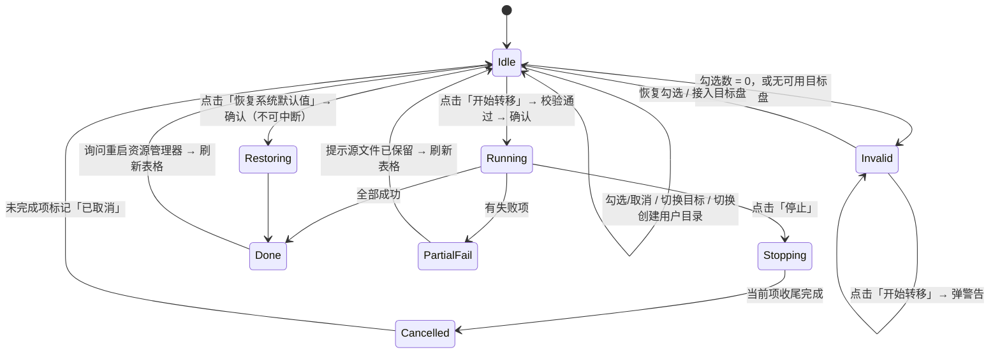

# 用户数据转移工具 2.0 — 界面骨架与设计规范

> 交付人：高见远（架构师）
> **文档性质：当前实态基线（Living Baseline）**——描述的是"界面现在是什么样、改动必须遵守什么"，
> 不是某次重构的提案。任何 UI 改动前请先读本文，改动后请更新本文并在 §8 变更记录追加一行。
>
> 2026-10-13 重写：原文档成文于"单屏 + 可折叠日志抽屉"的增量重构期，其中大量章节描述
> **运行日志抽屉（LogDrawer）**与**双页签 Notebook**——这两者均已随用户反馈整体删除。
> 本次重写直接按代码实态收敛，删除历史方案对比与已作废的任务分解（原 §2.2 / §8），
> 避免"文档描述一个不存在的界面"。

---

## 0. 设计目标与总纲

| 项 | 结论 |
|---|---|
| 导航层级 | **零导航（单屏）**：无页签、无侧栏、无二级窗口；主操作永远常驻首屏 |
| 运行日志 | **界面上没有日志查看区**。过程详情只写文件日志（`logs\`）；仅在出错或存在失败项时，状态栏露出一个「打开日志目录」链接作为出口 |
| 主操作位置 | 「目标根目录 → 项目列表 → 操作条」自上而下单列，首屏零跳转完成「勾选 → 开始转移」 |
| 视觉体系 | 设计令牌驱动：`theme.COLORS` / `SP_XS..SP_XL` / `Theme.px()` / 字体表。界面代码**禁止**字面色值与裸像素 |
| 代码落点 | 全部界面在 `main_window.py`（单文件），样式令牌在 `theme.py`，运行时图标在 `icons.py`。**不拆 UI 文件** |
| 不变式 | §6 一致性映射逐条为 Y：功能只增不减，已删功能禁止复活（见 §7 红线） |

---

## 1. 当前功能清单（以代码为准）

> 用途：作为 §6「一致性映射」的基线。所有行均来自现网代码，非推测。

| # | 功能点 | UI 承载位置 | 触发方式 | 涉及后端方法 / 属性 |
|---|---|---|---|---|
| F1 | 列出 7 个可转移项目 | `Treeview` 行 | 启动 / 目标变更后自动 | `FOLDERS`、`TransferEngine.build_plan()` |
| F2 | 显示「当前位置」 | `Treeview` 列 `current` | 自动 | `PlanItem.current`、`engine.resolve_current()` |
| F3 | 显示「转移目标」 | `Treeview` 列 `target` | 自动（随勾选 / 目标根目录变化） | `PlanItem.target`、`build_plan()` 目标合成规则 |
| F4 | 显示「状态 / 描述」 | `Treeview` 列 `status` | 自动 | `PlanItem.describe()` |
| F5 | 行首勾选框 | `Treeview` `#0` 列（渲染图标） | 渲染 | `Theme.checkbox()`、`_checkbox_image()` |
| F6 | 切换单项勾选 | `Treeview` `#0` / `#1` 列 | 左键 / `空格` / `回车` | `_on_tree_click`、`_on_tree_space`、`_toggle` |
| F7 | 全选 / 全不选 | 勾选框 `chk_select_all` | 左键 | `_on_select_all` |
| F8 | 已选摘要计数 | 标签 `lbl_summary` | 自动 | `_update_summary`、`_ordered_checked` |
| F9 | ~~勾选操作提示语~~ | **已移除**（2026-10-14 产品决策：界面元素自明，无需常驻说明） | — | — |
| F10 | 目标根目录固定下拉 | `dest_combo`（**readonly**） | 选择 | `fsops.list_fixed_drives()`、`system_drive()`、`_refresh_destination_choices` |
| F10b | 当前目标盘可用空间回显 | 标签 `lbl_space`（`Muted.TLabel`，贴右） | 自动 | `DriveInfo.label()`、`_update_space_label` |
| F11 | 创建当前用户目录 | 勾选框 `chk_create_user_dir`（默认勾选） | 左键 | `_on_create_user_dir`、`build_plan(create_user_dir=…)` |
| F12 | 开始转移（主操作） | 按钮 `btn_start`（Accent，全局唯一强调） | 左键 / `Ctrl+Return` | `_on_start`、`engine.execute()` |
| F13 | 执行中「停止」 | 同一按钮切换为「停止」 | 左键 | `_on_stop`、`_cancel.set()` |
| F14 | 执行前确认弹窗 | `dialogs.ask_yes_no`（warning） | 主操作前 | `_on_start` 内联；`_pending` 高亮将转移的行 |
| F15 | 「无需转移」提示 | `dialogs.show_info` | 无可转移项时 | `_on_start` 内联 |
| F16 | 目标校验（空选 / 非法 / 空间 / 不可读） | `showwarning` + 主按钮禁用态 | 主操作前 / 勾选变化 | `_validate()`、`fsops.validate_destination()`、`PlanItem.blocking_reason()` |
| F17 | 进度条 + 状态文字 | 状态栏 `progress` / `status_var` | 执行中回调（已按时间节流） | `_on_progress`、`_set_progress` |
| F18 | 逐项处理中/完成着色 | `Treeview` 行 tags（active / done / failed / pending / disabled） | 执行中回调 | `_on_item_start`、`_on_item_done`、`_row_tags` |
| F19 | 结果汇总弹窗 | `dialogs`（warning / info / success） | 完成后 | `report.summary()`、`report.failed` |
| F20 | 完成后询问重启资源管理器 | `dialogs.ask_yes_no` | 成功后（非 dry-run） | `shell.restart_explorer()`（已移出主线程） |
| F21 | 恢复系统默认值 | 按钮 `btn_restore`（Danger） | 左键 | `_on_restore_defaults`、`engine.restore_defaults()` |
| F22 | 退出程序 | 按钮 `btn_exit` | 左键 / 窗口 X | `_on_exit`（执行中二次确认 → 取消 → 轮询收尾后才销毁） |
| F23 | 试运行模式徽标 | 状态栏 `badge` | `dry_run=True` | `_build_statusbar` |
| F24 | 管理员权限提示条 | 顶部 banner（条件显示） | 启动时 `shell.is_admin()` | `_show_admin_banner`、`shell.relaunch_as_admin()` |
| F25 | ~~双击行~~ | **已移除**（2026-10-14 产品决策：双击易误触且与勾选语义冲突；失败详情由结果弹窗与「打开日志目录」承担） | — | — |
| F26 | 后台执行 / 队列回传 | 隐藏（`queue` + 线程） | 内部 | `_post`、`_drain_queue`、`_start_work`、`_finish_work`、`_cancel` |
| F27 | 控件 ToolTip 说明 | `dest_combo` / `btn_start` / `btn_restore` | 悬停 | `ToolTip`（单元格提示见 F32） |
| F28 | ~~规模预统计~~ | **已移除**（2026-10-14 产品决策：大规模目录下勾选后自动扫描是分钟级读盘开销，执行时引擎本就要权威扫描并做空间闸门把关） | — | — |
| F29 | 「打开日志目录」出口 | 状态栏链接按钮（**默认隐藏**） | 出错 / 有失败项后出现 | `_show_logs_link`、`_open_logs_dir` |
| F30 | 上次未完成事务提示与回滚 | `dialogs.ask_yes_no_cancel` | 启动后 400ms | `IntentJournal.pending()`、`_check_pending_intent`、`_rollback_from_snapshot` |
| F31 | 列宽按内容自适应 | `Treeview` 四个值列 | 数据刷新 / 文案变化 / 窗口缩放 | `columns.fit_columns()`、`_column_needs`、`_apply_column_fit`、`_on_tree_configure` |
| F32 | 截断单元格的完整文本提示 | 表格单元格（深色浮层） | 悬停被裁的单元格 | `_cell_tip_text`、`ToolTip(provider=…, at_pointer=True)` |

---

## 2. 导航关系（Navigation Model）

**结论：零导航（单屏）。窗口即界面，界面即流程。**

```
Root Window（唯一容器）
├── ① AdminBanner        条件显示（非管理员）
├── ② DestinationBar     目标根目录 + 可用空间
├── ③ FolderTable        项目列表（唯一纵向伸缩区）
├── ④ ActionBar          勾选控制 + 摘要 + 操作
└── ⑥ StatusBar          状态文字 + （条件）日志出口 + 进度 + 徽标
```

三条硬性导航约束：

1. **不引入 Notebook / 页签**——页签在本工具里是"伪导航"：只有一个页面承载操作。
2. **不引入抽屉 / 折叠区 / 二级窗口**——过程详情写文件日志，界面不承载日志查看。
3. **失败信息就近呈现**——结果弹窗逐项列出原因，完整过程记录通过状态栏
   「打开日志目录」链接抵达。二者构成"错误可达性"闭环。

---

## 3. 界面骨架（Wireframe）

### 3.1 单屏线框

```
┌─ 用户数据转移工具 ─────────────────────────────────────────────[ _ ▢ × ]─┐  ← 系统标题栏（正文不重复标题）
│                                                                           │
│ ┌ ① AdminBanner（条件：非管理员时显示）─────────────────────────────────┐ │
│ │ ⚠ 当前未以管理员身份运行：部分被系统占用的位置可能转移失败。 [以管理员身份重启]│ │
│ └───────────────────────────────────────────────────────────────────────┘ │
│                                                                           │
│ ┌ ② DestinationBar ─────────────────────────────────────────────────────┐ │
│ │ 目标根目录  [ D:\UserData ▾ ]                    D:\  可用 1.2 TB / 2.0 TB │ │
│ └───────────────────────────────────────────────────────────────────────┘ │
│ ───────────────────────────────────────────────────────────────────────── │
│ ┌ ③ FolderTable（Card，唯一 weight=1 伸缩区）───────────────────────────┐ │
│ │ ☑ 文件夹名称     当前位置              转移目标              状态      │ │
│ │ ☑ 我的文档       C:\Users\me\Documents D:\UserData\me\Documents  待转移 │ │
│ │ ☑ 收藏夹         …                     …                      …        │ │
│ └───────────────────────────────────────────────────────────────────────┘ │
│                                                                           │
│ ┌ ④ ActionBar ──────────────────────────────────────────────────────────┐ │
│ │ ☑ 全选/全不选                                        已选择 7 / 7 项，共 …   [开始转移]│ │
│ │ ☑ 创建当前用户目录                        [恢复系统默认值]   [退出程序]   │ │
│ └───────────────────────────────────────────────────────────────────────┘ │
│ ───────────────────────────────────────────────────────────────────────── │
│ ┌ ⑥ StatusBar ──────────────────────────────────────────────────────────┐ │
│ │ 就绪                        [打开日志目录]        [====----]  试运行模式  │ │
│ └───────────────────────────────────────────────────────────────────────┘ │
└───────────────────────────────────────────────────────────────────────────┘
```

### 3.2 网格行号（结构性常量，`main_window.py` 顶部）

| 行 | 常量 | 区域 | `weight` |
|---|---|---|---|
| 0 | `_ROW_BANNER` | AdminBanner | 0（条件显示） |
| 1 | `_ROW_DESTINATION` | DestinationBar | 0 |
| 2 | `_ROW_SEP_TOP` | Separator | 0 |
| 3 | `_ROW_TABLE` | FolderTable | **1（唯一伸缩区）** |
| 4 | `_ROW_ACTION` | ActionBar | 0 |
| 5 | `_ROW_SEP_BOTTOM` | Separator | 0 |
| 6 | `_ROW_STATUS` | StatusBar | 0 |
| — | `_ROW_COUNT = 7` | 用于批量 `rowconfigure` | — |

### 3.3 拉伸策略

- **唯一伸缩区**：仅 `FolderTable`（行 3）`weight=1`，其余行 `weight=0`。
  窗口缩放时"表格先变、控件不动"，操作条与状态栏永远贴底可见。
- 窗口最小尺寸 `px(780) × px(640)`，默认 `px(900) × px(700)`；表格 `height=8`。
- **列宽按内容自适应**（2026-10-15 起，`docmover/ui/columns.py`）：不再使用 Tk 的
  `stretch`（它只会把窗口差值**平均**分给每个可伸缩列，与内容无关），改为两步分配：

  1. **量内容**：用真实字体量出「表头 + 每一行文字」的宽度取最大值，加左右留白，
     得到每列的内容需要宽度 `need`（= 该列不裁字所需的最小宽度）；
  2. **分视口**：可用宽度按固定优先级分配，**各列之和恒等于可用宽度**——
     有余量时按角色配额给（路径列 `140`，名称列 `24`，状态列 `72`，逻辑像素）；
     视口不足时按「可让出的余量」等比压缩，余量最大的列先让。

  | 列 | key | 下限 | 余量配额 | 说明 |
  |---|---|---|---|---|
  | 文件夹名称 | `name` | 内容需要宽度（受保护） | 24 | 只承载 2~5 个汉字，多给即空白 |
  | 当前位置 | `current` | `px(90)` | 140 | 长路径受益，可压缩 + 悬停补全 |
  | 转移目标 | `target` | `px(90)` | 140 | 同上 |
  | 状态 | `status` | 内容需要宽度（受保护） | 72 | 文案完整可见（既有契约，见下） |

- 行首 `#0` 列固定 `px(28)`（= Item padding 6 + 图标 16 + 6），不参与自适应。
- **状态列宽度是契约**：状态文案必须完整可见（历史缺陷：列 150px + 文案过长 → 行尾被硬裁）。
  自适应后下限提升为「内容需要宽度」：窗口变窄只压缩路径列，**状态列一个字都不裁**。
  文案宽度仍由 `transfer.PlanItem.describe()` 守卫，测试有对应断言。
- **截断可补全**：路径列被压缩到放不下时，鼠标悬停该单元格给出完整文本
  （深色浮层 `当前位置：C:\...`，跟随指针；内容完整可见时不弹，避免打扰）。
- **表头不可拖拽改宽**：列宽由内容决定，手动拖出来的宽度会在下一次重排
  （窗口缩放 / 数据刷新）时被覆盖，与其自相矛盾，故 `_on_tree_click` 直接拦掉
  heading / separator 区域的按下事件。
- **重排时机与防抖**：数据刷新、行内文案变化、表格宽度变化（窗口缩放 / 滚动条
  出现）三处触发，`_FIT_DEBOUNCE_MS = 40` 合并连续触发；内容需要宽度带**高水位**
  （执行期间状态文案变短不会让列宽抖动），数据刷新时清零重算。

### 3.4 空态 / 忙碌态 / 特殊态

| 状态 | 表现 |
|---|---|
| 无可用目标盘 | `dest_combo` 置空 + 可用空间标签改为「未检测到可用的非系统固定磁盘」+ 状态栏与摘要同时告知 + 主按钮禁用 |
| 未勾选任何项 | 摘要显示「（请先勾选项目）」+ 主按钮禁用 + ToolTip 解释原因 |
| 执行中 | 主按钮变「停止」；输入类控件禁用；当前行 `tags=active` |
| 停止中 / 退出收尾中 | 主按钮显示「正在停止…」并禁用；状态栏说明"已完成项保留、未完成项源文件不删除" |
| 试运行 | 状态栏出现「试运行模式」徽标（`Warning.TLabel`） |
| 上次事务未收尾 | 启动 400ms 后弹出说明，可选一键回滚注册表 |

---

## 4. 模块划分

> 载体策略：**全部留在 `main_window.py`**（单文件交付）。
> 每模块 = 一个 `_build_xxx()` 构建方法 + 一组 `_on_xxx()` / `_work_xxx()` 处理方法。

| 模块 | 职责 | 构建方法 | 关键成员 |
|---|---|---|---|
| AdminBanner | 权限提示 + 提权重启 | `_show_admin_banner` | `_relaunch_admin` |
| DestinationBar | 目标根目录固定下拉 + 空间回显 | `_build_destination_bar` | `dest_combo`、`dest_var`、`lbl_space`、`_refresh_destination_choices`、`_update_space_label` |
| FolderTable | 项目列表与勾选交互 | `_build_folder_table` | `tree`、`_refresh_rows`、`_render_marks`、`_row_values`、`_row_tags` |
| ActionBar | 勾选控制、摘要、主操作与危险操作 | `_build_action_bar` | `chk_select_all`、`chk_create_user_dir`、`btn_start`、`btn_restore`、`btn_exit` |
| StatusBar | 状态文字、日志出口、进度、徽标 | `_build_statusbar` | `status_var`、`progress`、`badge`、`btn_open_logs` |
| 执行调度 | 线程启动、队列回传、收尾 | `_start_work` | `_work_transfer`、`_work_restore`、`_work_restart_explorer`、`_finish_work`、`_post`、`_drain_queue` |
| 退出收尾 | 取消 → 轮询 → 销毁 | `_on_exit` | `_poll_exit`、`_exit_requested`、`_cancel` |
| 事务恢复 | 启动检测未完成事务 | `_check_pending_intent` | `_rollback_from_snapshot`、`IntentJournal` |

---

## 5. 组件样式规范

### 5.1 按钮层级与放置规则

| 层级 | ttk 样式 | 用色（令牌） | 放置规则 | 本工具中的实例 |
|---|---|---|---|---|
| 主操作 | `Accent.TButton` | `accent` 底 / `text_on_accent` 字 | **全局唯一**，位于操作区右下，视觉动线终点 | 「开始转移 / 停止」 |
| 次操作 | `TButton` | `surface` 底 / `border_control` 描边（柔和一档）/ `text` 字 | 主操作**左侧**或次要行 | 「退出程序」 |
| 危险操作 | `Danger.TButton` | `surface` 底 / `danger` 字 / `danger_border` 描边，hover 浮现 `danger_soft` | 与主操作**拉开横向间距**，不与主操作相邻 | 「恢复系统默认值」 |
| 链接 | `Link.TButton` | `accent` 字 / 透明底，hover `accent_soft` | 行内、紧贴说明文字 | 状态栏「打开日志目录」 |
| 警示底上的链接 | `WarningLink.TButton` | `warning` 字 / 透明底 | 仅用于警示底 Banner 内 | Banner「以管理员身份重启」 |

> 尺寸：次按钮 padding `(16, 9)`、Accent `(20, 10)`（逻辑像素，经 `px()` 缩放）；
> 次按钮描边用柔和的 `border_control`（#c9ccd6），硬档 `border`（#8f92a0）保留为
> 勾选框描边语义锚点（icons `_RING_OFF`）与滚动条按压色。

### 5.2 控件状态用色（normal / hover / pressed / disabled / focus）

| 控件 | normal | hover(active) | pressed | disabled | focus |
|---|---|---|---|---|---|
| 主按钮 | `accent` 底 | `accent_hover`（**向深**） | `accent_pressed` | `accent_dim` 底 | focuscolor `accent_pressed` |
| 次按钮 | `surface` 底 + `border_control` 描边 | `btn_hover` 底 + `border` 描边 | `btn_pressed` | 底 `mix(btn_hover,surface,0.5)` / 字 `text_disabled` | focusthickness 1 |
| 危险按钮 | `surface` + `danger` 字 | `danger_soft` 底 + `danger` 描边 | `danger_soft` | 底灰化 / 字 `text_disabled` | 同上 |
| 下拉（只读） | `surface` 底 + `border_control` 描边 + 渲染 chevron（`text_dim`） | chevron → `text` | — | `surface_sunken` 底 | `border_control` → `accent` |
| 勾选框 | 指示器渲染图标 | 未选中指示器描边加深（`border_strong` 档，icons `_RING_OFF_HOVER`） | `accent_hover` | `surface_sunken` 指示器 | — |
| 表格 | 斑马纹 `row_alt` / `surface`，行高 40 | 行 `row_hover` | 选中 `row_selected` | 行字 `text_disabled` | — |
| 表头 | `surface_alt`（更轻底 + `border_hair` 分隔）/ `text_muted` / h3 加粗 | `surface_sunken` | — | — | — |
| 滚动条 | 拇指 `scroll_thumb`（宽 8） | `scroll_thumb_hover` | `border` | `surface_sunken` | — |
| 进度条 | 底槽 `surface_sunken` / 填充 `accent`（thickness 4） | — | — | — | — |
| 状态标签 | `Muted.TLabel`（`text_muted`） | — | — | — | — |
| 提示条 | `warning_bg` 底 + `warning_border` 描边 + `warning` 字 + 16px warning 图标 | — | — | — | — |

> 字号层级（2026-10-14 上调一档）：`base -14 / small -13 / strong -14 bold /
> h1 -22 / h2 -17 / h3 -13 bold`；间距刻度 `SP_XS..SP_XL = 4, 8, 12, 16, 24`。

> 铁律（沿用 `theme.py` 注释）：**浅底上一律"向深色变化"表达反馈**；白底按钮靠"描边 + 深浅"分层。

> 图标口径：`theme.icon(...)` / `IconFactory` 各方法的 `units` 参数一律是**设计单位**
> （16 单位画板），工厂内部（`IconFactory._make`）会按当前 DPI `scale` 自行缩放；
> 调用处**不得**再对 `units` 套 `px()`，否则高 DPI 下二次缩放（chevron 150% 时
> `px(12)=18` → 内部再 ×1.5 → 实渲染 27px）。间距 / 描边等**物理像素**语义才走 `px()`。
> **（本条口径已由 `tools/ci_check.py` 第 6 项守卫「图标 units 无二次缩放」强制。）**

### 5.3 禁止事项（红线）

1. ❌ 界面代码出现**字面色值**（`#0f6cbd`、`"white"` 等）—— 一律走 `COLORS[...]`。
2. ❌ **裸数字间距**（`padx=10`）—— 一律 `px(SP_MD)` 之类；`grid` 的 `0/1` 结构常量除外。
3. ❌ **卡片套卡片**（`Card.TFrame` 内含 `Card.TFrame`）—— 卡片仅两级：壳(`bg`) → 卡片(`surface`)。
4. ❌ 使用 **Unicode 几何字形**（☑ / ☐ / ▸ / ▾）作为控件 —— 一律 `icons.py` 运行时渲染（字体回退不可控）。
5. ❌ 使用第三方 UI 库或图片资产依赖（无 `PIL`、无 `.png` 资源；`assets/app.ico` 仅作窗口图标）。
6. ❌ 引入任何**已删功能**对应的控件 / 页签 / 快捷键 / 提示语（见 §7）。
7. ❌ 新增第二个 `Accent.TButton`（强调色必须全屏唯一）。
8. ❌ 让**工作线程直接读写 Tk 控件或 Tk 变量**——参数一律在主线程取好传给 worker，
   结果一律经 `_post` 回主线程消费（tkinter 线程契约）。

---

## 6. 交互规范

### 6.1 键盘

| 行为 | 绑定 | 说明 |
|---|---|---|
| 焦点顺序（Tab） | `dest_combo → tree → chk_select_all → chk_create_user_dir → btn_start → btn_restore → btn_exit` | 与视觉从上到下、从左到右一致 |
| 切换勾选 | 表格聚焦时 `空格` / `回车` | `_on_tree_space`；`Ctrl+Return` 时不切勾选，让全局键生效 |
| 主操作 | `Ctrl+Return` | 触发「开始转移」；**不占用**裸 `回车`（表格内回车已是勾选） |

> 已移除：双击行（`Double-1`）不再绑定任何处理函数。

> ❌ 不分配 `F5`（对应已删「刷新」）、`Ctrl+S`（对应已删「保存设置」）、`Ctrl+C` 全局复制日志、
> `Ctrl+L` / `Esc`（曾用于已删的日志抽屉）。

### 6.2 状态机



| 状态 | 禁用的控件 | 进度呈现 | 可否取消 |
|---|---|---|---|
| 空闲 | 无（主按钮受「是否勾选 / 有无目标盘」动态约束） | value=0 | — |
| 校验失败 | `btn_start`（disabled） | 不变 | — |
| 执行中 | `btn_restore`、`chk_select_all`、`chk_create_user_dir`、`dest_combo`（`_set_controls_enabled(False)`；`dest_combo` 恢复时必须是 `readonly`，**不是** `normal`） | determinate 推进 + 状态文字「正在处理 X（n/N）」+ 当前行 `tags=active` | ✅ 主按钮变「停止」 |
| 恢复默认值 / 重启资源管理器 | 同上 | 主按钮显示「恢复中…」/「重启中…」且禁用（**不给假的停止入口**） | ❌（引擎未提供中断回调） |
| 退出收尾中 | 全部输入控件；主按钮「正在停止…」 | 状态栏「正在安全收尾…」 | 已取消，等待收尾（上限 60s） |
| 完成（成功 / 部分失败） | 解除禁用，表格重建 | 保持满值 | — |
| 试运行 | 同执行中流程（但不落地改动） | 同上 | 同上 |

### 6.3 弹窗规范（2026-10-14 起为主题化自绘弹窗，`ui/dialogs.py`）

原生 `tkinter.messagebox` 的正文对齐、层级与间距不可定制（Windows 上正文居中），
已整体替换为遵循设计令牌的自绘模态弹窗：**surface 白卡底 + 1px hairline 外圈描边**
（全尺寸 Frame 的 highlight 边实现）+ 软色圆底语义图标（44px）+ h2 加粗标题 +
左对齐分段正文（首段主文字色、后续段落 `text_dim` 拉开层级）+
右对齐统一宽度按钮（主按钮 Accent 样式）；
Return 触发默认按钮，Escape / 关闭等同「取消」。
**例外**：`run.py` 的重复启动 / 启动错误提示发生在主窗口建立之前，仍用原生 messagebox。

| 场景 | API（`ui/dialogs`） | kind | 按钮 |
|---|---|---|---|
| 无法开始（校验失败） | `show_warning("无法开始", …)` | warning | 确定 |
| 无需转移 | `show_info("无需转移", …)` | info | 确定 |
| 确认开始转移 | `ask_yes_no(…, kind="warning")` | warning | 是/否 |
| 恢复系统默认值 | `ask_yes_no(…, kind="warning")` | warning | 是/否 |
| 已停止 | `show_info("已停止", …)` | info | 确定 |
| 部分项目未完成 | `show_warning("部分项目未完成", …)` | warning | 确定 |
| 操作完成 | `show_success("操作完成", …)` | success | 确定 |
| 重启资源管理器 | `ask_yes_no("重启资源管理器", …)` | question | 是/否 |
| 执行出错 | `show_error("执行出错", …)` | error | 确定 |
| 执行中退出 | `ask_yes_no("正在执行", …, kind="warning")` | warning | 是/否 |
| 上次转移未正常收尾 | `ask_yes_no_cancel("上次转移未正常收尾", …)` | warning | 是/否/取消 |
| 回滚成功 / 失败 | `show_success("已回滚")` / `show_error("回滚失败", …)` | success / error | 确定 |
| 提权提示 | `show_info("提示", …)` | info | 确定 |
| 重复启动 | （run.py，原生 `showinfo(APP_TITLE, …)`） | — | 确定 |

### 6.4 微交互

| 交互 | 规范 |
|---|---|
| 悬停反馈 | 按钮 hover 一律向深（见 §5.2）；表格行 `row_hover` 为可选增强，不改行为 |
| 按下反馈 | `pressed` 状态用更深一档令牌；`Accent` 用 `accent_pressed` |
| ToolTip | **仅**用于「图标 / 语义不自明」的控件：`dest_combo`、`btn_start`（随状态变化）、`btn_restore`、`btn_open_logs`；**不新增**其他 ToolTip |
| 忙碌指示 | 进度条 + 状态文字；禁用操作控件；**不引入转圈动画**（保标准库 + 最小变更） |
| 进度上报节流 | 引擎侧按「≥100ms 或最后一个文件」上报，避免逐文件入队造成队列洪水 |

---

## 7. 一致性映射表与删除红线

### 7.1 功能落点映射

| 功能点 | 界面落点 | 行为不变 |
|---|---|---|
| F1 列出 7 项 | ③ FolderTable | **Y** |
| F2 / F3 / F4 三列 | ③ 列 `current` / `target` / `status` | **Y** |
| F5 / F6 勾选框与切换 | ③ `#0` 列 + `#0/#1` 点击、空格、回车 | **Y** |
| F7 / F8 全选 / 摘要 | ④ `chk_select_all` / `lbl_summary` | **Y**（F9 提示语已移除） |
| F10 / F10b 目标下拉与空间 | ② `dest_combo`（readonly）/ `lbl_space` | **Y** |
| F11 创建当前用户目录 | ④ `chk_create_user_dir`（默认勾选） | **Y** |
| F12 / F13 主操作与停止 | ④ `btn_start`（同一按钮切换文案与命令） | **Y** |
| F14 – F16 确认 / 无需转移 / 校验 | 由 `_on_start` / `_validate` 触发 | **Y** |
| F17 / F18 进度与着色 | ⑥ StatusBar / ③ 行 tags | **Y** |
| F19 / F20 结果弹窗与重启询问 | 由 `_after_transfer` 触发 | **Y** |
| F21 恢复系统默认值 | ④ `btn_restore`（Danger） | **Y** |
| F22 退出程序 | ④ `btn_exit` + 窗口 X（同一路径） | **Y** |
| F23 / F24 徽标 / 提示条 | ⑥ `badge` / ① AdminBanner | **Y** |
| F25 双击行 | — | **已移除**（2026-10-14） |
| F26 后台执行 / 队列 | 内部（`_post` / `_drain_queue` / 线程 / `_cancel`） | **Y** |
| F27 ToolTip | ② ④ ⑥ | **Y**（信息性，不改变行为） |
| F28 规模预统计 | — | **已移除**（2026-10-14） |
| F29 打开日志目录 | ⑥ `btn_open_logs`（条件显示） | **Y** |
| F30 未完成事务提示 | 启动后弹窗 | **Y** |
| F31 列宽自适应 | ③ 四个值列（`columns.py` + `_apply_column_fit`） | **Y**（仅宽度分配，行内容与交互不变） |
| F32 截断单元格提示 | ③ 单元格悬停浮层（`_cell_tip_text`） | **Y**（新增可读出口，不改显示值） |

> 覆盖 §1 全部 F1–F32，**零 N**。

### 7.2 已删除、禁止复活（红线）

- 页签：基本参数 / 帮助 / 自动执行 / **运行日志**；Notebook 容器本身。
- 按钮：推荐选择 / **刷新** / **保存设置** / **复制全部**；目标根目录「浏览」「打开」。
- 输入项：程序标题 / 目录别名 / 目标盘符策略 / 备份目录 UI / 从旧版导入。
- **任何配置持久化**（配置文件读写代码）——程序为纯内存态，每次启动用内置默认值。
- 倒计时 / 自动执行。
- 文件夹项：Cookies / 网页缓存 / 历史记录 / 最近文档 / 临时目录（现仅 7 项，见 `constants.FOLDERS`）。
- **运行日志抽屉（LogDrawer）**与状态栏日志指示区、`Ctrl+L` / `Esc` 绑定、
  `logging_setup` 的内存环形缓冲（`RingBufferHandler` / `ring_text()` / `ring_lines()`）。

---

## 8. 变更记录

### 2026-10-15 · 表格列宽改为按内容自适应
问题：`Treeview` 的 `stretch=True` 把余量**平均**分给每个可伸缩列，列宽与内容无关。
最小窗口（975×800 物理像素 / DPI 1.25）实测：

| 列 | 内容需要 | 改造前 | 现象 |
|---|---|---|---|
| 文件夹名称 | 84px | 179px | 白占 95px 空白 |
| 当前位置 | 288px | 241px | 路径尾部被硬裁 |
| 转移目标 | 317px | 239px | 路径尾部被硬裁 |
| 状态 | 210px | 203px | 最长状态文案贴边 |

- 新增 `docmover/ui/columns.py`：`fit_columns(needs, minimums, quotas, available)`
  纯函数（零 Tk 依赖，离线可测）。列定义 `COLUMNS`（key / 表头 / 锚点 / 余量配额 /
  是否受保护）成为表头的唯一来源。
- 名称列与状态列**受保护**（下限 = 内容需要宽度）：窗口变窄只压缩路径列。
  → 改造后同一窗口：`107 / 262 / 286 / 209`（名称不再浪费 95px，路径得到全部余量）；
  默认窗口（1125）四列全部完整显示，无一处裁字。
- 行宽之和恒等于可用宽（最大余数法取整，结果可复现），不再出现右端留白。
- `stretch` 全部置 False，宽度完全由 `_apply_column_fit` 决定；触发点：数据刷新 /
  行内文案变化 / `<Configure>`（防抖 40ms）。内容需要宽度带高水位，执行期间文案
  变短不抖动；数据刷新时清零重算。
- 表头分隔线不再可拖拽（`_on_tree_click` 拦掉 heading / separator）——手工拖出来的
  宽度会在下一次重排被覆盖，与其自相矛盾，不如明确不支持。
- 截断兜底：`ToolTip` 支持 `provider` 回调 + 跟随指针，悬停被裁的路径单元格给出
  完整文本（`当前位置：C:\...`）；内容完整可见时不弹。表格显示值不做任何改写。
- 表格销毁时撤回待触发重排（否则 Tcl 收尾时打印 `invalid command name ..._run_column_fit`，
  噪声会掩盖退出路径上的真实错误）。
- 测试：新增 `tests/test_columns.py`（14 项纯函数用例：总和 == 可用宽、保护列不被压、
  余量归属、确定性、极端窄窗兜底）；`test_ui_smoke.py` 的列宽契约测试改为自适应口径
  （名称列不超配额、状态列不裁字、窗口变宽路径列吃余量、长内容自动变宽、刷新后高水位
  复位、截断提示只在需要时出现、表头拖拽被拦）。

### 2026-10-14 · 卫生清理批次（换行统一 / 裸像素清零 / chevron 单位口径）
功能、布局结构（7 行单列网格）、交互与线程契约一律不变，仅做卫生清理 + 一处真 bug 修复：
- **换行统一**：交付树内残留 CRLF 的两个测试文件（`tests/test_core.py` / `tests/test_ui_smoke.py`，
  字节级核实仅此二者）按字节转 LF；新增 `pydm/.gitattributes`（`* text=auto eol=lf` +
  二进制文件声明）；`tools/ci_check.py` 新增第 5 项红线守卫「文本文件统一 LF」。
- **裸像素清零**：表格 inset、`Card.TFrame` 外框与按钮描边 / `focusthickness` 一律经 `px()`
  （`borderwidth=0` 保持 0）；`ToolTip` 增加**可选** `theme` 参数，像素语义与字号改走设计令牌
  （`theme.px` / `fonts["small"]`），无主题时从 widget 自身推导等价实现（不再硬编码 `-12` 字号与 `10/6/280`）。
- **chevron 二次缩放缺陷修复**：`_install_combobox_chevron` 原写 `units=self.px(12)`，而
  `IconFactory._make` 内部已按 scale 缩放 → 高 DPI 下双重放大（150% 实渲染 27px，设计意图 12px）。
  改为 `units=12`（设计单位）；单位口径已写入 §5。

### 2026-10-14 · 界面视觉现代化（Fluent 2 / WinUI 3 浅色观感）
功能、布局结构（7 行单列网格）、交互与绑定完全不变，仅调视觉：
- 字号层级整体上调一档：base -14 / small -13 / strong -14 bold / h1 -22 / h2 -17 / h3 -13 bold。
- 间距刻度上调：`SP_XS..SP_XL = 4, 8, 12, 16, 24`，各 bar 的 padding 随之加大。
- 按钮：次按钮 padding `(16,9)`、Accent `(20,10)`；次按钮描边改用新令牌
  `border_control`（#c9ccd6，柔和一档），hover 保持向深色变化。
- 下拉框：padding `(10,7)` + `border_control` 描边 + focus accent 不变；
  原生下箭头替换为 icons 渲染的 12px 圆头 chevron（`element_create` + layout
  重组为 field 子元素；TclError 整体回退原生箭头）。
- 勾选框图标：圆角 3.6 → 4.5；新增未选中 hover 态（描边加深一档，
  icons 新增 `_RING_OFF_HOVER`，与 `border_strong` 同步）。
- 表格：行高 34 → 40；`Treeview.Item` padding 5 → 6（`#0` 列宽同步 26 → 28）；
  表头改 `surface_alt` 轻底 + `text_muted` + h3 加粗。
- 滚动条：宽 10 → 8，拇指新令牌 `scroll_thumb` / `scroll_thumb_hover`。
- 进度条：thickness 5 → 4。
- AdminBanner：新增 icons 渲染的 16px warning 小图标（文案与按钮不动）。
- 弹窗（dialogs）：底色 bg → surface 白卡 + 1px hairline 外圈描边（全尺寸
  Frame highlight 实现）；标题倍率 1.18 → 1.21（对齐 h2/base 比例）；图标
  40 → 44；首段主文字色、后续段落 `text_dim`；外框留白加大（逻辑 24）。
- 删除令牌 `heading_bg`（表头改用 `surface_alt`）；新增 `border_control` /
  `scroll_thumb` / `scroll_thumb_hover`。
- 测试同步：`test_checkbox_icon_colors_match_tokens` 的期望色改为从
  `icons._RING_*` 常量取值（守卫意图不变：图标色必须等于令牌色）。

### 2026-10-13 · 审计遗留项加固批次（P2 / P3）
- `_set_controls_enabled` 对 `dest_combo` 改用 `readonly` 恢复（原为 `normal`，破坏固定选项契约）。
- 工作线程不再读 Tk 变量：目标根目录、创建用户目录等参数在**主线程**取好后传入。
- 新增「上次转移未正常收尾」启动提示与一键回滚（`_check_pending_intent`，配合引擎侧意图日志）。
- 新增执行中「停止」入口（主按钮文案/命令切换）与退出收尾轮询（`_poll_exit`）。
- ~~规模预统计改为逐项 + 防抖 + 会话内缓存~~（**2026-10-14 已整体移除**，见 F28）。
- 状态列文案精简、列宽改走 `px()` 重新分配，杜绝行尾硬裁。

### 2026-10-13 · 移除运行日志抽屉 + 修正状态列截断
- 删除 `LogDrawer` 类、`_build_log_drawer`、状态栏 `log_toggle`、`Ctrl+L` / `Esc` 绑定；
  网格由 8 行收敛为 **7 行**（本文件 §3.2 即该结构）。
- 删除 `theme` 的 Drawer / StatusLog / chevron 样式与 `icons` 的 `_chevron_painter`；
  `logging_setup` 删除内存环形缓冲，仅保留文件 + stderr 处理器。
- 状态列文案改短（未扫描态 → 「待转移」），列宽 `140 / 190 / 190 / 160`。
- 测试同步：删除抽屉与持久化用例，`test_notebook_tabs` 改写为「断言无 Notebook / 无页签 / 无日志区」，
  新增「按钮已移除」与状态列宽度守卫。

### 2026-10-13 · 删除刷新 / 保存设置；配置去持久化
- 删除「运行日志」页签的刷新、复制全部按钮；删除资料转移页的刷新、保存设置按钮；
  随之删除 `Ctrl+S` / `F5` 绑定与 `_copy_log` / `_save_settings` / `_collect_config`。
- `config.py` 重写为**纯内存态**：默认全选、目标根目录 `D:\UserData`、默认创建用户目录；
  删除 `load_config` / `save_config` / 配置 schema 与用户名迁移逻辑。

### 2026-10-13 · 单屏重构（初版本文档成文时）
- 移除双页签 Notebook，改为单屏布局；`main_window.py` 按区域拆为 `_build_xxx()` 方法。
- 建立/复用设计令牌体系（`COLORS` / `SP_*` / `px()` / 字体表）与运行时图标渲染。
